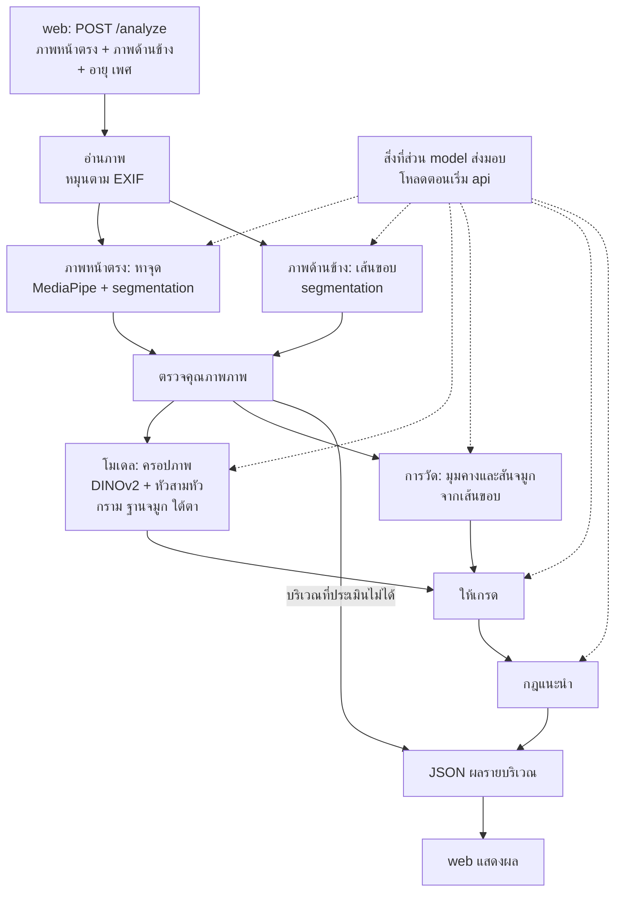

# ระบบแนะนำศัลยกรรมและหัตถการจากภาพถ่ายใบหน้า: ส่วน api

เอกสารของโปรเจกต์แบ่งเป็นสามไฟล์ตามส่วนของระบบ

| ไฟล์ | เนื้อหา |
| --- | --- |
| model.md | เกณฑ์และวิธีให้เกรดของแต่ละบริเวณ กฎแนะนำ ข้อมูล การเตรียมโมเดล และการประเมินผล |
| api.md (ไฟล์นี้) | Python API ที่รับภาพ ตรวจคุณภาพภาพ หาจุดบนใบหน้า แล้วเรียกใช้สิ่งที่ส่วน model ส่งมอบ |
| web.md | หน้าเว็บที่ถ่ายภาพ คุมท่า และแสดงผล |

เลขอ้างอิง \[n\] ใช้ชุดเดียวกันทั้งสามไฟล์ ท้ายไฟล์นี้แสดงเฉพาะรายการที่ไฟล์นี้อ้างถึง

## 1. ภาพรวม

### 1.1 หน้าที่ของส่วน api

ส่วน api เป็นโปรแกรม Python ที่ใช้ FastAPI รันบนเครื่องเดียวกับหน้าเว็บ web ส่งภาพหน้าตรง ภาพด้านข้าง อายุ และเพศมาในการเรียกครั้งเดียว api หาจุดและเส้นขอบ ตรวจคุณภาพภาพ เรียกโค้ด โมเดล และกฎของส่วน model แล้วส่งผลรายบริเวณกลับเป็น JSON ความรู้ว่าวัดอะไรและแนะนำอะไรอยู่ใน model.md ไฟล์นี้อธิบายเฉพาะคำขอ ลำดับการประมวลผล การตรวจคุณภาพภาพ และรูปแบบของผล

### 1.2 ตำแหน่งในระบบ



### 1.3 หลักที่ต้องรักษา

- **ไม่เก็บภาพ** ภาพอยู่ในหน่วยความจำระหว่างประมวลผลเท่านั้น (หัวข้อ 6)
- **ใช้โค้ดชุดเดียวกับตอนเตรียมข้อมูล** api เรียกโมดูลของส่วน model ทั้งขั้นหาจุด ครอปภาพ หาเส้นขอบ และวัดค่า ไม่เขียนซ้ำเอง (model.md หัวข้อ 1.4)
- **หาจุดใหม่จากภาพความละเอียดเต็ม** ไม่ใช้จุดที่หน้าเว็บหาไว้ระหว่างคุมท่า เพราะการหาจุดและการครอปต้องตรงกับตอนเตรียมข้อมูล และ model card ของ MediaPipe ระบุว่าใบหน้าที่เล็กจนครอปไม่พอทำให้คุณภาพลดลง \[2\]
- **จบในการเรียกครั้งเดียว** ทุกขั้นทำใน `POST /analyze` ถ้าต้องถ่ายใหม่ web ส่งคำขอใหม่ทั้งชุด
- **กฎเป็นผู้ตัดสินเรื่องหัตถการ** api รันกฎของส่วน model ซึ่งรวมเงื่อนไขอายุ เพศ และแหล่งของภาพ (model.md หัวข้อ 4.3) และส่งหัตถการแยกจากผลการวัด

## 2. คำขอและผลที่ส่งกลับ

### 2.1 คำขอ

api มีสอง endpoint คือ `POST /analyze` ที่รับภาพแบบ `multipart/form-data` แล้วคืนผลรายบริเวณ และ `GET /health` ที่คืนสถานะและรุ่นของสิ่งที่โหลด

| ส่วนของคำขอ | ชนิด | จำเป็น | เนื้อหา |
| --- | --- | --- | --- |
| `frontal` | ไฟล์ภาพ 1 ไฟล์ | ใช่ | ภาพหน้าตรง ถ่ายผ่านหน้าเว็บหรือเลือกจากเครื่อง |
| `profile` | ไฟล์ภาพ 1 ไฟล์ | ปกติต้องส่ง | ภาพด้านข้าง หันซ้ายหรือขวาก็ได้ ถ้าไม่ส่ง คางและสันจมูกประเมินไม่ได้ |
| `meta` | ข้อความ JSON | ใช่ | ข้อมูลประกอบตามตารางถัดไป |

| ฟิลด์ใน `meta` | ชนิด | จำเป็น | เนื้อหา |
| --- | --- | --- | --- |
| `age` | จำนวนเต็ม 0–120 | ใช่ | อายุเป็นปี |
| `sex` | `"female"` หรือ `"male"` | ใช่ | ใช้เลือกเกณฑ์ของกรามและจมูก |
| `frontal_source` | `"camera"` หรือ `"upload"` | ไม่ | แหล่งของภาพหน้าตรง ถ้าไม่ส่งถือเป็น `"camera"` ภาพจากเครื่องไม่รู้ระยะถ่าย ฐานจมูกจึงแสดงเฉพาะค่าวัด (model.md หัวข้อ 4.3) |
| `lab` | `true` หรือ `false` | ไม่ | โหมดทดลอง (หัวข้อ 2.4) |
| `lang` | รหัสภาษา เช่น `"th"` | ไม่ | ภาษาของข้อความในผล ถ้าไม่ส่งใช้ `"th"` (หัวข้อ 2.2) |

ตัวอย่างคำขอ

```bash
curl -X POST http://localhost:8000/analyze \
  -F frontal=@frontal.jpg \
  -F profile=@profile.jpg \
  -F 'meta={"age": 22, "sex": "female", "frontal_source": "camera"}'
```

**ข้อกำหนดของภาพ**

- รับ JPEG และ PNG ภาพ JPEG ควรมีคุณภาพ 0.9 ขึ้นไป เพราะการบีบอัดลบรายละเอียดเล็ก ๆ อย่างเงาใต้ตา
- ส่งภาพที่ความละเอียดเต็มของกล้อง ไม่ย่อก่อนส่ง (web.md หัวข้อ 3.1)
- พิกัดในผลเป็นพิกเซลของภาพหลังหมุนตาม EXIF orientation web จึงต้องวาดเส้นบนภาพที่หมุนแล้วเช่นกัน
- ขนาดคำขอรวมไม่เกิน 25 MB และรับเฉพาะไฟล์ภาพ

### 2.2 ผลที่ส่งกลับ

| ฟิลด์ระดับบนสุด | เนื้อหา |
| --- | --- |
| `request_id` | รหัสสุ่มของคำขอ ไม่ผูกกับตัวผู้ใช้ ใช้ไล่ข้อผิดพลาด |
| `versions` | รุ่นของ api และของชุดสิ่งที่ส่วน model ส่งมอบ |
| `lab` | `true` เมื่อเป็นผลของโหมดทดลอง |
| `retake` | รายการภาพที่ควรถ่ายใหม่ แต่ละรายการมีชื่อภาพ รหัสเหตุผล บริเวณที่ได้รับผล และข้อความ |
| `quality` | ค่าคุณภาพของภาพหน้าตรงและภาพด้านข้าง พร้อมรหัสของเงื่อนไขที่ไม่ผ่าน |
| `regions` | ผลรายบริเวณ (model.md หัวข้อ 4.4) |
| `disclaimer` | ข้อความว่าผลไม่ใช่การวินิจฉัย และการตัดสินใจทำหัตถการต้องผ่านการตรวจโดยแพทย์ |

| ฟิลด์ใน `regions` | เนื้อหา |
| --- | --- |
| `region` | รหัสบริเวณ (หัวข้อ 2.3) |
| `status` | `assessed` หรือ `not_assessable` |
| `status_reasons` | รหัสเหตุผลเมื่อประเมินไม่ได้ |
| `warnings` | รหัสของเงื่อนไขที่ไม่ผ่านแต่ยังวัดต่อ ใช้ในโหมดทดลอง |
| `measurements` | ค่าวัดแต่ละค่า มีชื่อ ค่า หน่วย `method` `landmark_value` เส้นแบ่งพร้อมขนาดช่วงก้ำกึ่ง (`cutoffs`) คำอธิบายเกณฑ์ (`reference`) และที่มา ใต้ตาไม่มีค่าวัด |
| `overlay` | ภาพที่ใช้วาด (`frontal` หรือ `profile`) พิกัดจุด และคู่จุดที่ต้องลากเส้น ใต้ตาใช้กรอบครอปแทนเส้น ชื่อจุดที่ลงท้ายด้วย `_l` และ `_r` คือซ้ายและขวาของภาพ เพราะใช้วาดเท่านั้น |
| `probabilities` | เฉพาะใต้ตา คือ `grades` ความน่าจะเป็นของแต่ละเกรด และ `at_least` คือ P(เกรด ≥ k) ที่แต่ละจุดเปลี่ยน |
| `decision` | เกรด หรือช่วงเกรดเมื่อก้ำกึ่ง และระดับ `clear` หรือ `borderline` |
| `procedures` | หัตถการเรียงจากรุกล้ำน้อยไปมาก แต่ละรายการมีรหัส ชื่อ กรณีที่เหมาะ และสิ่งที่ต้องตรวจเพิ่ม |
| `procedures_withheld` | รหัสเหตุที่ไม่แสดงหัตถการ |
| `notes` | ข้อความเพิ่มเติมของบริเวณนั้น แต่ละรายการมีรหัส ข้อความ และ `with_procedures` ซึ่งเป็น `true` เมื่อเป็นข้อความเกี่ยวกับหัตถการที่ต้องแสดงพร้อมหัตถการเท่านั้น (model.md หัวข้อ 1.3) |

ใน `measurements` ค่า `value` ใช้ให้เกรด `method` เป็น `model` เมื่อหัวของโมเดลทาย (กรามและฐานจมูก) หรือ `measured` เมื่อวัดจากเส้นขอบ (คางและสันจมูก) ค่าจากโมเดลมี `landmark_value` คืออัตราส่วนเดียวกันที่วัดจากจุดของ MediaPipe แล้วปรับด้วยสมการเส้นตรง (model.md หัวข้อ 7.1) ค่านี้ไม่ใช้ให้เกรด แต่เป็นสัญญาณเดียวบนภาพจริงที่บอกว่าโมเดลอาจทายคลาด web แสดงเฉพาะในโหมดทดลอง ส่วนเส้นของกรามและฐานจมูกวาดจากจุดของ MediaPipe เพื่อบอกตำแหน่งที่วัด ความยาวเส้นจึงไม่จำเป็นต้องตรงกับ `value`

เกรดเขียนเป็นข้อความ `"0"`, `"1"` และ `"2+"` ส่วนคางเป็น `"0"` ถึง `"3"` เมื่อก้ำกึ่ง `decision.grade_range` คือเกรดต่ำสุดกับสูงสุดของช่วง ใต้ตาที่ก้ำกึ่งทั้งสองจุดเปลี่ยนได้ `["0", "2+"]` ฟิลด์ที่ไม่มีค่าเป็น `null` หรือรายการว่าง บริเวณที่ `not_assessable` ไม่มีค่าวัดและผลตัดสิน กรามของผู้ชายและฐานจมูกของภาพจากเครื่องมีค่าวัดแต่ `decision` เป็น `null` ผลไม่มีภาพ web วาดเส้นบนภาพที่ตัวเองส่งไป

ตัวอย่างผลที่ย่อเหลือสองบริเวณ ตัวเลขเป็นค่าสมมติ กรามได้ 83.6% จากโมเดล ซึ่งห่างจากจุดตัด 83% ของ \[3\] ไม่ถึง 1 จุด จึงก้ำกึ่งระหว่างเกรด 0 กับ 1 ส่วนสันจมูกได้มุมต่ำกว่าเส้นแบ่งเกรด ≥2 ของผู้หญิงจาก \[39\] จึงมีหัตถการสองทาง

```json
{
  "request_id": "5f0c2a9e-0d1b-4c8e-9a51-2f3e7b6d8c10",
  "versions": {"api": "1.0.0", "model_bundle": "1.0.0"},
  "lab": false,
  "retake": [],
  "quality": {
    "frontal": {"iod_px": 96, "yaw_deg": 0.9, "pitch_deg": -0.8, "roll_deg": 0.5, "smile": 0.05, "jaw_open": 0.02, "blink_left": 0.03, "blink_right": 0.04, "hair_jaw": 0.02, "hair_undereye_left": 0.0, "hair_undereye_right": 0.0, "failed": []},
    "profile": {"face_found": false, "face_yaw_deg": null, "silhouette_found": true, "flipped": false, "failed": []}
  },
  "regions": [
    {
      "region": "jaw",
      "status": "assessed",
      "status_reasons": [],
      "warnings": [],
      "measurements": [
        {"name": "facial_taperness", "value": 83.6, "unit": "%", "method": "model", "landmark_value": 84.2, "cutoffs": [{"value": 83, "band": 1}, {"value": 87, "band": 1}], "reference": "จุดตัด 83% ช่วงก้ำกึ่ง ±1", "source": "[3]"}
      ],
      "overlay": {
        "image": "frontal",
        "points": {"go_l": [405, 980], "go_r": [877, 978], "zy_l": [356, 640], "zy_r": [920, 642]},
        "lines": [["go_l", "go_r"], ["zy_l", "zy_r"]]
      },
      "probabilities": null,
      "decision": {"grade": null, "grade_range": ["0", "1"], "level": "borderline"},
      "procedures": [],
      "procedures_withheld": ["no_procedure_at_grade"],
      "notes": []
    },
    {
      "region": "nose_dorsum",
      "status": "assessed",
      "status_reasons": [],
      "warnings": [],
      "measurements": [
        {"name": "nasofacial_angle", "value": 28.5, "unit": "deg", "method": "measured", "landmark_value": null, "cutoffs": [{"value": 30.1, "band": 1.35}, {"value": 32.8, "band": 1.35}, {"value": 38.4, "band": 1.5}], "reference": "หญิง เกรด 0 อยู่ที่ 32.8–38.4° เกรด ≥2 เมื่อน้อยกว่า 30.1°", "source": "[39]"}
      ],
      "overlay": {
        "image": "profile",
        "points": {"g": [640, 410], "n": [655, 520], "prn": [774, 760], "pog": [610, 1210]},
        "lines": [["g", "pog"], ["n", "prn"]]
      },
      "probabilities": null,
      "decision": {"grade": "2+", "grade_range": null, "level": "clear"},
      "procedures": [
        {"code": "nose_filler", "name": "ฉีดฟิลเลอร์จมูก", "when": "รุกล้ำน้อยกว่าและมีการทดลองแบบสุ่มรองรับ", "checks": null},
        {"code": "rhinoplasty_implant", "name": "เสริมจมูก", "when": "การเสริมด้วยแกนให้ผลถาวรกว่า", "checks": null}
      ],
      "procedures_withheld": [],
      "notes": [{"code": "nose_filler_vision_risk", "text": "จมูกเป็นตำแหน่งที่มีรายงานการสูญเสียการมองเห็นหลังฉีดฟิลเลอร์มากที่สุด", "with_procedures": true}]
    }
  ],
  "disclaimer": "ผลนี้เป็นการนำเกณฑ์จากงานวิจัยมาใช้กับค่าที่วัดจากภาพถ่าย ไม่ใช่การวินิจฉัย การตัดสินใจทำหัตถการต้องผ่านการตรวจโดยแพทย์"
}
```

**รูปแบบที่ตัวอย่างไม่ได้แสดง**

- แต่ละรายการใน `retake` มี `image` (`"frontal"` หรือ `"profile"`), `code`, `regions` คือรหัสบริเวณที่รหัสนั้นทำให้ประเมินไม่ได้ และ `text` คือข้อความของรหัส เช่น `{"image": "frontal", "code": "smiling", "regions": ["jaw", "undereye_left", "undereye_right", "nose_base"], "text": "ทำหน้าปกติ ปิดปาก ไม่ยิ้ม"}` ภาพหนึ่งภาพมีหนึ่งรายการต่อรหัส และ `missing_input` ก็เข้า `retake` เป็นภาพ `"profile"` ด้วย หน้าเว็บตอนนี้ไม่ใช้ `retake` แต่บอกสิ่งที่ต้องทำด้วยข้อความของรหัสในการ์ด (web.md หัวข้อ 4.3) ส่วนผู้ที่เรียก api โดยตรง เช่น `try_api.py` ใช้รู้ว่าควรถ่ายภาพใดใหม่
- `unit` เป็น `"%"` สำหรับ `facial_taperness`, `"deg"` สำหรับมุม และ `"ratio"` สำหรับ `alar_intercanthal_ratio`
- เมื่อไม่พบใบหน้าหรือไม่ได้ส่งภาพด้านข้าง `quality.frontal` และ `quality.profile` ยังมีคีย์ครบ ค่าเป็น `null` และรหัสอยู่ใน `failed`
- กรามของผู้ชายมี `cutoffs` เป็นรายการว่าง ส่วนฐานจมูกของภาพจากเครื่องยังมี `cutoffs` และ `reference` ตามเพศ แต่ `decision` เป็น `null`

ข้อความในผลเป็นภาษาตาม `lang` จากไฟล์ภาษา `shared/i18n/<lang>.json` ซึ่งใช้ร่วมกับ web (web.md หัวข้อ 8.4) คีย์ที่ภาษานั้นยังไม่มีใช้ข้อความภาษาไทยแทน และทุกข้อความมีรหัสกำกับ ค่าใน `cutoffs` ใช้หน่วยเดียวกับ `value` ส่วน `band` คือขนาดช่วงก้ำกึ่งรอบเส้นแบ่งนั้น (model.md หัวข้อ 4.1) web จึงจัดรูปแบบตัวเลขเองได้

### 2.3 รหัสที่ใช้ในผล

| `region` | ค่าวัด | `method` |
| --- | --- | --- |
| `jaw` | `facial_taperness` | `model` |
| `chin` | `legan_angle` | `measured` |
| `undereye_left`, `undereye_right` | ไม่มี ใช้ความน่าจะเป็นจากโมเดล | – |
| `nose_base` | `alar_intercanthal_ratio` | `model` |
| `nose_dorsum` | `nasofacial_angle` | `measured` |

`undereye_left` คือตาซ้ายของผู้ใช้ ซึ่งอยู่ทางขวาของภาพที่ไม่ได้กลับซ้ายขวา (web.md หัวข้อ 3.1) `decision.level` เป็น `clear` เมื่อได้เกรดเดียว และ `borderline` เมื่อเป็นช่วงเกรด

**รหัสเหตุผลด้านคุณภาพภาพ** ใช้ทั้งใน `retake`, `status_reasons` และ `warnings`

| รหัส | ความหมาย | ภาพ | บริเวณที่ได้รับผล |
| --- | --- | --- | --- |
| `no_face` | ไม่พบใบหน้า | หน้าตรง | กราม ใต้ตา ฐานจมูก |
| `multiple_faces` | พบใบหน้ามากกว่าหนึ่งใบหน้า | หน้าตรง | กราม ใต้ตา ฐานจมูก |
| `face_too_small` | ระยะระหว่างตาต่ำกว่าเกณฑ์พิกเซล | หน้าตรง | กราม ใต้ตา ฐานจมูก |
| `frontal_pose` | หน้าหัน ก้มเงย หรือเอียงเกินเกณฑ์ | หน้าตรง | กราม ใต้ตา ฐานจมูก |
| `smiling` | ยิ้มหรืออ้าปาก | หน้าตรง | กราม ใต้ตา ฐานจมูก |
| `eyes_closed` | ตาปิด | หน้าตรง | ใต้ตา |
| `hair_occlusion` | ผมบังขอบกรามหรือโหนกแก้ม หรือบังใต้ตา | หน้าตรง | กรามเมื่อผมบังขอบหน้า และใต้ตาข้างที่ถูกบัง |
| `profile_invalid` | ยังหันไม่ถึงด้านข้าง หรือหาเส้นขอบของหน้าผาก จมูก ปาก และคางไม่ได้ | ด้านข้าง | คาง สันจมูก |
| `missing_input` | ไม่ได้ส่งภาพด้านข้าง | – | คาง สันจมูก |

ภาพที่มืดหรือเบลอมากมักหาใบหน้าหรือเส้นขอบไม่ได้ จึงได้ `no_face` หรือ `profile_invalid` ส่วนแว่น ทิศแสง และผมบังหน้าผากไม่มีการตรวจอัตโนมัติ web บอกผู้ใช้ตอนถ่ายแทน (web.md หัวข้อ 3)

นอกจากรหัสด้านคุณภาพภาพ ยังมี `model_not_ready` ซึ่งใช้เมื่อหัวของบริเวณนั้นใน bundle ยังเป็นหัวชั่วคราว ระหว่างพัฒนาก่อนเทรนเสร็จ ปกติบริเวณนั้นเป็น `not_assessable` ส่วนโหมดทดลองใส่รหัสนี้ใน `warnings` และไม่ใส่ใน `retake` เพราะถ่ายใหม่ไม่ช่วย

**รหัสเหตุที่ไม่แสดงหัตถการ**

| รหัส | ความหมาย |
| --- | --- |
| `no_procedure_at_grade` | เกรดยังไม่ถึงระดับที่แนะนำหัตถการ |
| `age_under_18` | อายุต่ำกว่า 18 ปี |
| `age_21_or_under` | อายุไม่เกิน 21 ปี ใช้กับใต้ตา |
| `male_jaw_no_criterion` | ยังไม่มีเกณฑ์กรามของผู้ชาย |
| `distance_unknown` | ภาพหน้าตรงจากเครื่องไม่รู้ระยะถ่าย ใช้กับฐานจมูก |

**รหัสหัตถการและข้อความเพิ่มเติม** ถ้อยคำอยู่ในไฟล์ภาษา (model.md หัวข้อ 4.4)

| รหัส | ความหมาย | บริเวณ |
| --- | --- | --- |
| `botox_masseter` | ฉีดโบท็อกซ์กราม | กราม |
| `jaw_reduction` | ตัดกราม | กราม |
| `chin_filler` | ฉีดฟิลเลอร์คาง | คาง |
| `chin_implant` | เสริมคาง | คาง |
| `genioplasty` | ตัดเลื่อนกระดูกคาง | คาง |
| `undereye_filler` | ฉีดฟิลเลอร์ใต้ตา | ใต้ตา |
| `alar_reduction` | ตัดปีกจมูก | ฐานจมูก |
| `nose_filler` | ฉีดฟิลเลอร์จมูก | สันจมูก |
| `rhinoplasty_implant` | เสริมจมูก | สันจมูก |
| `jaw_cause_unknown` | ข้อความว่าภาพแยกสาเหตุของความกว้างไม่ได้ (model.md หัวข้อ 3.1) | กราม |
| `chin_check_occlusion` | ข้อความของเกรด 2 ในตารางหัตถการของคาง (model.md หัวข้อ 3.2) | คาง |
| `chin_check_mandible` | ข้อความของเกรด 3 ในตารางหัตถการของคาง | คาง |
| `undereye_scope` | ระบบประเมินเฉพาะร่องลึก ไม่ได้ประเมินถุงใต้ตาหรือรอยคล้ำ (model.md หัวข้อ 3.3) | ใต้ตา |
| `nose_base_indications` | ข้อความของฐานจมูกในตารางหัตถการของจมูก (model.md หัวข้อ 3.4) | ฐานจมูก |
| `nose_filler_vision_risk` | ข้อความของสันจมูกในตารางหัตถการของจมูก | สันจมูก |

**สถานะ HTTP** ตอบ 200 เมื่อประมวลผลได้ แม้บางบริเวณประเมินไม่ได้ ตอบ 422 เมื่อขาดส่วนที่จำเป็นหรือ `meta` ผิดรูปแบบ 415 เมื่อไม่ใช่ไฟล์ภาพ 400 เมื่อถอดรหัสภาพไม่ได้ 413 เมื่อใหญ่เกินกำหนด และ 500 เมื่อผิดพลาดภายใน body ของข้อผิดพลาดมีเฉพาะรหัสข้อผิดพลาดกับ `request_id` และต้องไม่มีข้อมูลภาพหรือค่าวัด

### 2.4 โหมดทดลอง

web เปิดโหมดนี้จาก URL (web.md หัวข้อ 7) แล้วส่ง `lab` เป็น `true` ใช้ทดสอบกับภาพที่ไม่ผ่านเกณฑ์และดูว่าเกณฑ์เข้มเกินไปหรือไม่ ในโหมดนี้ api ไม่ปฏิเสธภาพ ทุกบริเวณที่หาจุดหรือเส้นขอบได้จะถูกวัดและให้เกรด เงื่อนไขที่ไม่ผ่านใส่ไว้ใน `warnings` แทน และ `status` เป็น `not_assessable` เฉพาะเมื่อวัดไม่ได้จริง เช่น ไม่พบใบหน้า

## 3. ลำดับการประมวลผล

1. **อ่านภาพ** ตรวจชนิดและขนาด ถอดรหัส หมุนตาม EXIF orientation แล้วไม่ใช้ EXIF อื่น เพราะอาจมีพิกัด GPS
2. **หาจุดบนภาพหน้าตรง** ด้วย Face Landmarker \[1\] โหมด IMAGE ตั้ง `num_faces` เป็น 2 และเปิดผล blendshape กับ transformation matrix ถ้าพบสองใบหน้าถือว่า `multiple_faces` แล้วรัน segmentation \[27\] บนครอปใบหน้าเพื่อหาผมรอบขอบกรามและในกรอบใต้ตา
3. **หาเส้นขอบภาพด้านข้าง** รัน Face Landmarker ก่อน ถ้าพบใบหน้าที่ |yaw| น้อยกว่า 40° แปลว่ายังหันไม่ถึงด้านข้าง เกณฑ์นี้เป็นมาตราของ Face Landmarker ซึ่งให้ yaw ต่ำกว่าจริงมากที่มุมสุด ภาพด้านข้างเต็มของ FEI ที่พบใบหน้าได้ |yaw| มัธยฐานราว 49° (`model/reports/fei_profiles.md`) จากนั้นรัน segmentation สองรอบ คือทั้งภาพเพื่อหากรอบศีรษะ แล้วบนครอปศีรษะให้ขอบละเอียด เพราะรุ่นนี้ประมวลผลภาพที่ 256×256 \[27\] รวมคลาสผิวหน้า ผม และผิวกายเป็นเงาศีรษะ ถ้าจมูกชี้ไปทางซ้ายของภาพ ให้กลับภาพทั้งภาพแล้วรัน segmentation สองรอบนั้นใหม่บนภาพที่กลับแล้ว เพราะ segmentation ไม่ได้ให้ผลสมมาตรแบบกระจก ภาพเดียวกันที่หันซ้ายหรือขวาจึงเข้า segmentation เป็นภาพเดียวกัน แล้วหาจุด glabella nasion ปลายจมูก subnasale และ pogonion ถ้าหาไม่ครบตามลำดับถือว่า `profile_invalid`
4. **ตรวจคุณภาพภาพ** ตามหัวข้อ 4 บริเวณที่ไม่ผ่านเป็น `not_assessable` และภาพนั้นใส่ใน `retake` ยกเว้นในโหมดทดลอง บริเวณอื่นประมวลผลต่อ
5. **ครอปและวัดค่า** ครอปทั้งใบหน้าและใต้ตาสองข้างจากภาพความละเอียดเต็ม ถ้าระยะระหว่างตามากกว่าช่วงที่ใช้เทรน (`train_face_iod_px` ใน bundle) ให้ย่อภาพให้เท่าค่าสูงสุดของช่วงแล้วหาจุดใหม่ก่อนครอป ภาพที่เข้าโมเดลจึงละเอียดไม่เกินตอนเทรน (model.md หัวข้อ 3.3) ส่วนพิกัดในผลยังเป็นพิกัดของภาพเดิม จากนั้นวัดมุมคางและสันจมูกจากเส้นขอบ และวัดอัตราส่วนกรามกับฐานจมูกจากจุดของ MediaPipe เป็น `landmark_value`
6. **รันโมเดลและให้เกรด** รัน DINOv2 กับภาพครอปทั้งสามในชุดเดียว ภาพทั้งใบหน้าเข้าหัวกรามและหัวฐานจมูก ใต้ตาแต่ละข้างเข้าหัวใต้ตาแล้วปรับด้วย temperature จากนั้นตัดสินเกรดของบริเวณที่ประเมินได้ตาม model.md หัวข้อ 4.1 และ 4.2
7. **รันกฎแนะนำ** ได้ผลตัดสิน หัตถการ เหตุที่ไม่แสดงหัตถการ และข้อความ (model.md หัวข้อ 4.3)
8. **ส่งผลและลบภาพ** สร้าง JSON ตามหัวข้อ 2.2 แล้วลบภาพออกจากหน่วยความจำและไฟล์ชั่วคราว

โมเดลทุกตัวโหลดครั้งเดียวตอนเริ่ม api และประมวลผลทีละคำขอด้วย lock ซึ่งพอสำหรับการใช้ทีละคนบนเครื่องเดียว

## 4. การตรวจคุณภาพภาพ

| สิ่งที่ตรวจ | วิธี | ค่าเริ่มต้น | รหัส |
| --- | --- | --- | --- |
| มีใบหน้าเดียว | จำนวนใบหน้าจาก Face Landmarker ที่ตั้ง `num_faces` เป็น 2 | 1 ใบหน้า | `no_face`, `multiple_faces` |
| ขนาดใบหน้า | ระยะระหว่างจุดกึ่งกลางของตาสองข้าง ซึ่งเป็นกึ่งกลางของหัวตากับหางตาตามนิยามใน model card \[2\] (จุด 33 กับ 133 และจุด 362 กับ 263 ของ MediaPipe) | ไม่ต่ำกว่า 75 px | `face_too_small` |
| ท่าหน้าตรง | yaw pitch และ roll จาก transformation matrix \[1\] | yaw และ pitch ไม่เกิน ±10° roll ไม่เกิน ±8° ตาม model card \[2\] | `frontal_pose` |
| การยิ้มและการอ้าปาก | blendshape `mouthSmileLeft`, `mouthSmileRight` และ `jawOpen` \[1\] | ยิ้มไม่เกิน 0.3 อ้าปากไม่เกิน 0.2 | `smiling` |
| การหลับตา | blendshape `eyeBlinkLeft` และ `eyeBlinkRight` | ไม่เกิน 0.5 | `eyes_closed` |
| ผมบัง | พิกเซลคลาสผมจาก selfie multiclass \[27\] ในแถบด้านในเส้นขอบหน้ากว้าง 5% ของระยะระหว่างตา ตั้งแต่กึ่งกลางระหว่างระดับตากับระดับใต้จมูกลงไปถึงกึ่งกลางระหว่างระดับมุมปากกับปลายคาง ซึ่งครอบโหนกแก้มช่วงล่างและขอบกราม และในกรอบครอปใต้ตาแต่ละข้าง ต้องตรวจแยกเพราะ MediaPipe คืนจุดครบแม้ส่วนนั้นถูกบัง แถบไม่นับผมนอกเส้นขอบ เพราะผมที่ห้อยข้างใบหน้าไม่ได้บังขอบ และไม่เริ่มที่ระดับตา เพราะตรงนั้นเส้นขอบอยู่ติดจอนและผมข้างขมับ ซึ่งทำให้ภาพราว 75% ของ SCUT-FBP5500 และ FFHQ ไม่ผ่าน | ไม่เกิน 10% | `hair_occlusion` |
| ภาพด้านข้าง | Face Landmarker ไม่พบใบหน้าหรือพบที่ yaw สูง และหาจุดบนเส้นขอบได้ครบ (หัวข้อ 3) | \|yaw\| ตั้งแต่ 40° ขึ้นไป ตามมาตราของ Face Landmarker | `profile_invalid` |

**เครื่องหมายของมุม** yaw เป็นบวกเมื่อผู้ใช้หันไปทางซ้ายของตัวเอง pitch เป็นบวกเมื่อเงย และ roll เป็นบวกเมื่อตาซ้ายของผู้ใช้อยู่สูงกว่าตาขวาในภาพ web ใช้สูตรเดียวกันเพื่อบอกทิศตอนคุมท่า และตรวจว่าคำนวณตรงกับ api ด้วยไฟล์ตัวอย่าง `shared/testdata/pose_cases.json`

ค่าเริ่มต้นเหล่านี้ตั้งเป็นจุดเริ่ม แล้วปรับในโหมดทดลองโดยดูตัวเลขสดในหน้าเว็บ (web.md หัวข้อ 7) ค่าทั้งหมดเก็บใน `shared/quality.json` ไฟล์เดียว ซึ่ง api และ web อ่านร่วมกัน (web.md หัวข้อ 4.1) ค่า blendshape อยู่ระหว่าง 0 ถึง 1 ถ้าคนที่ทำหน้าปกติถูกขอถ่ายใหม่บ่อย ให้เพิ่มเกณฑ์ทีละ 0.05 บริเวณที่ได้รับผลของแต่ละรหัสอยู่ในหัวข้อ 2.3

## 5. สิ่งที่ส่วน model ส่งมอบและการโหลด

api โหลดสิ่งที่ส่วน model ส่งมอบ (model.md หัวข้อ 1.4) ครั้งเดียวตอนเริ่ม และใส่รุ่นไว้ใน `versions` ของทุกผล โค้ดวัดค่าติดตั้งเป็นแพ็กเกจ Python รุ่นเดียวกับที่ส่วน model ใช้

api ยังโหลดไฟล์โมเดลที่ไม่ได้เทรนเอง คือ Face Landmarker และ Image Segmenter ของ MediaPipe \[1\]\[27\] และ DINOv2 \[29\] รุ่นต้องตรงกับตอนเตรียมข้อมูล เพราะจุดและ feature เปลี่ยนตามรุ่น จึงล็อกรุ่นของ mediapipe และ PyTorch และเก็บไฟล์โมเดลไว้ในโฟลเดอร์ของ api ไม่ให้โหลดรุ่นใหม่เองตอนเริ่ม หัวทั้งสามเป็นชั้นเชิงเส้นขนาดเล็ก ไลบรารีหลักจึงมี FastAPI, MediaPipe, NumPy, Pillow และ PyTorch api อ่านเกณฑ์คุณภาพภาพและข้อความจากโฟลเดอร์ `shared/` ซึ่งใช้ร่วมกับ web โฟลเดอร์ของ api ไม่รวมภาพจากชุดข้อมูลที่ใช้เทรน (model.md หัวข้อ 5.1)

## 6. ความเป็นส่วนตัวและความปลอดภัย

- **ไม่เก็บภาพ** ประมวลผลในหน่วยความจำ และลบไฟล์ชั่วคราวทันที log เก็บได้เฉพาะ `request_id` เวลาที่ใช้ สถานะ HTTP และรหัสข้อผิดพลาด ไม่มีภาพ ค่าวัด หรือผล
- **ไม่ส่งภาพกลับและไม่ให้แคชผล** ผลมีเฉพาะพิกัดและค่าวัด และตั้ง `Cache-Control: no-store`
- **ไม่ใช้ EXIF นอกจากการหมุนภาพ**
- **รันบนเครื่องเดียว** api และหน้าเว็บอยู่ที่ localhost ภาพจึงไม่ออกจากเครื่อง และไม่ต้องใช้ HTTPS หรือ CORS (web.md หัวข้อ 8.3) ให้ api ฟังเฉพาะ `127.0.0.1` เพื่อไม่ให้เครื่องอื่นในเครือข่ายเรียกได้

## 7. การทดสอบ

ใช้ภาพจากชุดข้อมูลเดียวกับส่วน model (model.md หัวข้อ 5.1) และรันกับ api บนเครื่องของทีม

- **ความตรงกับตอนเตรียมข้อมูล** ค่าวัดและค่าที่หัวทายจาก `POST /analyze` ต้องตรงกับผลตอนเตรียมข้อมูลบนภาพเดียวกัน ถ้าไม่ตรง มักเป็นเพราะการครอปหรือการเตรียมภาพต่างกัน และส่งภาพเดิมซ้ำต้องได้ผลเท่าเดิม
- **การหมุนและการกลับภาพ** ภาพที่หมุนด้วย EXIF ต้องได้ค่าเท่าภาพตั้งตรง และภาพด้านข้างที่กลับซ้ายขวาต้องได้มุมเท่าเดิม
- **การตรวจคุณภาพ** ใช้ภาพที่ย่อหรือหมุนตรวจรหัสด้านขนาดและท่า ใช้ภาพยิ้มของ FEI ตรวจสีหน้า และเทียบการตรวจท่ากับผมบังใต้ตากับป้ายของ FFHQ-Aging ซึ่งมาจาก Face++ \[41\] จึงเป็นการเทียบกับเครื่องมืออีกตัว ไม่ใช่คำตอบที่ถูกแน่นอน
- **ภาพด้านข้าง** ภาพด้านข้างของ FEI ต้องผ่าน ภาพหน้าตรงที่ส่งเป็นภาพด้านข้างต้องได้ `profile_invalid` และใช้ภาพมุมกลาง ๆ ดูว่าเกณฑ์ 40° สมเหตุสมผล
- **กฎ** ทดสอบอายุต่ำกว่า 18 ปี 18–21 ปี และมากกว่า 21 ปี ทั้งสองเพศ และภาพจากกล้องกับจากเครื่อง
- **โหมดทดลอง** ภาพที่ไม่ผ่านต้องได้ผลพร้อม `warnings` และผลมี `lab` เป็น `true`
- **รูปแบบและความเป็นส่วนตัว** ทุกผลตรงกับ schema ของหัวข้อ 2.2 ไม่มีไฟล์ภาพเหลือในเครื่อง และ log ไม่มีข้อมูลภาพหรือค่าวัด
- **เวลาประมวลผล** วัดบนโน้ตบุ๊กที่ใช้จริง ซึ่งรัน DINOv2 กับสามครอปต่อคำขอและอาจไม่มี GPU ถ้าช้าเกินไปให้ลอง DINOv2 รุ่นเล็กลง ซึ่งต้องเทรนหัวใหม่ทั้งหมด

## 8. ข้อจำกัด

- **ไม่รู้มุมหันของภาพด้านข้าง** ตรวจได้เพียงว่า Face Landmarker ไม่พบใบหน้าหรือให้ |yaw| ถึง 40° ซึ่งเป็นมาตราของ Face Landmarker ไม่ใช่มุมจริง ภาพที่หันคลาดจาก 90° เล็กน้อยจึงผ่าน และ Face Landmarker ไม่เหมาะกับใบหน้าที่หันเกินราว 80° \[2\]
- **segmentation หยาบ** selfie multiclass ประมวลผลภาพที่ 256×256 และทำมาสำหรับภาพเซลฟี \[27\] ความแม่นบนภาพด้านข้างจึงต้องดูจากการตรวจบนภาพ FEI
- **การตรวจคุณภาพมีเท่าที่จำเป็น** ไม่ตรวจแว่น ทิศแสง ผมบังหน้าผาก และปากเปิดในภาพด้านข้าง
- **ภาพหน้าตรงภาพเดียว** ไม่มีการเฉลี่ยหลายเฟรม ความคลาดเคลื่อนของภาพนั้นจึงส่งผลเต็มที่
- **เส้นกับตัวเลขของกรามและฐานจมูกมาจากคนละวิธี** เส้นวาดจากจุดของ MediaPipe ส่วนตัวเลขมาจากโมเดล (หัวข้อ 2.2)
- **ความละเอียดของภาพ** จำกัดอยู่ที่สตรีมวิดีโอจากเว็บแคม (web.md หัวข้อ 3.1)

## เอกสารอ้างอิง

เลขอ้างอิงใช้ชุดเดียวกับ model.md และ web.md รายการที่ไฟล์นี้ไม่ได้อ้างถึงจึงไม่แสดง

- \[1\] Google AI Edge. [*Face landmark detection guide* (MediaPipe Face Landmarker)](https://ai.google.dev/edge/mediapipe/solutions/vision/face_landmarker)
- \[2\] Google. [*Model Card: MediaPipe Face Mesh V2*](https://storage.googleapis.com/mediapipe-assets/Model%20Card%20MediaPipe%20Face%20Mesh%20V2.pdf)
- \[3\] Wu T-Y, Chou C-Y, Liang Y-M, Chang K-W, Wu C-H. [*A digital photograph study evaluating facial taperness and square face perception of Taiwanese females*](https://doi.org/10.1097/JCMA.0000000000000442). J Chin Med Assoc. 2021;84(3):314–319.
- \[27\] Google AI Edge. [*Image segmentation guide* (MediaPipe Image Segmenter, selfie multiclass)](https://developers.google.com/edge/mediapipe/solutions/vision/image_segmenter)
- \[29\] Oquab M, et al. [*DINOv2: Learning Robust Visual Features without Supervision*](https://arxiv.org/abs/2304.07193). Transactions on Machine Learning Research. 2024.
- \[39\] Kaewsomnuk C, Suetrong S, Reechaipichitkul W, Chainansamit S, Kasemsiri P, Komany K, Piromchai P. [*Exploring ideal nasal aesthetics in Thailand: Trends and participants' awareness of rhinoplasty*](https://pmc.ncbi.nlm.nih.gov/articles/PMC11580085/). SAGE Open Medicine. 2024;12:20503121241299066. doi:10.1177/20503121241299066
- \[41\] Or-El R, Sengupta S, Fried O, Shechtman E, Kemelmacher-Shlizerman I. *Lifespan Age Transformation Synthesis*. ECCV 2020. ป้ายกำกับ [FFHQ-Aging Dataset](https://github.com/royorel/FFHQ-Aging-Dataset)
