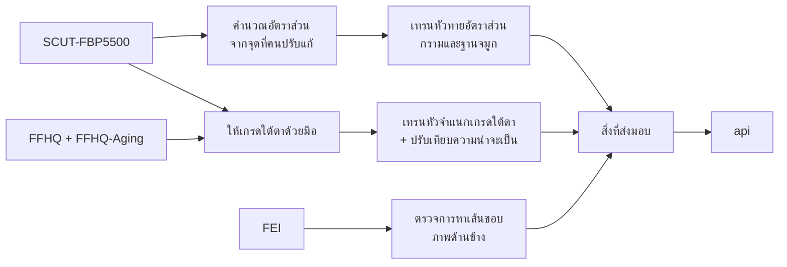

# ระบบแนะนำศัลยกรรมและหัตถการจากภาพถ่ายใบหน้า: ส่วน model

เอกสารของโปรเจกต์แบ่งเป็นสามไฟล์ตามส่วนของระบบ

| ไฟล์ | เนื้อหา |
| --- | --- |
| model.md (ไฟล์นี้) | เกณฑ์และวิธีให้เกรดของแต่ละบริเวณ กฎแนะนำ ข้อมูล การเตรียมโมเดล และการประเมินผล |
| api.md | Python API ที่รับภาพ ตรวจคุณภาพภาพ หาจุดบนใบหน้า แล้วเรียกใช้สิ่งที่ส่วน model ส่งมอบ |
| web.md | หน้าเว็บที่ถ่ายภาพ คุมท่า และแสดงผล |

เลขอ้างอิง \[n\] ใช้ชุดเดียวกันทั้งสามไฟล์ ท้ายไฟล์นี้แสดงเฉพาะรายการที่ไฟล์นี้อ้างถึง

## 1. ภาพรวม

### 1.1 เป้าหมายของโปรเจกต์

ระบบแนะนำศัลยกรรมและหัตถการแบบเฉพาะบุคคลจากภาพถ่ายใบหน้า ผู้ใช้ถ่ายภาพผ่านหน้าเว็บ ระบบประเมินใบหน้าทีละบริเวณ แล้วแนะนำหัตถการโดยระบุชื่อตรง ๆ เช่น เสริมคาง ตัดกราม เสริมจมูก หรือฉีดฟิลเลอร์ ผลของแต่ละบริเวณบอกระดับ ค่าที่ใช้ตัดสิน และหัตถการ ถ้าภาพมีข้อมูลไม่พอให้ตัดสินทางเดียว ระบบเสนอหลายทางพร้อมบอกว่าแต่ละทางเหมาะกับกรณีใด

คำแนะนำเป็นการนำเกณฑ์จากงานวิจัยมาใช้กับค่าจากภาพถ่าย ไม่ใช่การวินิจฉัย ผลทุกครั้งจึงต้องแจ้งว่าการตัดสินใจทำหัตถการต้องผ่านการตรวจโดยแพทย์

### 1.2 ขอบเขต

- ไม่เปิดให้บุคคลทั่วไป api และ web รันบนโน้ตบุ๊กหรือคอมพิวเตอร์ของทีมเครื่องเดียว ไม่มีเซิร์ฟเวอร์ภายนอก (api.md หัวข้อ 6)
- ประเมินสี่บริเวณ คือ กราม คาง ใต้ตา และจมูก ซึ่งแยกเป็นฐานจมูกกับสันจมูก ใต้ตา กราม และฐานจมูกใช้โมเดลที่ทีมเทรนเอง คางและสันจมูกใช้การวัดจากเส้นขอบใบหน้า (หัวข้อ 2.3)
- ผู้ใช้ต้องระบุอายุและเพศ เพราะเกณฑ์ของกรามและจมูกแยกตามเพศ และกฎบางข้อใช้อายุ ผู้ใช้ชายเห็นอัตราส่วนกรามแต่ไม่ได้เกรด เพราะยังไม่มีเกณฑ์ของผู้ชาย (หัวข้อ 3.1)
- ใช้เฉพาะภาพจากชุดข้อมูลสาธารณะที่ดาวน์โหลดได้ทันทีโดยไม่ต้องกรอกฟอร์มหรือรออนุมัติ (หัวข้อ 5.1)
- ไม่มีแพทย์ร่วม ความรู้ที่ใช้ตัดสินทั้งหมดมาจากงานวิจัยและเอกสารการทดลองทางคลินิกที่เปิดเผย
- เพื่อไม่ให้ขอบเขตมากเกินไป ไม่รวมปลายจมูก ภาพตอนกัดฟัน เกณฑ์กรามของผู้ชาย การวัดคางตามนิยามของ GCRS ซึ่งต้องให้ผู้ใช้แตะมุมปาก การให้เกรด GCRS ด้วยตาเพื่อหาเส้นแบ่งของมุมคาง และการทดลองท่าและระยะด้วยใบหน้าสังเคราะห์

### 1.3 หลักการใช้งานอย่างรับผิดชอบ

- ไม่แสดงหัตถการกับผู้ที่อายุต่ำกว่า 18 ปี เพราะการทดลองที่อ้างอิงทำในผู้ใหญ่ทั้งหมด \[11\]\[12\]\[44\] และแสดงหัตถการของใต้ตาเฉพาะผู้ที่อายุเกิน 21 ปี ตามการทดลอง \[12\]
- ใช้ภาษาที่เป็นกลาง เช่น “อัตราส่วนสูงกว่าเกณฑ์ที่คนส่วนใหญ่มองว่าเหลี่ยม” แทนคำว่าผิดปกติหรือไม่สวย เพราะเกณฑ์บางข้อมาจากการรับรู้ ไม่ใช่ความผิดปกติทางการแพทย์
- ผลการวัดแสดงได้เสมอ ส่วนหัตถการแสดงเมื่อผู้ใช้เลือกดูเท่านั้น ผลจึงแยกสองส่วนนี้ออกจากกัน (หัวข้อ 4.4)

### 1.4 หน้าที่ของส่วน model

ส่วน model กำหนดว่าระบบวัดอะไร ให้เกรดอย่างไร และแนะนำอะไร แล้วเตรียมสิ่งที่ api ต้องใช้ล่วงหน้า ตอนใช้งาน api เป็นผู้รับภาพ และส่งภาพหน้าตรงความละเอียดเต็ม จุด 478 จุดของ MediaPipe Face Landmarker \[1\] เส้นขอบภาพด้านข้าง ข้อมูลคุณภาพภาพ อายุ เพศ และแหล่งของภาพหน้าตรงเข้าโค้ดและกฎของส่วนนี้

| สิ่งที่ส่งมอบ | เนื้อหา | ผู้ใช้ |
| --- | --- | --- |
| โค้ดวัดค่า | หาจุดด้วย MediaPipe ครอปภาพสำหรับโมเดล หาเส้นขอบภาพด้านข้าง และคืนค่าวัดพร้อมพิกัดเส้นวัด เป็นโมดูลเดียวที่ทั้งการเตรียมข้อมูลและ api เรียกใช้ ภาพตอนใช้งานจึงผ่านขั้นตอนเดียวกับภาพที่ใช้เทรน | api |
| เกณฑ์เกรดและช่วงก้ำกึ่ง | เส้นแบ่งของทุกบริเวณและขนาดช่วงก้ำกึ่ง (หัวข้อ 3 และ 4.1) | api |
| โมเดล | DINOv2 กับหัวสามหัว ค่า temperature ของใต้ตา วิธีครอปของแต่ละหัว ขนาดใบหน้าที่ใช้ตอนเทรน และสมการเส้นตรงที่ปรับอัตราส่วนจากจุดของ MediaPipe (หัวข้อ 2.3, 6 และ 7.1) | api |
| กฎแนะนำ | ตารางเกรดกับหัตถการ ข้อความที่แสดง เกณฑ์ 0.3/0.7 ของใต้ตา และเงื่อนไขอายุ เพศ และแหล่งของภาพ (หัวข้อ 4.3) | api |
| เกณฑ์การถ่ายภาพ | ขอบเขตท่า สีหน้า ผมบัง และขนาดใบหน้าขั้นต่ำซึ่งต้องตรงกับขนาดที่ใช้เทรน (หัวข้อ 3.3) เก็บใน `shared/quality.json` ที่ web และ api อ่านร่วมกัน (web.md หัวข้อ 4.1) ส่วนระยะราว 1 ม. คุมด้วยกรอบนำท่าของ web (web.md หัวข้อ 3.2) | web, api |

## 2. แนวทาง

### 2.1 แยกการประเมินออกจากการแนะนำ

ไม่มีชุดข้อมูลสาธารณะที่บอกว่าใบหน้าแบบใดควรทำหัตถการใด เพราะการตัดสินใจนี้มาจากแพทย์ร่วมกับเป้าหมายของผู้ป่วย ระบบจึงแบ่งเป็นสองขั้น ขั้นแรกให้ “เกรด” ทีละบริเวณ คือระดับความรุนแรงของลักษณะที่เกี่ยวกับหัตถการ เช่น ความถอยของคาง ขั้นที่สองนำเกรดผ่านกฎที่เขียนจากข้อบ่งชี้ในงานวิจัยเพื่อเลือกหัตถการ ทุกคำแนะนำจึงย้อนกลับได้ว่ามาจากค่าเท่าไร เทียบเกณฑ์ใด และผ่านกฎข้อใด

### 2.2 ที่มาของเกรด

งานวิจัยด้านความงามใช้สเกลภาพถ่าย (photonumeric scale) ที่มี 4–5 ระดับพร้อมภาพอ้างอิง และผ่านการทดสอบความสอดคล้องของผู้ประเมินแล้ว \[6\]\[7\]

- **ใต้ตา** ใช้สเกล GIHS 4 ระดับของ Galderma (0 ไม่มี ถึง 3 รุนแรง) ซึ่งรับรองด้วยผู้ประเมิน 3 คนกับผู้เข้าร่วมราว 70 คน \[7\] และใช้คัดผู้เข้าร่วมการทดลองฟิลเลอร์ใต้ตา \[12\]
- **คาง** มีสเกล GCRS ในชุดเดียวกัน \[7\] แต่การแปลงเป็นเกณฑ์ของค่าวัดต้องให้คนเกรดภาพด้านข้างจำนวนมาก จึงใช้ค่าปกติของมุม Legan แทน \[5\]\[26\]
- **กราม** ไม่มีสเกลที่ใช้กับภาพนิ่งได้ เพราะสเกล MMPS ของ Allergan ต้องคลำและดูตอนกัดฟัน \[30\] จึงใช้เกณฑ์อัตราส่วนจากงานวิจัย \[3\]
- **จมูก** ยังไม่พบสเกลที่รับรองแล้ว จึงใช้ค่าที่คนไทยชอบจากงานสำรวจ \[39\]

การจับคู่เกรดของคางและจมูกกับหัตถการเป็นการเชื่อมโยงของทีม เพราะงานผ่าตัดแบ่งความรุนแรงด้วยมิลลิเมตรหรือดุลยพินิจของแพทย์

### 2.3 สองวิธีในการให้เกรด

**โมเดลที่เทรน** ใช้กับใต้ตา กราม และฐานจมูก ทั้งสามใช้ DINOv2 \[29\] แบบแช่แข็งตัวเดียวกันแปลงภาพครอปเป็นเวกเตอร์ feature แล้วต่อด้วยหัวเล็ก ๆ ที่ทีมเทรนเอง

| บริเวณ | ภาพที่เข้าโมเดล | สิ่งที่หัวทาย | label มาจาก |
| --- | --- | --- | --- |
| ใต้ตา | ครอปใต้ตาทีละข้าง | เกรด 0, 1 หรือ ≥2 (classification) | ทีมให้เกรดด้วยตาตามสเกล GIHS (หัวข้อ 5.2) |
| กราม | ครอปทั้งใบหน้า | อัตราส่วน Go–Go/Zy–Zy (regression) | คำนวณจากจุดของ SCUT-FBP5500 (หัวข้อ 5.2) |
| ฐานจมูก | ครอปทั้งใบหน้า | อัตราส่วนฐานจมูกต่อระยะหัวตา (regression) | คำนวณจากจุดของ SCUT-FBP5500 (หัวข้อ 5.2) |

ใต้ตาเป็นเรื่องเงาและปริมาตรที่วัดเป็นระยะไม่ได้ label จึงต้องมาจากคน ส่วนกรามและฐานจมูกมีเกณฑ์เป็นตัวเลขอัตราส่วนอยู่แล้ว หัวจึงทายตัวเลขแล้วนำไปเทียบเกณฑ์ ผลจึงอธิบายได้ และเปลี่ยนเกณฑ์ภายหลังได้โดยไม่ต้องเทรนใหม่

**การวัด** ใช้กับคางและสันจมูก ซึ่งต้องใช้ภาพด้านข้าง และยังไม่มีภาพด้านข้างที่มีจุดหรือเกรดมากพอให้เทรน ระบบจึงหาจุดบนเส้นขอบ คำนวณมุม แล้วเทียบกับเกณฑ์โดยตรง

ทั้งสองวิธีให้ผลในรูปเดียวกัน คือเกรด หรือช่วงเกรดเมื่อก้ำกึ่ง (หัวข้อ 4) กฎแนะนำจึงไม่ต้องรู้ว่าเกรดมาจากวิธีใด

### 2.4 ระดับผลลัพธ์และลำดับหัตถการ

คางใช้ 4 ระดับ เพราะแต่ละเกรดแนะนำหัตถการต่างกัน บริเวณอื่นใช้ 3 ระดับ คือ 0 ไม่มีข้อสังเกต, 1 ข้อสังเกต และ ≥2 แนะนำหัตถการ หัตถการเรียงจากรุกล้ำน้อยไปมาก เกรดสูงขึ้นเลือกหัตถการลำดับสูงขึ้น ถ้าภาพแยกสาเหตุไม่ได้ ระบบเสนอหัตถการของแต่ละสาเหตุคู่กันพร้อมบอกสิ่งที่ต้องตรวจเพิ่ม

## 3. บริเวณที่ประเมิน

| บริเวณ | ภาพที่ใช้ | วิธีให้เกรด | เกณฑ์ | หัตถการที่แนะนำได้ |
| --- | --- | --- | --- | --- |
| กราม | หน้าตรง | โมเดลทายอัตราส่วน | อัตราส่วนความเรียวของใบหน้า \[3\] ผู้ชายแสดงเฉพาะค่า | ฉีดโบท็อกซ์กราม, ตัดกราม |
| คาง | ด้านข้าง | การวัด | ค่าปกติของมุม Legan \[5\]\[26\] | ฉีดฟิลเลอร์คาง, เสริมคาง, ตัดเลื่อนกระดูกคาง |
| ใต้ตา | หน้าตรง | โมเดลจำแนกเกรด ทีละข้าง | GIHS \[7\] | ฉีดฟิลเลอร์ใต้ตา |
| จมูก | หน้าตรง + ด้านข้าง | ฐานจมูกใช้โมเดล สันจมูกใช้การวัด | ค่าที่คนไทยชอบ \[39\] แยกตามเพศ | ตัดปีกจมูก, ฉีดฟิลเลอร์จมูก, เสริมจมูก |

### 3.1 กราม

ค่าที่ใช้คืออัตราส่วนความเรียวของใบหน้า (facial taperness) คือความกว้างระหว่างมุมกรามสองข้าง (Go–Go) หารด้วยความกว้างระหว่างโหนกแก้มสองข้าง (Zy–Zy) จากภาพหน้าตรง

**ที่มาของเกณฑ์** Wu et al. \[3\] ดัดแปลงภาพหน้าตรงของผู้หญิงคนหนึ่งให้มีอัตราส่วน 8 ระดับ คือ 65, 70, 75, 80, 83, 85, 87 และ 90% แล้วให้ผู้ประเมินชาวไต้หวัน 203 คน อายุ 20–40 ปี ให้คะแนนความสวยและตอบว่าเหลี่ยมหรือไม่ ได้จุดตัดจาก ROC ที่ 83% (AUC 0.933) คือใบหน้าที่มากกว่า 83% ถูกมองว่าเหลี่ยม ใบหน้า 75% ได้คะแนนสูงสุด (74.5) และ 90% ต่ำสุด (39.3) ค่า 83% จึงเป็นเกณฑ์ของการรับรู้ว่าเหลี่ยม ไม่ใช่ข้อบ่งชี้ทางการแพทย์ งานด้านการผ่าตัดลดมุมกรามก็ระบุว่ายังไม่มีอัตราส่วนใดเป็นข้อยุติ \[14\] และเพราะระดับที่ทดสอบติดกันรอบจุดตัดคือ 83% กับ 85% จุดเปลี่ยนจริงอาจอยู่ที่ใดก็ได้ในช่วงนั้น

**ความขัดกับค่าที่วัดจากประชากร** หญิงจีนฮั่น 450 คนใน \[31\] มีอัตราส่วนเฉลี่ย 0.880 และ 0.869 ในกลุ่มที่สวยที่สุด ซึ่งสูงกว่า 83% ทั้งคู่ อาจเพราะนิยามจุด Go และ Zy ต่างกัน ก่อนเทรนจึงต้องดูว่าผู้หญิงเอเชีย 2,000 ภาพใน SCUT-FBP5500 \[8\] เกิน 83% กี่เปอร์เซ็นต์ ถ้าสัดส่วนสูงจนเกรด ≥1 กลายเป็นค่าปกติ แปลว่าจุดที่เลือกยังไม่ตรงกับนิยามของ \[3\] และต้องแก้ก่อน

**เกรด** ของผู้ใช้หญิง

| เกรด | อัตราส่วน Go–Go/Zy–Zy | ผล | ที่มา |
| --- | --- | --- | --- |
| 0 | ไม่เกิน 83% | ไม่มีข้อสังเกต | จุดตัดของ \[3\] |
| 1 | มากกว่า 83% ถึง 87% | ข้อสังเกต ยังไม่แนะนำหัตถการ | ทีมกำหนด โดยอิงระดับที่ \[3\] ทดสอบ |
| ≥2 | มากกว่า 87% | แนะนำหัตถการตามสาเหตุด้านล่าง | ทีมกำหนด ระดับ 90% ใน \[3\] ได้คะแนนความสวยต่ำสุด |

เกรด 1 ยังไม่แนะนำหัตถการ เพราะอยู่ใกล้จุดตัดและเปลี่ยนได้ง่าย (หัวข้อ 4.1)

**ผู้ใช้ชาย** แสดงเฉพาะอัตราส่วน ไม่ให้เกรด เพราะหลักฐานขัดกัน ผลต่างระหว่างเพศมีตั้งแต่ไม่ถึง 1 จุดในข้อมูลวัดศีรษะคนคอเคเชียนของ Farkas ที่ \[3\] อ้าง (ชาย 70.8% หญิง 70.1%) ถึงราว 3.5 จุดในภาพดาราคอเคเชียน \[22\] และใบหน้าทรงเหลี่ยมอาจถูกมองว่าดึงดูดในผู้ชาย \[24\] เกณฑ์ของผู้ชายต้องหาจากความชอบโดยตรง เช่นจากคะแนนความสวยในภาพชายของ SCUT-FBP5500 ซึ่งทำต่อได้ภายหลัง

**สาเหตุของความกว้าง** มาได้จากกล้ามเนื้อกราม กระดูกขากรรไกร หรือไขมัน ซึ่งภาพถ่ายแยกไม่ได้ เกรด ≥2 จึงแสดงฉีดโบท็อกซ์กรามเมื่อเกิดจากกล้ามเนื้อ และตัดกรามเมื่อเกิดจากกระดูก พร้อมแจ้งว่าถ้าเกิดจากไขมันจะไม่ตรงกับทั้งสองแบบ และต้องคลำหรือเอกซเรย์ก่อนจึงจะรู้ว่าทางใดเหมาะ

**การประเมิน** หัวกรามทายอัตราส่วนจากภาพครอปทั้งใบหน้า (หัวข้อ 2.3) label คำนวณจากจุดของ SCUT-FBP5500 ที่คนปรับแก้แล้ว แต่ชุดข้อมูลไม่มีจุดตรงมุมกรามและโหนกแก้ม จึงหา Go และ Zy จากเส้นขอบหน้าด้วยกฎ (หัวข้อ 5.2) หลังเทรนตรวจกับภาพ 8 ภาพในรูปที่ 2 ของ \[3\] ซึ่งรู้อัตราส่วนอยู่แล้ว จุดขอบหน้าของ MediaPipe ใช้วาดเส้นบนภาพ และวัดอัตราส่วนไว้เทียบกับโมเดล (หัวข้อ 7.1)

**เงื่อนไขที่ผลใช้ได้** api เป็นผู้ตรวจ (api.md หัวข้อ 4) ถ้าไม่ผ่าน ผลของกรามเป็น “ประเมินไม่ได้” เพื่อให้ web ขอถ่ายใหม่

- ขอบกรามและโหนกแก้มไม่ถูกผมบัง ตรวจด้วย segmentation ที่มีคลาสผม \[27\] เพราะ MediaPipe คืนจุดครบแม้ส่วนนั้นถูกบัง
- ท่าหน้าตรงอยู่ในเกณฑ์ และศีรษะเอียง (roll) ไม่เกินราว 8° ตาม model card ของ MediaPipe \[2\]
- ไม่ยิ้มและไม่อ้าปาก เพราะเปลี่ยนเส้นขอบแก้มและกราม
- ระยะระหว่างตาไม่ต่ำกว่าเกณฑ์พิกเซลขั้นต่ำ

### 3.2 คาง

ความยื่นหรือถอยของคางวัดจากภาพหน้าตรงไม่ได้ และค่าความลึกของ MediaPipe มาจากข้อมูลสังเคราะห์ซึ่งไม่ได้ประเมินความแม่น \[2\] ระบบจึงใช้ภาพด้านข้าง

**มุม Legan** คือมุมที่เส้น subnasale–pogonion (Sn–Pog) เบนไปด้านหลังจากแนวต่อของเส้น glabella–subnasale (G–Sn) ทั้งสามจุดอยู่บนเส้นขอบใบหน้าด้านข้าง ค่าเหมาะสมราว 12° ช่วงที่ยอมรับได้ 8–16° \[5\]\[26\] มุมยิ่งมาก คางยิ่งอยู่ด้านหลัง

**เกรด** ทีมแบ่งจาก 12° ± 4° โดยเพิ่มทีละ 4°

| เกรด | มุม Legan | ผล |
| --- | --- | --- |
| 0 | ไม่เกิน 16° | อยู่ในช่วงที่ยอมรับได้ หรือคางยื่นกว่านั้น |
| 1 | มากกว่า 16° ถึง 20° | คางอยู่ด้านหลังเล็กน้อย |
| 2 | มากกว่า 20° ถึง 24° | คางอยู่ด้านหลังปานกลาง |
| 3 | มากกว่า 24° | คางอยู่ด้านหลังมาก |

ข้อแลกของการแบ่งแบบนี้ คือไม่ใช่สเกล GCRS จึงเทียบกับเกรดที่การทดลองฟิลเลอร์ใช้ได้เพียงคร่าว ๆ มุมรวมผลของขากรรไกรบน ขากรรไกรบนหรือฟันหน้าที่ยื่นจึงทำให้มุมมากขึ้นได้แม้คางปกติ และค่าปกตินี้ไม่ได้มาจากคนไทย

**ท่าศีรษะ** ทั้งสามจุดอยู่บนแนวกลางหน้า มุมจึงไม่เปลี่ยนเมื่อก้มเงย และเปลี่ยนน้อยเมื่อหันคลาดเล็กน้อย api ตรวจเพียงว่าภาพหันถึงด้านข้างและหาเส้นขอบได้ (api.md หัวข้อ 3)

**เงื่อนไขที่ค่าวัดใช้ได้** ภาพหันถึงด้านข้างและหาเส้นขอบของหน้าผาก จมูก ปาก และคางได้ ซึ่ง api ตรวจ ส่วนท่าที่ใช้ประเมินคางในการทดลอง \[11\] คือศีรษะตั้งตรง มองตรง สีหน้าปกติ ปากปิด ริมฝีปากผ่อนคลาย พร้อมถ่ายหน้าผนังเรียบและไม่ให้ผมบังหน้าผาก เป็นคำแนะนำตอนถ่าย (web.md หัวข้อ 3.3)

**หัตถการ** ฟิลเลอร์และการเติมไขมันใช้กับคางพร่องเล็กน้อย การเสริมด้วยแกนและการตัดเลื่อนกระดูกใช้กับระดับปานกลางถึงรุนแรง โดยการตัดกระดูกแก้รูปทรงที่ซับซ้อนและความไม่สมมาตรได้ดีกว่า \[4\] แกน Medpore ให้ผลเท่าการตัดกระดูกในการพร่องเล็กน้อยถึงปานกลาง \[15\] และทุกเทคนิคให้ผลดีและผู้ป่วยพึงพอใจสูง \[25\] การทดลองฟิลเลอร์คางรับผู้ที่มี GCRS 1 หรือ 2 \[11\] ตารางนี้จึงถือว่าระดับ 1 และ 2 ของมุม Legan ใกล้เคียงช่วงนั้น ซึ่งเป็นการเชื่อมโยงของทีม

| เกรด | ทางเลือกที่แสดง | ข้อความที่แสดงเพิ่ม |
| --- | --- | --- |
| 1 | ฉีดฟิลเลอร์คาง | – |
| 2 | ฉีดฟิลเลอร์คาง หรือเสริมคาง แสดงคู่กัน ฟิลเลอร์รุกล้ำน้อยกว่า การเสริมคางให้ผลถาวรกว่า และตัดเลื่อนกระดูกคางเมื่อคางสั้นหรือไม่สมมาตรร่วมด้วย | ควรตรวจการสบฟันก่อน เพราะคางถอยที่สัมพันธ์กับปัญหาการสบฟัน และคางที่สั้นในแนวตั้ง เป็นข้อห้ามของการเสริมด้วยแกน \[5\] ขากรรไกรบนหรือฟันหน้าที่ยื่นทำให้มุมมากขึ้นได้แม้คางปกติ |
| 3 | ตัดเลื่อนกระดูกคาง | คางที่ถอยมากอาจเกิดจากขากรรไกรล่างทั้งชิ้น ต้องตรวจการสบฟันและเอกซเรย์กะโหลกด้านข้างก่อนตัดสินใจ |

### 3.3 ใต้ตา

ใต้ตาให้เกรดทีละข้าง และเป็นบริเวณเดียวที่ label มาจากคน โมเดลจำแนกเกรดจากภาพครอปใต้ตาซ้ายและขวา โดยกลับภาพข้างหนึ่งให้เป็นทิศเดียวกัน เพราะ GIHS และการทดลองประเมินแยกข้าง \[7\]\[12\] และได้ข้อมูลเทรนเพิ่มเท่าตัว (วิธีเทรนอยู่ในหัวข้อ 6) เกรด ≥2 แนะนำการฉีดฟิลเลอร์ ซึ่งตรงกับการทดลองที่รับเฉพาะผู้ที่อายุเกิน 21 ปีและมีใต้ตาลึกระดับ 2–3 \[12\]

**ตัวกวน** การทดลองคัดผู้ที่บวมใต้ตาเรื้อรัง มีความผิดปกติของสีผิว หรือมีถุงไขมันยื่นมากหรือ festoons ออก \[12\] ในภาพถ่าย รอยคล้ำและถุงใต้ตาดูคล้ายร่องลึกได้ และแสงจากด้านบนทำให้ดูลึกขึ้น จึงต้อง

- ให้ web บอกให้หันหน้าเข้าหาแสง เพราะไม่มีการตรวจทิศแสง
- ให้ผู้ให้เกรดทำเครื่องหมายภาพที่มีถุงใต้ตาหรือรอยคล้ำเด่น (หัวข้อ 5.2)
- แจ้งในผลว่าระบบประเมินเฉพาะร่องลึก ไม่ได้ประเมินถุงใต้ตาหรือรอยคล้ำ

**ความละเอียดภาพ** ที่ 1 ม. ด้วยเว็บแคม ร่องใต้ตาที่กว้างราว 2 ซม. อาจเหลือเพียง 15–30 px ขณะที่ภาพ FFHQ ละเอียดกว่าหลายเท่า ตอนเทรนจึงย่อภาพให้ใบหน้ามีขนาดพิกเซลเท่าตอนใช้งาน พร้อมเพิ่ม JPEG และ noise ขนาดนี้ต้องตรงกับเกณฑ์พิกเซลขั้นต่ำของ web และ api และยืนยันได้ด้วยการยืนห่างกล้อง 1 ม. แล้วอ่านระยะระหว่างตาจากตัวเลขสดในโหมดทดลอง โดยไม่ต้องบันทึกภาพ (web.md หัวข้อ 7) ช่วงขนาดที่ใช้เทรนเก็บไว้ใน bundle และภาพตอนใช้งานที่ใบหน้าใหญ่กว่าช่วงนี้จะถูกย่อลงก่อนครอป (api.md หัวข้อ 3)

**เงื่อนไขที่ผลใช้ได้** ใบหน้าใหญ่พอ ท่าอยู่ในเกณฑ์ ตาเปิด ไม่ยิ้ม และผมไม่บังใต้ตา ส่วนแสงและการถอดแว่นเป็นคำแนะนำตอนถ่าย ภาพเทรนคัดภาพใส่แว่นออกแล้ว (หัวข้อ 5.1)

### 3.4 จมูก

จมูกประเมินสองส่วนตามนิยามของ \[39\] ฐานจมูกใช้โมเดลทายอัตราส่วน ส่วนสันจมูกใช้การวัด

| ส่วน | ภาพ | ค่าวัด | หัตถการที่เกี่ยวข้อง |
| --- | --- | --- | --- |
| ฐานจมูก | หน้าตรง | อัตราส่วนฐานจมูกต่อระยะหัวตา คือระยะระหว่างจุดนอกสุดของฐานปีกจมูกตรงที่ต่อกับริมฝีปาก หารด้วยระยะระหว่างหัวตาสองข้าง | ตัดปีกจมูก |
| สันจมูก | ด้านข้าง | มุม nasofacial คือมุมระหว่างระนาบใบหน้า (เส้นที่สัมผัส glabella และ pogonion) กับเส้นที่สัมผัสสันจมูก มุมเล็กแปลว่าจมูกยื่นจากใบหน้าน้อย | ฉีดฟิลเลอร์จมูก, เสริมจมูก |

ปลายจมูกไม่อยู่ในต้นแบบนี้ เพราะหาเส้นใต้จมูกจากเส้นขอบได้ยาก และนิยามมุมจมูกกับริมฝีปากในงานวิจัยมีหลายแบบ \[46\]

**ที่มาของเกณฑ์** ยังไม่พบสเกลที่รับรองแล้วสำหรับจมูก แม้การทดลองฟิลเลอร์จมูกก็คัดผู้เข้าร่วมจากความไม่พอใจรูปจมูก \[44\] เกณฑ์จึงมาจาก Kaewsomnuk et al. \[39\] ซึ่งให้คนไทยอายุ 18–60 ปี 1,452 คนเลือกจมูกที่ชอบจากภาพจมูกคนไทยที่ดัดแปลงค่าละ 5 ระดับรอบค่าอุดมคติของคนผิวขาว (มุม nasofacial 25–45° อัตราส่วนฐานจมูก 0.8–1.2) ค่าที่กลุ่มทั่วไป 933 คนชอบตามตารางที่ 3 ของบทความ เป็นดังนี้

| ค่าวัด | หญิง | ชาย |
| --- | --- | --- |
| มุม nasofacial | 35.60° ± 2.76° | 37.18° ± 2.99° |
| อัตราส่วนฐานจมูกต่อระยะหัวตา | 1.05 ± 0.10 | 1.10 ± 0.11 |

ค่า ± คือการกระจายของความชอบ ไม่ใช่การกระจายของรูปจมูกจริง ข้อควรระวังคือเกณฑ์นี้เป็นความชอบ ไม่ใช่ข้อบ่งชี้ทางการแพทย์ \[40\] ค่าที่ชอบอาจถูกดึงเข้าหากึ่งกลางของภาพที่ให้เลือก และการเลือกกลุ่มตัวอย่างเป็นแบบเจาะจงซึ่งได้ผู้ตอบไม่ถึงเป้า \[39\]

**เกรด** ทีมกำหนดจากค่าเฉลี่ยและ SD ในตารางข้างต้น แยกตามเพศ

| เกรด | เงื่อนไข | ผล |
| --- | --- | --- |
| 0 | อยู่ในช่วงค่าเฉลี่ย ± 1 SD | ไม่มีข้อสังเกต |
| 1 | อยู่นอกช่วง ± 1 SD แต่ไม่เกิน ± 2 SD หรือเกิน ± 2 SD ในทิศที่ไม่มีหัตถการรองรับ | ข้อสังเกต ยังไม่แนะนำหัตถการ |
| ≥2 | เกิน ± 2 SD ในทิศที่มีหัตถการรองรับ คือฐานจมูกกว้าง หรือจมูกยื่นน้อย | แนะนำหัตถการของส่วนนั้น |

ทิศตรงข้าม คือฐานจมูกแคบหรือจมูกยื่นมาก ได้สูงสุดแค่เกรด 1 เพราะแหล่งข้อมูลไม่ครอบคลุมหัตถการในทิศนั้น เส้นแบ่งที่ได้คือ

| ส่วน | เพศ | เกรด 0 | เกรด ≥2 เมื่อ |
| --- | --- | --- | --- |
| ฐานจมูก | หญิง | 0.95–1.15 | มากกว่า 1.25 |
| ฐานจมูก | ชาย | 0.99–1.21 | มากกว่า 1.32 |
| สันจมูก (มุม nasofacial) | หญิง | 32.8°–38.4° | น้อยกว่า 30.1° |
| สันจมูก (มุม nasofacial) | ชาย | 34.2°–40.2° | น้อยกว่า 31.2° |

SD ของความชอบแคบกว่าความหลากหลายของจมูกจริง เกณฑ์จึงอาจให้เกรดสูงกับจมูกที่พบบ่อย ฐานจมูกตรวจการกระจายได้ด้วย SCUT-FBP5500 ส่วนสันจมูกยังไม่มีภาพด้านข้างของคนเอเชียให้ตรวจ

**หัตถการ** คนเอเชียส่วนใหญ่ต้องการเสริมสันจมูกและปลายจมูก และในเอเชียนิยมแกนซิลิโคนมากที่สุด \[42\] การตัดปีกจมูกพิจารณาเมื่อระยะระหว่างปีกจมูกกว้างกว่าระยะหัวตา \[43\] แต่คนไทยชอบฐานจมูกที่กว้างกว่าระยะหัวตาเล็กน้อย จึงใช้เส้นแบ่งจากความชอบแทนอัตราส่วน 1.0 ฟิลเลอร์จมูกมีการทดลองแบบสุ่มในผู้ใหญ่ชาวจีน 164 คน ซึ่งดีขึ้น 87.2% เทียบกับ 18.8% ในกลุ่มควบคุม \[44\] แต่จมูกเป็นตำแหน่งที่มีรายงานการสูญเสียการมองเห็นหลังฉีดฟิลเลอร์มากที่สุด คือ 40.6% ของรายงานในปี 2018–2023 \[45\] ตารางนี้เป็นการเชื่อมโยงของทีม

| ส่วน | ทางเลือกเมื่อเกรด ≥2 | ข้อความที่แสดงเพิ่ม |
| --- | --- | --- |
| ฐานจมูก | ตัดปีกจมูก | ข้อบ่งชี้ของการตัดปีกจมูกมีหลายแบบ เช่นปีกจมูกบาน ระยะระหว่างปีกจมูกกว้าง หรือฐานรูจมูกกว้าง ซึ่งต้องดูจากภาพมุมใต้จมูก \[43\] ภาพหน้าตรงแยกกรณีเหล่านี้ไม่ได้ |
| สันจมูก | ฉีดฟิลเลอร์จมูก หรือเสริมจมูก แสดงคู่กัน ฟิลเลอร์รุกล้ำน้อยกว่าและมีการทดลองแบบสุ่มรองรับ การเสริมด้วยแกนให้ผลถาวรกว่า | จมูกเป็นตำแหน่งที่มีรายงานการสูญเสียการมองเห็นหลังฉีดฟิลเลอร์มากที่สุด \[45\] |

**การประเมิน**

- **ฐานจมูก** หัวทายอัตราส่วนจากภาพครอปทั้งใบหน้า label คำนวณจากจุดฐานปีกจมูกและหัวตาของ SCUT-FBP5500 (หัวข้อ 5.2) อัตราส่วนนี้เปลี่ยนตามระยะกล้อง ภาพที่ถ่ายใกล้ทำให้ฐานจมูกดูกว้างขึ้น \[16\] ภาพที่เลือกจากเครื่องจึงแสดงเฉพาะค่า ไม่ให้เกรด (หัวข้อ 4.3)
- **สันจมูก** หาจุด glabella nasion ปลายจมูก และ pogonion จากเส้นขอบชุดเดียวกับคาง แล้ววัดมุมระหว่างระนาบใบหน้า (เส้น glabella–pogonion) กับเส้นสันจมูก ซึ่งใช้เส้นจาก nasion ถึงปลายจมูกแทนเส้นสัมผัสสันจมูก สองเส้นนี้ตรงกันเมื่อสันจมูกไม่มีโหนก มุมนี้ไม่เปลี่ยนเมื่อก้มเงยแบบเดียวกับมุม Legan

**เงื่อนไขที่ผลใช้ได้** ภาพหน้าตรงผ่านเงื่อนไขของกราม ยกเว้นเรื่องผมบังขอบหน้า ภาพด้านข้างผ่านเงื่อนไขของคาง และไม่ใส่แว่น เพราะแว่นบังเส้นขอบของสันจมูก ข้อนี้เป็นคำแนะนำตอนถ่าย

## 4. การตัดสินเกรดและกฎแนะนำ

### 4.1 เกรดจากอัตราส่วนและมุม

ค่าที่อยู่ใกล้เส้นแบ่งอาจตกอีกฝั่งได้ ระบบจึงใช้ช่วงก้ำกึ่งรอบเส้นแบ่ง ถ้าค่าห่างจากเส้นแบ่งไม่เกินขนาดช่วง ผลเป็นช่วงของสองเกรด เช่น “เกรด 0–1” ถ้าห่างกว่านั้น ผลเป็นเกรดเดียว

| ค่า | ขนาดช่วงก้ำกึ่ง |
| --- | --- |
| อัตราส่วนกรามและอัตราส่วนฐานจมูกที่โมเดลทาย | ราวครึ่งหนึ่งของ RMSE ของหัวนั้นบนชุดทดสอบ ก่อนเทรนเสร็จใช้ ±1 จุดเปอร์เซ็นต์สำหรับกราม และ ±0.04 สำหรับฐานจมูก |
| มุม Legan และมุม nasofacial | ±1.5° |

ครึ่งหนึ่งของ RMSE ใช้หลักเดียวกับเกณฑ์ 0.3/0.7 ของใต้ตา ถ้าความคลาดเคลื่อนกระจายแบบปกติ ค่าที่ห่างจากเส้นแบ่งไม่เกินราว 0.52 เท่าของ RMSE คือช่วงที่ความน่าจะเป็นที่ค่าจริงเกินเส้นแบ่งอยู่ระหว่าง 0.3 ถึง 0.7 RMSE นี้ไม่รวมความคลาดเคลื่อนจากการถ่ายภาพจริง ส่วนช่วงของมุมทีมตั้งแบบคร่าว ๆ ช่วงของเส้นแบ่งที่ติดกันต้องไม่ซ้อนกัน ถ้าซ้อนให้ลดเหลือครึ่งหนึ่งของระยะระหว่างเส้นแบ่ง เช่น 1.15 กับ 1.25 ของฐานจมูกผู้หญิงห่างกัน 0.10 ช่วงจึงไม่เกิน ±0.05

ตัวอย่าง: ถ้าช่วงของกรามคือ ±1 จุด อัตราส่วน 83.6% ห่างจาก 83% ไม่ถึง 1 จุด ผลจึงเป็น “เกรด 0–1” ส่วน 85.0% ห่างจาก 83% และ 87% เกิน 1 จุดทั้งคู่ ผลจึงเป็นเกรด 1

### 4.2 เกรดจากโมเดลใต้ตา

หัวใต้ตาให้ความน่าจะเป็นสะสม P(เกรด ≥ k) ของ k = 1 และ 2 โดยตรง เพราะเป็นหัวแบบ ordinal ในรูปเดียวกับ CORAL \[28\] และต้องปรับเทียบด้วย temperature scaling บนชุด validation ก่อนใช้ เพราะความน่าจะเป็นของโครงข่ายประสาทเทียมมักมั่นใจเกินจริง \[10\]

กฎตัดสินที่จุดเปลี่ยนแต่ละจุดด้วย P(เกรด ≥ k) แทนการเลือกเกรดที่น่าจะเป็นที่สุด เช่น P(0) = 0.40, P(1) = 0.35 และ P(≥2) = 0.25 เกรดที่น่าจะเป็นที่สุดคือ 0 แต่ P(เกรด ≥ 1) เท่ากับ 0.60 ผลจึงเป็นก้ำกึ่งระหว่างเกรด 0 กับ 1

| P(เกรด ≥ k) | การตัดสินที่จุดเปลี่ยน k |
| --- | --- |
| ตั้งแต่ 0.7 ขึ้นไป | ถึงระดับ k |
| ระหว่าง 0.3 กับ 0.7 | ก้ำกึ่ง แสดงเป็นช่วงเกรด |
| ไม่เกิน 0.3 | ไม่ถึงระดับ k |

ถ้าก้ำกึ่งทั้งสองจุดเปลี่ยน ผลเป็นช่วงเกรด 0 ถึง ≥2 ค่า 0.3 และ 0.7 เป็นค่าเริ่มต้นที่ปรับได้บนชุดข้อมูลที่เกรดแล้ว

การปรับเทียบมักคลาดเคลื่อนเมื่อกล้องและแสงต่างไป \[18\] จึงตรวจซ้ำบนภาพที่ทำให้คุณภาพลดลงเลียนแบบเว็บแคม และตรวจข้ามชุดข้อมูล คือเทรนบน FFHQ \[37\] แล้วตรวจบนภาพ SCUT-FBP5500 ที่เกรดไว้ ทั้งสองทางยังไม่ยืนยันกับกล้องจริง web จึงแสดงผลเป็นระดับ “ชัด” หรือ “ก้ำกึ่ง” ไม่แสดงตัวเลขความน่าจะเป็น

### 4.3 กฎแนะนำ

กฎตัดสินที่จุดเปลี่ยนของแต่ละบริเวณ คือเกรด 1 และ 2 ของกราม ใต้ตา และจมูก และทุกเกรดของคาง เมื่อผลเป็นช่วง กฎแสดงคำแนะนำของทุกระดับในช่วงนั้น

- เกรด 0 ไม่มีหัตถการ แต่ยังคืนผลการวัด
- เกรดสูงขึ้นเลือกหัตถการลำดับสูงขึ้น ถ้าแยกสาเหตุไม่ได้ เสนอหัตถการของแต่ละสาเหตุคู่กัน
- อายุต่ำกว่า 18 ปีไม่เห็นหัตถการ และอายุไม่เกิน 21 ปีไม่เห็นหัตถการของใต้ตา (หัวข้อ 1.3)
- ผู้ชายไม่ได้รับเกรดกราม และเกณฑ์ของจมูกเลือกตามเพศ
- ภาพหน้าตรงที่เลือกจากเครื่องไม่รู้ระยะถ่าย ฐานจมูกจึงแสดงเฉพาะค่า ไม่ให้เกรด \[16\]

### 4.4 ผลรายบริเวณ

api นำผลไปจัดเป็น JSON (api.md หัวข้อ 2.2) และ web นำไปแสดง ผลของแต่ละบริเวณมีส่วนต่อไปนี้

| ส่วนของผล | เนื้อหา |
| --- | --- |
| บริเวณ | กราม คาง ใต้ตาซ้าย ใต้ตาขวา ฐานจมูก และสันจมูก |
| สถานะ | ประเมินได้ หรือประเมินไม่ได้พร้อมเหตุผล |
| ค่าวัด | ค่าที่ใช้ให้เกรด หน่วย เกณฑ์ และที่มา กรามและฐานจมูกมีค่าที่วัดจากจุดของ MediaPipe เป็นค่าประกอบ |
| เส้นวัด | พิกัดจุดและเส้นสำหรับวาดบนภาพ |
| ความน่าจะเป็น | เฉพาะใต้ตา |
| ผลตัดสิน | เกรด หรือช่วงเกรดเมื่อก้ำกึ่ง |
| หัตถการ | เรียงจากรุกล้ำน้อยไปมาก พร้อมกรณีที่เหมาะและสิ่งที่ต้องตรวจเพิ่ม |
| เหตุที่ไม่แสดงหัตถการ | อายุ เพศ ภาพจากเครื่อง หรือเกรดยังไม่ถึงระดับที่แนะนำ |
| ข้อความเพิ่มเติม | เช่น ระบบไม่ได้ประเมินถุงใต้ตา หรือความเสี่ยงของฟิลเลอร์จมูก ข้อความที่เกี่ยวกับหัตถการแสดงพร้อมหัตถการเท่านั้น |

ทุกผลต้องมาพร้อมข้อความว่าไม่ใช่การวินิจฉัย และการตัดสินใจทำหัตถการต้องผ่านการตรวจโดยแพทย์

กฎคืนผลเป็นรหัส ทั้งหัตถการ เหตุที่ไม่แสดงหัตถการ และข้อความเพิ่มเติม (api.md หัวข้อ 2.3) ถ้อยคำภาษาไทยตามตารางในหัวข้อ 3 อยู่ในไฟล์ภาษา `shared/i18n/th.json` จึงเพิ่มภาษาอื่นได้ภายหลังโดยไม่แก้กฎ (web.md หัวข้อ 8.4)

## 5. ข้อมูล

### 5.1 แหล่งภาพ

| แหล่งข้อมูล | ลักษณะข้อมูล | การใช้งาน |
| --- | --- | --- |
| SCUT-FBP5500 \[8\] | ภาพหน้าตรง 5,500 ภาพ อายุ 15–60 ปี ไม่ถูกบังและสีหน้าปกติ เป็นคนเอเชียหญิงและชายอย่างละ 2,000 ภาพ และคนผิวขาวอย่างละ 750 ภาพ ทุกภาพมีจุด 86 จุดที่คนปรับแก้แล้ว และมีการแบ่ง train/test 60/40 มาให้ | ข้อมูลเทรนและทดสอบของหัวกรามและหัวฐานจมูก ภาพเสริมของใต้ตา และชุดตรวจการปรับเทียบข้ามชุดข้อมูล |
| FEI \[33\] | ชาวบราซิล 200 คน อายุ 19–40 ปี คนละ 14 ภาพ หมุนศีรษะได้ถึงราว 180° | ตรวจการหาเส้นขอบบนภาพด้านข้าง |
| FFHQ \[37\] กับป้าย FFHQ-Aging \[41\] | 70,000 ภาพขนาด 1024×1024 จาก Flickr FFHQ-Aging เพิ่มป้ายเพศและกลุ่มอายุจากผู้กำกับบน Appen และป้ายท่า แว่น และการถูกบังของตาจาก Face++ | ภาพหลักของใต้ตา คัดเฉพาะผู้ใหญ่ หน้าค่อนข้างตรง ไม่ใส่แว่น และตาไม่ถูกบัง โหลดเฉพาะภาพที่ใช้ เพราะทั้งชุดมีขนาด 89 GB และใช้ขนาด 1024×1024 เพราะภาพ 256×256 ที่สคริปต์ของ FFHQ-Aging โหลดเป็นค่าเริ่มต้น \[41\] มีระยะระหว่างตาไม่เกินราว 64 px ต่ำกว่าตอนใช้งาน |

ชุดที่ต้องกรอกฟอร์มหรือรออนุมัติ ได้แก่ CFD \[9\], RaFD \[32\] และ M2FPA \[34\] ไม่ใช้ในต้นแบบนี้

**เงื่อนไขการใช้** ทุกชุดใช้ได้เฉพาะงานวิจัยที่ไม่ใช่เชิงพาณิชย์ FEI ห้ามแจกจ่ายหรือทำซ้ำ จึงไม่ใส่ภาพ FEI ในรายงานหรือสไลด์ FFHQ และป้ายของ FFHQ-Aging ใช้ CC BY-NC-SA 4.0 และภาพแต่ละภาพมีสัญญาอนุญาตของเจ้าของบน Flickr ภาพทั้งหมดเก็บและเทรนบนเครื่องของทีม ยกเว้นภาพที่ส่งให้ผู้ให้เกรด (หัวข้อ 5.2) ภาพสเกล GIHS ใน \[7\] เป็นลิขสิทธิ์ของ Galderma ใช้อ้างอิงภายในได้ แต่ถ้าจะใส่ในรายงานต้องขออนุญาตก่อน

### 5.2 การสร้าง label

**เกรดใต้ตา** ผู้ให้เกรด 1 คนให้เกรด 0–3 กับใต้ตาแต่ละข้าง เทียบกับภาพอ้างอิง GIHS ใน Figure 2 ของ \[7\] แผนเดิมใช้ผู้ให้เกรดอย่างน้อย 2 คนเพื่อวัดความสอดคล้องและใช้ soft label แต่ทีมเลือกใช้ผู้ให้เกรดคนเดียว label จึงสะท้อนการตัดสินของคนเดียว และวัดความสอดคล้องระหว่างผู้ให้เกรดไม่ได้ (หัวข้อ 7.2)

1. **ฝึก** ด้วยภาพสำหรับฝึกเทียบกับภาพอ้างอิงจนเข้าใจเกณฑ์ เพราะสเกลรับรองด้วยแพทย์ที่ประเมินตัวจริง \[7\] คนที่ไม่ใช่แพทย์และดูจากภาพมักให้เกรดคลาดจากแพทย์ได้มากกว่า
2. **ทดลองกับภาพสุ่มราว 200 ภาพ** เพื่อดูสัดส่วนของแต่ละเกรด
3. **ให้เกรดทั้งชุด** ราว 600 ภาพหรือ 1,200 ข้าง โดยนับรวม 200 ภาพแรก และทำเครื่องหมายภาพที่มีถุงใต้ตาหรือรอยคล้ำเด่น ซึ่งไม่ใช้เทรนเกรด label ของแต่ละข้างคือเกรดที่ผู้ให้เกรดให้ จึงเป็นเป้า P(เกรด ≥ k) ที่เป็น 0 หรือ 1 (หัวข้อ 6)
4. **ถ้าภายหลังมีผู้ให้เกรดเพิ่ม** ให้ทุกคนเกรดทุกภาพ แล้วรวมเป็น soft label และวัดความสอดคล้องด้วย weighted kappa แบบ Cicchetti–Allison (linear) เหมือน \[7\] ตั้งเป้า 0.61 ขึ้นไป ซึ่งเป็นระดับ substantial ตาม Landis & Koch \[17\] และรายงาน ICC เพื่อเทียบกับ \[6\] เป้านี้อาจทำได้ยาก เพราะแม้แพทย์ที่ประเมินตัวจริงยังได้ 0.55 ในกลุ่มที่ไม่ใช่คนผิวขาว \[7\] ถ้าไม่ถึงเป้า ให้ตกลงเกรดร่วมกันสำหรับภาพที่เห็นต่าง และรายงานค่าตามจริง

**ภาพที่ให้เกรด**

- FFHQ ราว 450 ภาพ คัดจากป้ายของ FFHQ-Aging เฉพาะผู้ใหญ่ ไม่ใส่แว่น ตาไม่ถูกบัง หันและก้มเงยไม่เกิน ±10° ตามเกณฑ์ท่าของ api และไม่ใช่ภาพขาวดำ แล้วเลือกจำนวนเท่ากันจากกลุ่มอายุ 20–29, 30–39, 40–49 และ 50 ปีขึ้นไป โดยให้หญิงชายเท่ากันในแต่ละกลุ่ม เพราะใต้ตาระดับ 2–3 พบมากในผู้ใหญ่อายุสูง แต่คนอายุ 50 ปีขึ้นไปมีเพียงราว 15% ของภาพที่ผ่านเงื่อนไข ถ้าสุ่มตามสัดส่วนเดิม เกรด ≥2 จะมีน้อยเกินไป
- SCUT-FBP5500 เฉพาะคนเอเชีย หญิงและชายอย่างละราว 75 ภาพ เพราะผู้ใช้เป็นคนไทย และใช้ตรวจการปรับเทียบข้ามชุดข้อมูล (หัวข้อ 4.2)
- 200 ภาพแรกสุ่มจาก 600 ภาพนี้
- ภาพสำหรับฝึกอีก 20–30 ภาพที่ไม่อยู่ใน 600 ภาพ เพื่อไม่ให้ภาพที่ใช้ฝึกและอาจคุยกันแล้วปนอยู่ใน label

**ที่ให้เกรดและเครื่องมือ** ผู้ให้เกรดเกรดบนเครื่องของตัวเองได้ ส่งเฉพาะภาพที่ต้องเกรดจาก FFHQ และ SCUT-FBP5500 ผ่านลิงก์ที่เปิดได้เฉพาะผู้ให้เกรด ไม่ส่งภาพ FEI และให้ลบเมื่อเกรดเสร็จ เครื่องมือคือ `undereye_grader.html` ซึ่งเป็นหน้าเว็บไฟล์เดียวที่เปิดได้โดยไม่ต้องติดตั้ง แสดงภาพในลำดับสุ่มของแต่ละคน ให้กดเกรดตาซ้ายและตาขวาของคนในภาพ (ตาซ้ายอยู่ทางขวาของภาพ) หรือเลือกว่าประเมินไม่ได้ ทำเครื่องหมายถุงใต้ตาหรือรอยคล้ำ แล้วส่งออกเป็น CSV หนึ่งแถวต่อใต้ตาหนึ่งข้าง แท็บสรุปผลของเครื่องมือรวม CSV ของทุกคน คำนวณ weighted kappa และ ICC(2,1) แสดงข้างที่เห็นต่าง และส่งออกตารางรวมที่มีสัดส่วนคนที่ให้เกรดตั้งแต่ 1 และตั้งแต่ 2 ของแต่ละข้าง ซึ่งใช้เป็น soft label ได้ทันที ภาพอ้างอิง GIHS ให้เปิดจากบทความไว้ข้างกัน ไม่ฝังในเครื่องมือ ผู้ให้เกรดไม่เห็นเกรดของกันและกัน และควรปิดโหมดถนอมสายตาของจอ เพราะสีจอเปลี่ยนการเห็นเงาใต้ตา

**อัตราส่วนจากจุดของ SCUT-FBP5500** ตำแหน่งของจุดทั้ง 86 จุดดูได้จากรูปใน repo ของชุดข้อมูล \[8\]

- ฐานจมูกใช้จุดที่ 65 กับ 69 และหัวตาใช้จุดที่ 43 กับ 55 ซึ่งตรงตำแหน่งอยู่แล้ว
- โหนกแก้มและมุมกรามไม่มีจุดตรงตำแหน่ง จึงหาจากเส้นขอบหน้า (จุดที่ 1–22) ด้วยกฎ คือ Zy เป็นจุดบนเส้นขอบที่หน้ากว้างที่สุดระหว่างระดับกลางตา (จุดที่ 59 และ 60) กับระดับใต้จมูก (จุดที่ 67) และ Go เป็นจุดบนเส้นขอบกรามที่ระดับเดียวกับมุมปาก (ค่าเฉลี่ยของจุดที่ 74 และ 80) ทั้งสองข้าง ไม่ใช้จุดที่เส้นขอบเลี้ยวมากที่สุด เพราะเส้นขอบของ SCUT-FBP5500 เป็นเส้นโค้งเรียบที่ไม่มีมุมชัดในหลายภาพ กฎนั้นจึงไปจับปลายคางข้างหนึ่งบ่อย ระดับมุมปากอยู่ใกล้ระดับของจุดที่ 9 และ 15 ซึ่งเป็นมุมกรามในรูปของ repo ทั้งสองจุดหาหลังหมุนให้กลางตาสองข้างอยู่ระดับเดียวกัน สคริปต์ `scut_landmark_preview.py` คำนวณและวาดจุดเหล่านี้ baseline ของ MediaPipe ใช้กฎเดียวกันกับเส้นขอบหน้าของ MediaPipe โดยใช้จุด 98 กับ 327 เป็นฐานจมูกและจุด 133 กับ 362 เป็นหัวตา คู่จุดฐานจมูกที่ลองทั้ง 7 คู่มีสหสัมพันธ์กับ label ใกล้กันมาก (r 0.32–0.33 บนชุด train) จึงเลือกคู่ที่อยู่ตรงนิยามในหัวข้อ 3.4 คือจุดนอกสุดของฐานปีกจมูกตรงที่ต่อกับริมฝีปาก
- ก่อนคำนวณ label ให้วาดจุดทับภาพตัวอย่างเพื่อดูว่าอยู่ถูกที่ ถ้ากฎวาง Go หรือ Zy ผิดบ่อย ให้กำกับสองจุดนี้เองบนภาพราว 300 ภาพ
- ภาพที่กฎหาจุดไม่ได้ไม่มี label คือกลางตาสองข้าง (จุดที่ 59 และ 60) ไม่ได้เรียงจากซ้ายไปขวาของภาพ ซึ่งทำให้การหมุนกลับหน้าเป็นหัวลง เส้นขอบหน้าข้างใดข้างหนึ่งไม่ถึงระดับมุมปาก หรือไม่มีเส้นขอบช่วงระหว่างระดับกลางตากับระดับใต้จมูก ใน SCUT-FBP5500 พบ 3 ภาพซึ่งจุดวางผิดตำแหน่ง รวมกับไฟล์จุดที่อ่านไม่ได้ 1 ไฟล์ จึงมี label 5,496 ภาพ baseline ของ MediaPipe ใช้เงื่อนไขเดียวกัน
- คนวางจุดต่างกันเฉลี่ย 2.56% ของระยะระหว่างตา \[2\] label จึงคลาดเคลื่อนได้ในระดับนี้

### 5.3 การแบ่งชุดข้อมูล

ใต้ตาแบ่งตามภาพเป็น train, validation และ test ราว 70/15/15 หรือ 420/90/90 ภาพ ให้สัดส่วนแหล่งภาพและกลุ่มอายุใกล้กันทุกชุด และกำหนดชุด test ก่อนเทรน ใต้ตาสองข้างของภาพเดียวกันอยู่ชุดเดียวกัน แต่ FFHQ และ SCUT-FBP5500 ไม่มีป้ายตัวบุคคล ถ้าคนเดียวกันมีหลายภาพจึงแยกไม่ได้ ชุด validation ใช้ตั้ง temperature และค่า 0.3/0.7 ส่วนการตรวจข้ามชุดข้อมูลใช้โมเดลที่เทรนด้วยภาพ FFHQ อย่างเดียว แล้วตรวจบนภาพ SCUT-FBP5500 ที่เกรดแล้วทั้งหมด

หัวกรามและหัวฐานจมูกใช้การแบ่ง 60/40 ที่ SCUT-FBP5500 ให้มา \[8\] และแบ่ง validation ออกจากชุด train ถ้าต้องกำกับจุดเอง ใช้เฉพาะภาพที่กำกับตามรายชื่อเดียวกัน

## 6. การเตรียมโมเดล

- **สร้าง label ของกรามและฐานจมูก** แล้วดูการกระจายเทียบกับเส้นแบ่ง เช่นสัดส่วนผู้หญิงที่เกิน 83% ถ้าผิดปกติให้กลับไปตรวจการเลือกจุด (หัวข้อ 3.1 และ 5.2)
- **ครอปและดึง feature** ด้วยโค้ดครอปชุดเดียวกับ api แล้วเก็บ feature ของ DINOv2 ไว้ หัวทุกหัวจึงเทรนซ้ำได้เร็ว
- **ตรวจการหาเส้นขอบภาพด้านข้าง** บนภาพ FEI ราว 20 ภาพ
- **ให้เกรดใต้ตาและแบ่งชุดข้อมูล** (หัวข้อ 5.2 และ 5.3)
- **เทรนหัวทั้งสาม** ปรับเทียบใต้ตา และตั้งช่วงก้ำกึ่งของกรามและฐานจมูกจาก RMSE (หัวข้อ 4.1 และ 4.2)

**DINOv2** ใช้รุ่น ViT-B/14 (`dinov2_vitb14`) ที่ขนาดภาพ 224×224 ภาพครอปทุกแบบเป็นสี่เหลี่ยมจัตุรัส และต้องย่อกับ normalize แบบเดียวกันทั้งตอนเทรนและตอนใช้งาน ในแต่ละคำขอ api รัน DINOv2 กับสามครอป คือครอปทั้งใบหน้าซึ่งใช้ร่วมกันสองหัว และครอปใต้ตาข้างละหนึ่งครอป ถ้าหัวใดต้อง fine-tune หัวนั้นจะได้ DINOv2 ของตัวเองซึ่งทำให้ช้าลง จึงควรลองแบบแช่แข็งก่อน ใช้ DINOv2 แทน DINOv3 เพราะ DINOv2 ใช้สัญญาอนุญาต Apache 2.0 และโหลดได้ทันที \[53\] ส่วน DINOv3 ต้องกรอกข้อมูลและยอมรับสัญญาอนุญาตเฉพาะก่อน \[54\]

**หัวใต้ตา** เป็น ordinal logistic regression บน feature ที่แช่แข็ง เขียนใน PyTorch ในรูปเดียวกับ CORAL \[28\] คือชั้นเชิงเส้นที่ให้คะแนนเดียว บวก bias หนึ่งค่าต่อจุดเปลี่ยน แล้วผ่าน sigmoid เป็น P(เกรด ≥ 1) และ P(เกรด ≥ 2) เป้าคือ P(เกรด ≥ 1) และ P(เกรด ≥ 2) ของ label ซึ่งเป็น 0 หรือ 1 เมื่อมีผู้ให้เกรดคนเดียว ถ้ามีหลายคน soft label ใช้เป็นเป้าได้ตรง ๆ เช่นผู้ให้เกรดสองคนให้ 1 กับ 2 จะได้เป้า P(เกรด ≥ 1) = 1 และ P(เกรด ≥ 2) = 0.5 เลือก weight decay ด้วยชุด validation และย่อภาพให้ใบหน้ามีขนาดพิกเซลเท่าตอนใช้งาน พร้อมเพิ่ม JPEG และ noise (หัวข้อ 3.3)

**หัวกรามและหัวฐานจมูก** ครอปทั้งใบหน้าจากจุดของ MediaPipe หมุนให้ตาอยู่ระดับเดียวกัน และเว้นขอบให้เห็นกรามและโหนกแก้มครบ แล้วต่อด้วย ridge regression เทรนด้วยทุกภาพของ SCUT-FBP5500 เพราะ label เป็นอัตราส่วนทางเรขาคณิต ส่วนเกณฑ์ที่แยกตามเพศใช้ตอนตัดสินเกรด เพิ่มข้อมูลด้วยการกลับภาพซ้ายขวาได้ และย่อภาพกับเพิ่ม noise แบบเดียวกับใต้ตา ถ้ายังไม่ดีพอ ให้ลองใช้ feature ของ patch แทน feature รวมของทั้งภาพ

## 7. การประเมินผล

การประเมินทั้งหมดทำบนชุดข้อมูลสาธารณะ เพราะไม่มีแพทย์ร่วมตรวจคำแนะนำ และไม่มีภาพของคนจริงที่ถ่ายผ่านระบบ

### 7.1 การทดสอบที่ทำได้ด้วยชุดข้อมูล

1. **หัวกรามและหัวฐานจมูก** วัด MAE และ RMSE เทียบกับ label บนชุดทดสอบ แยกตามกลุ่มย่อยทั้งสี่ของ SCUT-FBP5500 และวัด weighted kappa ของเกรด แล้วเทียบกับ baseline คืออัตราส่วนจากจุดของ MediaPipe บนภาพเดียวกัน ซึ่งจุดคลาดเคลื่อนเฉลี่ย 3.24% ของระยะระหว่างตา \[2\] baseline ปรับด้วยสมการเส้นตรงที่ fit บนชุด train ก่อน เพราะนิยามจุดอาจต่างจาก SCUT-FBP5500 ระบบใช้ค่าจากโมเดลแม้ baseline จะแม่นกว่า เพราะโปรเจกต์ตั้งใจแสดงการเทรนโมเดล ถ้าเป็นเช่นนั้นให้รายงานเป็นข้อจำกัด และตรวจกรามกับภาพ 8 ภาพของ \[3\] ด้วย
2. **การหาเส้นขอบภาพด้านข้าง** ดูจุดบนภาพ FEI ราว 20 ภาพด้วยตา นับภาพที่หาไม่ได้ และใช้ภาพมุมอื่นของคนเดิมดูคร่าว ๆ ว่ามุมเปลี่ยนแค่ไหนเมื่อท่าเปลี่ยน
3. **โมเดลใต้ตา** วัด accuracy และ weighted kappa บนชุด test เทียบโมเดลกับผู้ให้เกรด แล้ววัด expected calibration error (หัวข้อ 4.2) เมื่อมีผู้ให้เกรดคนเดียว ไม่มี kappa ระหว่างผู้ให้เกรดให้วางคู่ จึงอ้างค่า 0.55–0.65 ของแพทย์ใน \[7\] ได้เพียงคร่าว ๆ เพราะเป็นการเทียบคนละแบบ ถ้ามีผู้ให้เกรดหลายคน ให้เทียบโมเดลกับแต่ละคนและกับ kappa ระหว่างผู้ให้เกรด

### 7.2 สิ่งที่ทำไม่ได้และถือเป็นข้อจำกัดของต้นแบบ

| งาน | เหตุที่ทำไม่ได้ | สิ่งที่ทำแทนและผลต่อระบบ |
| --- | --- | --- |
| ทดสอบถ่ายซ้ำคนเดิม | ไม่มีชุดที่ถ่ายคนเดิมซ้ำ | ช่วงก้ำกึ่งตั้งจาก RMSE และค่าประมาณ จึงอาจแคบหรือกว้างเกินไป |
| ภาพจริงที่รู้มุม และภาพด้านข้างของคนเอเชีย | ชุดแบบนี้ เช่น M2FPA ต้องรออนุมัติ | ใช้ FEI ชุดเดียว ผลของท่า การหาเส้นขอบ และเกณฑ์คางกับสันจมูกอาจไม่ตรงกับคนไทย และสันจมูกอาจได้เกรด ≥2 บ่อยเกินจริง |
| จุดที่ตรงนิยามของเกณฑ์กราม | SCUT-FBP5500 ไม่มีจุดตรงมุมกรามและโหนกแก้ม | หาจากเส้นขอบด้วยกฎ ถ้านิยามต่างกัน เกรดกรามจะเลื่อนทั้งระบบ |
| ภาพหน้าตรงมาตรฐานสำหรับใต้ตา | ชุดแบบนี้ (CFD) ต้องกรอกฟอร์ม | ใช้ FFHQ กับ SCUT-FBP5500 ซึ่งแสง ท่า และการแต่งภาพหลากหลายกว่า |
| ความสอดคล้องระหว่างผู้ให้เกรดใต้ตา | ทีมใช้ผู้ให้เกรดคนเดียว (หัวข้อ 5.2) | label เป็นการตัดสินของคนเดียวที่ไม่ใช่แพทย์ วัดไม่ได้ว่าคนอื่นจะเห็นตรงกันแค่ไหน ความน่าจะเป็นหลังปรับเทียบจึงบอกเพียงว่าตรงกับผู้ให้เกรดคนนี้แค่ไหน |
| ปรับเทียบใต้ตากับกล้องจริง | ต้องมีภาพจากกล้องของระบบที่เกรดแล้ว | ตรวจบนภาพที่ลดคุณภาพและข้ามชุดข้อมูล web จึงแสดงเป็นระดับแทนตัวเลข |
| ผลของระยะกล้องและแสงในห้อง | ตัดออก | ใช้ระยะราว 1 ม. ไม่ให้เกรดฐานจมูกของภาพจากเครื่อง และบอกให้หันหน้าเข้าหาแสง |
| เกณฑ์คางจากเกรด GCRS และเกณฑ์กรามของผู้ชาย | ตัดออก | ใช้มุม Legan และแสดงเฉพาะค่าของผู้ชาย |

ถ้าภายหลังมีเวลารอชุดข้อมูลที่ต้องขออนุมัติ หรือสมาชิกทีมยินยอมให้ใช้ใบหน้าของตัวเองพร้อมเอกสารยินยอม งานในตารางนี้จะทำได้มากขึ้น

## 8. ข้อจำกัด

- **ความถูกต้องทางการแพทย์** ไม่มีแพทย์ร่วม จึงตรวจได้เพียงว่าค่าและเกรดสมเหตุสมผล ไม่ได้ว่าคำแนะนำตรงกับที่แพทย์จะแนะนำ และการจับคู่เกรดของคางและจมูกกับหัตถการเป็นการเชื่อมโยงของทีม
- **ที่มาของเกณฑ์** เกณฑ์กรามมาจากการรับรู้ต่อภาพที่ดัดแปลงจากใบหน้าเดียว \[3\] และค่าเฉลี่ยของหญิงจีนก็สูงกว่า 83% \[31\] มุม Legan ไม่ได้มาจากคนไทย เกณฑ์จมูกเป็นความชอบ ไม่ใช่ข้อบ่งชี้ \[39\] สเกลของ Galderma รับรองกับกลุ่มที่ส่วนใหญ่เป็นผู้หญิงและคนผิวขาว \[7\] และเส้นแบ่งที่ละเอียดกว่างานวิจัยกับขนาดช่วงก้ำกึ่งเป็นการกำหนดของทีม
- **ข้อมูลที่ภาพถ่ายให้ไม่ได้** เช่น สาเหตุของกรามกว้าง ความผิดปกติของขากรรไกร การแยกร่องใต้ตาจากถุงใต้ตาและรอยคล้ำ หรือฐานจมูกที่ต้องดูจากมุมใต้จมูก กฎจึงเสนอหลายทางหรือแจ้งสิ่งที่ต้องตรวจเพิ่ม
- **ข้อมูลเทรน** ภาพใต้ตามาจากอินเทอร์เน็ตซึ่งแสงและการแต่งภาพหลากหลาย และเกรดใต้ตามาจากผู้ให้เกรดคนเดียวที่ไม่ใช่แพทย์ SCUT-FBP5500 มีใบหน้าอายุ 15–17 ปีปนอยู่และไม่มีอายุรายภาพ label ของกรามและฐานจมูกแม่นได้ไม่เกินจุดที่คนวาง และภาพไม่รู้ระยะถ่าย ทุกชุดถ่ายต่างจากเว็บแคมของผู้ใช้ ผลจริงจึงอาจแย่กว่าผลบนชุดข้อมูล
- **ความไวต่อสภาพการถ่าย** ค่าขึ้นกับระยะ มุม แสง สีหน้า และความละเอียด ต้นแบบนี้ไม่ได้วัดระยะถ่าย มุมหันของภาพด้านข้าง และทิศแสง
- **วัตถุประสงค์ของ MediaPipe** model card ระบุว่าออกแบบมาสำหรับ AR เพื่อความบันเทิง ไม่ได้มีไว้สำหรับการตัดสินใจที่กระทบชีวิต \[2\]

## ภาคผนวก ก. ผลการตรวจกับต้นฉบับ

| สิ่งที่ตรวจ | ผล |
| --- | --- |
| Wu et al. \[3\] | ตรง ระดับในรูปที่ 2 คือ 90, 87, 85, 83, 80, 75, 70 และ 65% ใบหน้าที่มากกว่า 83% ถูกมองว่าเหลี่ยม AUC 0.933 คะแนนที่ 75% และ 90% คือ 74.5 และ 39.3 ข้อมูลของ Farkas ที่บทความอ้างคือชาย 70.8% หญิง 70.1% บทความรายงานจำนวนผู้ประเมินไม่ตรงกันบางจุด คือรวม 203 กับ 207 คน และผู้ชาย 64 กับ 74 คน |
| ค่าที่คนไทยชอบ \[39\] | ตรงกับตารางที่ 3 เส้นแบ่งคำนวณจากทศนิยมสองตำแหน่ง เช่น 35.60 − 2 × 2.76 = 30.08 จึงได้ 30.1° |
| สเกลของ Galderma \[7\] | ตรงกับฉบับเต็ม ผู้ประเมิน 3 คน ราว 70 คนต่อสเกล ประเมินตัวจริง 2 ครั้ง ใช้ weighted kappa แบบ Cicchetti–Allison สเกลใต้ตาได้ค่ามัธยฐาน 0.65 ในกลุ่มผิวขาว และ 0.55 ในกลุ่มที่รวมเชื้อชาติอื่น |
| model card ของ MediaPipe \[2\] | ตรง ความคลาดเคลื่อน 2.62% และ 3.24% ของระยะระหว่างตา คนวางจุดต่างกัน 2.56% ไม่เหมาะเมื่อหันเกิน 80° หรือเอียงเกิน 8° |
| จุดของ SCUT-FBP5500 \[8\] | ตรวจกับฉบับเต็มและรูปใน repo จุดที่ 1–22 เป็นเส้นขอบหน้า 23–42 คิ้ว 43–60 ตา 61–73 จมูก และ 74–86 ปาก ไม่มีจุดตรงมุมกรามและโหนกแก้ม |
| เกณฑ์คัดเข้าของการทดลอง \[11\]\[12\]\[44\] และตัวเลขของ \[43\]\[45\] | ตรง |
| สัญญาอนุญาตของ DINOv2 \[53\] และ DINOv3 \[54\] | ตรง |
| ตัวเลขของ \[22\] | ตรง ตาราง 2 ให้ bizygomatic/bigonial 1.174 ในผู้หญิงและ 1.128 ในผู้ชาย กลับเป็น Go–Go/Zy–Zy ได้ 85.2% กับ 88.7% ต่างกัน 3.5 จุด ประกาศแก้ไข \[38\] แก้เฉพาะระยะระหว่างรูม่านตาของผู้ชายในตาราง 1 |

## เอกสารอ้างอิง

เลขอ้างอิงใช้ชุดเดียวกับ api.md และ web.md รายการที่ไฟล์นี้ไม่ได้อ้างถึงจึงไม่แสดง

- \[1\] Google AI Edge. [*Face landmark detection guide* (MediaPipe Face Landmarker)](https://ai.google.dev/edge/mediapipe/solutions/vision/face_landmarker)
- \[2\] Google. [*Model Card: MediaPipe Face Mesh V2*](https://storage.googleapis.com/mediapipe-assets/Model%20Card%20MediaPipe%20Face%20Mesh%20V2.pdf)
- \[3\] Wu T-Y, Chou C-Y, Liang Y-M, Chang K-W, Wu C-H. [*A digital photograph study evaluating facial taperness and square face perception of Taiwanese females*](https://doi.org/10.1097/JCMA.0000000000000442). J Chin Med Assoc. 2021;84(3):314–319.
- \[4\] [*Implant-Based Chin Augmentation Vs Osseous Genioplasty: A Systematic Review of Indications and Outcomes*](https://pmc.ncbi.nlm.nih.gov/articles/PMC12262119/). Aesthetic Surgery Journal Open Forum. 2025. doi:10.1093/asjof/ojaf048
- \[5\] Harris WC, Winters R, Raggio BS. [*Facial Chin Augmentation*](https://www.ncbi.nlm.nih.gov/books/NBK554506/). StatPearls, updated 2024.
- \[6\] Lorenc ZP, Jones D, Kim J, Gwak HM, et al. [*Validating a Series of Photonumeric Rating Scales for Use in Facial Aesthetics Using Statistical Analysis of Intra- and Inter-rater Reliability*](https://pmc.ncbi.nlm.nih.gov/articles/PMC8958901/). Aesthetic Surgery Journal Open Forum. 2021.
- \[7\] Moradi A, Lin X, Allen S, Fagien S, Norberg M, Smith S. [*Validation of Photonumeric Assessment Scales for Temple Volume Deficit, Infraorbital Hollows, and Chin Retrusion*](https://pubmed.ncbi.nlm.nih.gov/31770155/). Dermatologic Surgery. 2020;46(9):1148–1154. doi:10.1097/DSS.0000000000002269 (open access แบบ CC BY-NC-ND ภาพสเกลเป็นลิขสิทธิ์ของ Galderma)
- \[8\] Liang L, Lin L, Jin L, Xie D, Li M. [*SCUT-FBP5500: A Diverse Benchmark Dataset for Multi-Paradigm Facial Beauty Prediction*](https://github.com/HCIILAB/SCUT-FBP5500-Database-Release). ICPR 2018. ([arXiv:1801.06345](https://arxiv.org/abs/1801.06345))
- \[9\] Ma DS, Correll J, Wittenbrink B. [*The Chicago Face Database: A Free Stimulus Set of Faces and Norming Data*](https://www.chicagofaces.org/). Behavior Research Methods. 2015;47:1122–1135.
- \[10\] Guo C, Pleiss G, Sun Y, Weinberger KQ. [*On Calibration of Modern Neural Networks*](https://arxiv.org/abs/1706.04599). ICML 2017.
- \[11\] Q-Med AB (Galderma). [*Clinical study protocol 43CH1627: Restylane Defyne for correction of chin retrusion*](https://cdn.clinicaltrials.gov/large-docs/56/NCT03597256/Prot_000.pdf). ClinicalTrials.gov NCT03597256 (นิยาม GCRS อยู่ในหัวข้อ 7.2 เกณฑ์คัดเข้าอยู่ในหัวข้อ 5.2)
- \[12\] [*A Multicenter, Randomized, Evaluator-Blinded Study to Examine the Safety and Effectiveness of Hyaluronic Acid Filler in the Correction of Infraorbital Hollows*](https://academic.oup.com/asj/article/44/9/1001/7640816). Aesthetic Surgery Journal 44(9). และ [ClinicalTrials.gov NCT04154930](https://clinicaltrials.gov/study/NCT04154930)
- \[14\] Tseng F-F, Li Y-H, Chen Y-W. [*Hard and Soft Tissue Facial Landmarks for Mandibular Angle Reduction: A Clinical Study*](https://pmc.ncbi.nlm.nih.gov/articles/PMC11417696/). Clinics and Practice. 2024. doi:10.3390/clinpract14050136
- \[15\] Mohammad S, Dwivedi CD, Singh RK, Singh V, Pal US. [*Medpore versus osseous augmentation in genioplasty procedure: A comparison*](https://pmc.ncbi.nlm.nih.gov/articles/PMC3304182/). Natl J Maxillofac Surg. 2010;1(1):1–5.
- \[16\] Ward B, Ward M, Fried O, Paskhover B. [*Nasal Distortion in Short-Distance Photographs: The Selfie Effect*](https://doi.org/10.1001/jamafacial.2018.0009). JAMA Facial Plastic Surgery. 2018.
- \[17\] Landis JR, Koch GG. *The Measurement of Observer Agreement for Categorical Data*. Biometrics. 1977;33(1):159–174.
- \[18\] Ovadia Y, et al. [*Can You Trust Your Model's Uncertainty? Evaluating Predictive Uncertainty Under Dataset Shift*](https://arxiv.org/abs/1906.02530). NeurIPS 2019.
- \[22\] Liu AS, Salinas CA, Sharaf BA. [*Using Artificial Intelligence to Quantify Sexual Dimorphism in Aesthetic Faces: Analysis of 100 Facial Points in 42 Caucasian Celebrities*](https://pmc.ncbi.nlm.nih.gov/articles/PMC10335162/). Aesthetic Surgery Journal Open Forum. 2023. doi:10.1093/asjof/ojad046
- \[24\] Grillo R, de Andrade TJD, Rodrigues dos Santos LA, Samieirad S, Fernandes LA, Melhem-Elias F. [*Frontal facial analysis of male celebrities attractiveness standards through artificial intelligence*](https://doi.org/10.1016/j.jormas.2026.102776). J Stomatol Oral Maxillofac Surg. 2026;127(4):102776.
- \[25\] [*Chin Augmentation Techniques: A Systematic Review*](https://archive-ouverte.unige.ch/unige:171992). Plastic and Reconstructive Surgery. 2023;151(5):758e–771e.
- \[26\] Legan HL, Burstone CJ. [*Soft tissue cephalometric analysis for orthognathic surgery*](https://pubmed.ncbi.nlm.nih.gov/6932485). J Oral Surg. 1980;38(10):744–751. (ค่าปกติของมุมอ้างตาม \[5\])
- \[27\] Google AI Edge. [*Image segmentation guide* (MediaPipe Image Segmenter, selfie multiclass)](https://developers.google.com/edge/mediapipe/solutions/vision/image_segmenter)
- \[28\] Cao W, Mirjalili V, Raschka S. *Rank consistent ordinal regression for neural networks with application to age estimation*. Pattern Recognition Letters. 2020;140:325–331.
- \[29\] Oquab M, et al. [*DINOv2: Learning Robust Visual Features without Supervision*](https://arxiv.org/abs/2304.07193). Transactions on Machine Learning Research. 2024.
- \[30\] Allergan. [*Clinical study protocol: BOTOX treatment of masseter muscle hypertrophy*](https://cdn.clinicaltrials.gov/large-docs/75/NCT02010775/Prot_000.pdf). ClinicalTrials.gov NCT02010775 (MMPS อยู่ในภาคผนวก 12.1.1) และ [*Reliability of a Masseter Muscle Prominence Scale and Lower Facial Shape Classification*](https://clinicaltrials.gov/study/NCT01821534). ClinicalTrials.gov NCT01821534
- \[31\] Zhao Q, Zhou R, Zhang X, Sun H, Lu X, Xia D, Song M, Liang Y. [*Morphological Quantitative Criteria and Aesthetic Evaluation of Eight Female Han Face Types*](https://doi.org/10.1007/s00266-013-0081-9). Aesthetic Plastic Surgery. 2013;37(2):445–453.
- \[32\] Langner O, Dotsch R, Bijlstra G, Wigboldus DHJ, Hawk ST, van Knippenberg A. [*Presentation and validation of the Radboud Faces Database*](https://rafd.socsci.ru.nl). Cognition & Emotion. 2010;24(8):1377–1388. doi:10.1080/02699930903485076
- \[33\] Centro Universitário da FEI. [*FEI Face Database*](https://fei.edu.br/~cet/facedatabase.html)
- \[34\] Li P, Wu X, Hu Y, He R, Sun Z. [*M2FPA: A Multi-Yaw Multi-Pitch High-Quality Dataset and Benchmark for Facial Pose Analysis*](https://pp2li.github.io/MEFPA/index). ICCV 2019.
- \[37\] NVIDIA. [*Flickr-Faces-HQ Dataset (FFHQ)*](https://github.com/NVlabs/ffhq-dataset)
- \[38\] [ประกาศแก้ไขของ \[22\]](https://pmc.ncbi.nlm.nih.gov/articles/PMC10631945). Aesthetic Surgery Journal Open Forum. 2023.
- \[39\] Kaewsomnuk C, Suetrong S, Reechaipichitkul W, Chainansamit S, Kasemsiri P, Komany K, Piromchai P. [*Exploring ideal nasal aesthetics in Thailand: Trends and participants' awareness of rhinoplasty*](https://pmc.ncbi.nlm.nih.gov/articles/PMC11580085/). SAGE Open Medicine. 2024;12:20503121241299066. doi:10.1177/20503121241299066
- \[40\] Naraghi M, Atari M, Asadollahi H. [*When Aesthetics, Surgery, and Psychology Meet: Aesthetic Nasal Proportions in Patients Having Rhinoplasty and Normal Adults*](https://pmc.ncbi.nlm.nih.gov/articles/PMC5553459/). The Surgery Journal. 2016.
- \[41\] Or-El R, Sengupta S, Fried O, Shechtman E, Kemelmacher-Shlizerman I. *Lifespan Age Transformation Synthesis*. ECCV 2020. ป้ายกำกับ [FFHQ-Aging Dataset](https://github.com/royorel/FFHQ-Aging-Dataset)
- \[42\] Ishii. [*Current Update in Asian Rhinoplasty*](https://pmc.ncbi.nlm.nih.gov/articles/PMC4174207/). Plastic and Reconstructive Surgery Global Open. 2014. PMID 25289326
- \[43\] Agrawal KS, Pabari M, Shrotriya R. [*A Refined Technique for Management of Nasal Flaring: The Quest for the Holy Grail of Alar Base Modification*](https://doi.org/10.5999/aps.2016.43.6.604). Archives of Plastic Surgery. 2016;43(6):604–607.
- \[44\] Li D, Sun J, Zhang Y, Wang X, Yang S, Harvey C, Zhang L. [*VYC-20L is Safe and Effective for Improving Volume and Aesthetic Appearance of the Nose in Chinese Adults*](https://doi.org/10.2147/CCID.S357855). Clinical, Cosmetic and Investigational Dermatology. 2022;15:1195–1204. (ClinicalTrials.gov NCT03430986)
- \[45\] Doyon VC, Liu C, Fitzgerald R, Humphrey S, Jones D, Carruthers JDA, Beleznay K. [*Update on Blindness From Filler: Review of Prognostic Factors, Management Approaches, and a Century of Published Cases*](https://doi.org/10.1093/asj/sjae091). Aesthetic Surgery Journal. 2024;44(10):1091–1104.
- \[46\] Harris R, Nagarkar P, Amirlak B. [*Varied Definitions of Nasolabial Angle: Searching for Consensus Among Rhinoplasty Surgeons and an Algorithm for Selecting the Ideal Method*](https://pmc.ncbi.nlm.nih.gov/articles/PMC4956864). Plastic and Reconstructive Surgery Global Open. 2016;4(6):e752. doi:10.1097/GOX.0000000000000729
- \[53\] Meta AI Research. [*DINOv2* (GitHub repository)](https://github.com/facebookresearch/dinov2) (โค้ดและน้ำหนักใช้สัญญาอนุญาต Apache 2.0)
- \[54\] Meta AI Research. [*DINOv3 model card* (Hugging Face, facebook/dinov3-vits16-pretrain-lvd1689m)](https://huggingface.co/facebook/dinov3-vits16-pretrain-lvd1689m) (ต้องกรอกข้อมูลและยอมรับ DINOv3 License ก่อนดาวน์โหลด)
