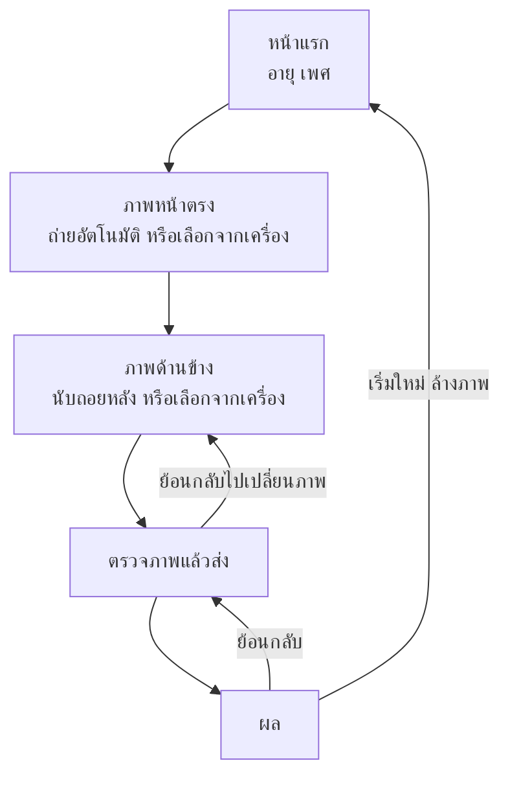

# ระบบแนะนำศัลยกรรมและหัตถการจากภาพถ่ายใบหน้า: ส่วน web

เอกสารของโปรเจกต์แบ่งเป็นสามไฟล์ตามส่วนของระบบ

| ไฟล์ | เนื้อหา |
| --- | --- |
| model.md | เกณฑ์และวิธีให้เกรดของแต่ละบริเวณ กฎแนะนำ ข้อมูล การเตรียมโมเดล และการประเมินผล |
| api.md | Python API ที่รับภาพ ตรวจคุณภาพภาพ หาจุดบนใบหน้า แล้วเรียกใช้สิ่งที่ส่วน model ส่งมอบ |
| web.md (ไฟล์นี้) | หน้าเว็บที่ถ่ายภาพ คุมท่า และแสดงผล |

เลขอ้างอิง \[n\] ใช้ชุดเดียวกันทั้งสามไฟล์ ท้ายไฟล์นี้แสดงเฉพาะรายการที่ไฟล์นี้อ้างถึง

## 1. ภาพรวม

### 1.1 หน้าที่ของส่วน web

ส่วน web ทำงานบนเบราว์เซอร์ มีหน้าที่สองอย่าง คือได้ภาพที่คุณภาพพอสำหรับการวัด และแสดงผลจาก api ส่วนการตรวจภาพ การวัด และการรันโมเดลทำที่ api จุดบนใบหน้าที่หน้าเว็บหาได้ระหว่างถ่ายใช้ช่วยจัดท่าเท่านั้น เพราะ api หาจุดใหม่จากภาพความละเอียดเต็มทุกครั้ง (api.md หัวข้อ 1.3)

### 1.2 หลักที่ต้องรักษา

- **ภาพไม่ออกจากเครื่องและไม่ถูกบันทึก** ภาพอยู่ในหน่วยความจำของเบราว์เซอร์ ไม่บันทึกลง localStorage, IndexedDB หรือ cache และส่งไปที่ api บนเครื่องเดียวกันเท่านั้น (หัวข้อ 8.3) ปิดแท็บหรือกดเริ่มใหม่แล้วภาพหายทั้งหมด
- **web แนะนำ api ตัดสิน** การตรวจในหน้าเว็บช่วยให้ถ่ายผ่านตั้งแต่ครั้งแรก ผลจริงมาจาก api และเกณฑ์ตัวเลขของทั้งสองส่วนต้องตรงกัน (หัวข้อ 4.1)
- **ผลการวัดแสดงเสมอ หัตถการแสดงเมื่อผู้ใช้กดดูเท่านั้น** (model.md หัวข้อ 1.3)
- **ไม่แสดงความน่าจะเป็นเป็นตัวเลข** แสดงเป็นระดับ "ชัด" หรือ "ก้ำกึ่ง" แทน ยกเว้นในโหมดทดลอง (หัวข้อ 7 และ model.md หัวข้อ 4.2)
- **ภาษาที่เป็นกลาง** ไม่ใช้คำว่าผิดปกติหรือไม่สวย และไม่ใช้สีแดงกับเขียวบอกผล สีแดงใช้เฉพาะข้อความผิดพลาดของฟอร์มและเครื่องหมายช่องที่ต้องกรอก (หัวข้อ 6.1 และ model.md หัวข้อ 1.3)
- **ข้อความแยกจากโค้ด** ข้อความที่ผู้ใช้เห็นทั้งหมดอยู่ในไฟล์ภาษา ภาษาไทยเป็นภาษาหลัก และใช้ภาษาอังกฤษกำกับเมื่อช่วยให้เข้าใจ เช่นชื่อรองของบริเวณและชื่อค่าวัด เพิ่มภาษาอื่นภายหลังได้ด้วยการเพิ่มไฟล์ภาษา (หัวข้อ 8.4)

## 2. ลำดับการใช้งาน



ทุกหน้าจอหลังหน้าแรกมีปุ่มย้อนกลับไปหน้าจอก่อนหน้า ย้อนกลับแล้วภาพ อายุ และเพศยังอยู่ หน้าภาพหน้าตรงและภาพด้านข้างที่มีภาพอยู่แล้วมีปุ่มใช้ภาพเดิม จึงเปลี่ยนเฉพาะภาพที่ต้องการได้ (หัวข้อ 4.3)

| หน้าจอ | เนื้อหา |
| --- | --- |
| หน้าแรก | คำอธิบายสั้นว่าระบบเทียบสัดส่วนใบหน้าสี่บริเวณ คือ กราม คาง ใต้ตา และจมูก กับเกณฑ์จากงานวิจัย ผลไม่ใช่การวินิจฉัย และภาพประมวลผลในเครื่องนี้โดยไม่ถูกเก็บ ช่องอายุและเพศ (หญิงหรือชาย) ซึ่งต้องกรอก และปุ่มเริ่ม |
| ภาพหน้าตรง | สามส่วนตามย่อหน้าใต้ตาราง ส่วนถ่ายภาพมีภาพจากกล้องพร้อมกรอบนำท่ารูปศีรษะด้านหน้า ข้อความบอกท่า ถ่ายอัตโนมัติเมื่อผ่านทุกข้อ และปุ่มถ่ายเอง (หัวข้อ 3.1, 3.2 และ 3.4) |
| ภาพด้านข้าง | สามส่วนตามย่อหน้าใต้ตาราง ส่วนถ่ายภาพมีกรอบนำท่ารูปศีรษะด้านข้าง ปุ่มนับถอยหลัง 3 วินาทีแล้วถ่าย และภาพให้ยืนยัน ส่วนล่างมีปุ่มข้ามเพิ่ม (หัวข้อ 3.1, 3.3 และ 3.4) |
| ตรวจภาพแล้วส่ง | ภาพย่อสองภาพ ปุ่มย้อนกลับไปเปลี่ยนภาพ ปุ่มส่งวิเคราะห์ และตัวบอกว่ากำลังวิเคราะห์ |
| ผล | ภาพพร้อมเส้นวัด การ์ดรายบริเวณ ปุ่มดูหัตถการ ข้อความว่าไม่ใช่การวินิจฉัย ปุ่มย้อนกลับไปหน้าตรวจภาพ และปุ่มเริ่มใหม่ (หัวข้อ 5) |

หน้าภาพหน้าตรงและภาพด้านข้างเรียงเป็นสามส่วน

- **ส่วนบน** หัวข้อ คำอธิบาย และกล่อง "ภาพที่ใช้ได้" ซึ่งเป็นรายการที่ต้องทำก่อนถ่าย
- **ส่วนกลาง** อย่างใดอย่างหนึ่ง คือส่วนถ่ายภาพเมื่อกล้องเปิด ภาพเดิมตรงกลางพร้อมปุ่มใช้ภาพเดิมเมื่อมีภาพแล้ว หรือว่างเมื่อยังไม่มีภาพ
- **ส่วนล่าง** เรียงจากซ้าย ปุ่มเปิดกล้องซึ่งเป็นปุ่มปิดกล้องเมื่อกล้องเปิดอยู่ (หัวข้อ 3.1) ปุ่มเลือกภาพจากเครื่อง และปุ่มข้ามในหน้าภาพด้านข้าง

ภาพที่ถ่ายหรือเลือกใหม่แทนภาพเดิม ถ้ากดปิดกล้องก่อนได้ภาพใหม่ ภาพเดิมยังอยู่

## 3. การได้ภาพ

### 3.1 กล้องและความละเอียด

**กล้อง** ใช้กล้องของเครื่องที่รันระบบ (หัวข้อ 8.3) ถ้ามีหลายตัวมีรายการให้เลือก เว็บแคม 720p ที่มุมรับภาพแนวนอนราว 70° ให้ระยะระหว่างตาเพียงราว 55–60 px ที่ระยะ 1 ม. ต่ำกว่าเกณฑ์ 75 px จึงต้องใช้กล้อง 1080p ขึ้นไป เช่น เว็บแคมภายนอก ซึ่งใช้ได้ทั้ง Mac และ Windows หรือมือถือผ่าน Continuity Camera บน Mac

**การเปิดกล้อง** เบราว์เซอร์เปิดกล้องได้เฉพาะหน้าที่โหลดผ่าน HTTPS หรือจาก localhost \[48\] ระบบเปิดที่ `http://localhost:8000` จึงไม่ต้องตั้ง HTTPS

**ความละเอียด** ขอความละเอียดสูงสุดที่กล้องให้ได้ แล้วอ่านค่าจริงจาก track ImageCapture API ไม่รองรับใน Safari และ Firefox ปิดไว้เป็นค่าเริ่มต้น \[21\] จึงดึงภาพจากเฟรมของสตรีมวิดีโอผ่าน canvas แล้วบีบเป็น JPEG คุณภาพ 0.92 ทุกเบราว์เซอร์ และส่งที่ความละเอียดเต็มของสตรีมโดยไม่ย่อ (api.md หัวข้อ 2.1)

**การกลับภาพ** พรีวิวกลับซ้ายขวาเหมือนกระจกได้ แต่ภาพที่ส่งต้องไม่กลับ เพราะ api ระบุตาซ้ายและขวาของผู้ใช้จากภาพที่ไม่ได้กลับ (api.md หัวข้อ 2.3)

**การเปิดและปิดกล้อง** ปุ่มเปิดกล้องอยู่ส่วนล่างของหน้าจอถ่ายภาพตลอด และเป็นปุ่มปิดกล้องเมื่อกล้องเปิดอยู่ กล้องเปิดเมื่อผู้ใช้กดปุ่มนี้เท่านั้น ไม่เปิดเองเมื่อเข้าหน้าจอถ่ายภาพหรือเมื่อกลับมาที่แท็บ หยุด track ทันทีเมื่อกดปิดกล้อง เมื่อกดเลือกภาพจากเครื่อง เมื่อออกจากหน้าจอถ่ายภาพ หรือเมื่อแท็บถูกซ่อน แล้วรอให้กดเปิดใหม่ การกดเลือกภาพจากเครื่องปิดกล้องด้วย เพราะถ้ากล้องยังเปิด ภาพหน้าตรงอาจถูกถ่ายอัตโนมัติระหว่างที่หน้าต่างเลือกไฟล์เปิดอยู่ เบราว์เซอร์ที่เปิดกล้องจากหน้านี้ไม่ได้จะไม่มีปุ่มเปิดกล้อง แต่มีข้อความบอกเหตุแทน

### 3.2 ภาพหน้าตรง

ใช้ Face Landmarker เวอร์ชันเว็บของ MediaPipe \[1\] โหมด VIDEO ตั้ง `numFaces` เป็น 2 เพื่อรู้ว่ามีใบหน้าอื่นในภาพ และเปิดผล blendshape กับ transformation matrix ประมวลผลไม่เกินราว 15 เฟรมต่อวินาที และเฉลี่ยค่าในช่วงราวครึ่งวินาที เพราะเมื่อ `numFaces` มากกว่า 1 ผลไม่ถูกทำให้นิ่งข้ามเฟรม \[1\]

| เงื่อนไข | วิธีตรวจในเว็บ | รหัสใน api |
| --- | --- | --- |
| มีใบหน้าเดียว | จำนวนใบหน้าที่ landmarker พบ | `no_face`, `multiple_faces` |
| ไม่ใกล้เกิน | กรอบนำท่าพอดีใบหน้าที่ระยะราว 1 ม. (ตั้งขนาดตามหัวข้อ 9) ขนาดกรอบคือความกว้างของศีรษะในกรอบที่โคนหู ถ้าใบหน้ากว้างเกินกรอบแปลว่าใกล้เกิน ซึ่งทำให้ฐานจมูกดูกว้างขึ้น \[16\] กรอบไม่แคบกว่าความกว้างใบหน้าที่ระยะระหว่างตาเท่าเกณฑ์ และไม่บอกให้ถอยถ้าถอยจนใบหน้าพอดีกรอบแล้วระยะระหว่างตาจะต่ำกว่าเกณฑ์ ข้อนี้กับข้อถัดไปจึงไม่บอกให้ถอยและเข้าใกล้สลับกัน | ไม่มี เว็บคุมเอง |
| ใบหน้าใหญ่พอ | ระยะระหว่างตาเป็นพิกเซลของภาพที่จะส่ง ไม่ต่ำกว่าเกณฑ์ | `face_too_small` |
| ท่า | yaw pitch และ roll จาก transformation matrix \[1\] | `frontal_pose` |
| สีหน้าและตา | blendshape ของการยิ้ม การอ้าปาก และการหลับตา | `smiling`, `eyes_closed` |

**ข้อความบอกท่า** แสดงทีละข้อตามลำดับ ใบหน้า ระยะ ท่า แล้วสีหน้า ด้วยข้อความในหัวข้อ 5.4 พร้อมจุดสถานะของแต่ละข้อใต้ภาพ ข้อที่ผ่านเป็นสีฟ้า รายการที่ต้องทำก่อนถ่าย คือ ถอดแว่น รวบผมให้เห็นกรามและใต้ตา หันหน้าเข้าหาแสง และทำหน้าปกติ อยู่ในกล่อง "ภาพที่ใช้ได้" เหนือภาพ (หัวข้อ 2) เพราะ api ไม่ได้ตรวจทุกข้อ (api.md หัวข้อ 2.3)

**ถ่ายอัตโนมัติและถ่ายเอง** เมื่อผ่านทุกข้อต่อเนื่องราว 1 วินาที หน้าเว็บถ่ายหนึ่งเฟรมพร้อมภาพกะพริบสั้น ๆ ปุ่มถ่ายเองกดได้ตลอด เพราะการตรวจในเว็บอาจคลาด ถ้าภาพไม่ผ่านจริง api จะขอถ่ายใหม่

### 3.3 ภาพด้านข้าง

Face Landmarker ไม่เหมาะกับใบหน้าที่หันเกินราว 80° \[2\] หน้าเว็บจึงไม่คุมท่าภาพด้านข้างแบบ live แต่ใช้กรอบนำท่ากับการนับถอยหลัง

- แสดงกรอบนำท่ารูปศีรษะด้านข้าง ขนาดและสไตล์เดียวกับกรอบของภาพหน้าตรง (หัวข้อ 6.3) จึงถ่ายจากระยะเดียวกัน กับข้อความ หันข้างให้เต็มที่ มองตรงระดับสายตา ปิดปาก ริมฝีปากผ่อนคลาย เปิดหน้าผาก ไม่ใส่แว่น และยืนหน้าผนังเรียบ (model.md หัวข้อ 3.2 และ 3.4) หันซ้ายหรือขวาก็ได้ เพราะ api กลับภาพเอง (api.md หัวข้อ 3)
- กดปุ่มแล้วนับถอยหลัง 3 วินาทีก่อนถ่ายหนึ่งเฟรม โดยมีเสียงกำกับ เพราะผู้ที่หันข้างมองไม่เห็นจอ มีคนช่วยกดจะถ่ายง่ายที่สุด
- แสดงภาพให้ยืนยันหรือถ่ายใหม่ ถ้ากดปิดกล้องก่อนยืนยัน ภาพนั้นถูกทิ้ง ส่วนการตรวจว่าเป็นภาพด้านข้างจริงทำที่ api (api.md หัวข้อ 4)

### 3.4 เลือกภาพจากเครื่อง

- ทั้งหน้าจอภาพหน้าตรงและภาพด้านข้างใช้ `<input type="file" accept="image/jpeg,image/png">` เพราะ Safari จะแปลงภาพ HEIC จาก iPhone เป็นชนิดแรกในรายการให้ \[49\] และไม่ใส่ `image/heic` เพราะ Safari 17 ขึ้นไปจะแปลงภาพเป็น HEIC แทน \[50\] ถ้าได้ไฟล์ที่ไม่ใช่ JPEG หรือ PNG ให้บอกผู้ใช้แปลงเป็น JPEG ก่อน
- แสดงภาพตามทิศ EXIF ด้วย `createImageBitmap` ที่ตั้ง `imageOrientation` เป็น `"from-image"` พิกัดในผลจึงตรงกับภาพที่แสดง (api.md หัวข้อ 2.1)
- ถ้าขนาดรวมเกินที่ api รับ ให้บีบใหม่เป็น JPEG คุณภาพ 0.92 ด้านยาวไม่เกิน 4032 px
- ภาพหน้าตรงจากเครื่องส่ง `frontal_source` เป็น `"upload"` ฐานจมูกจึงแสดงเฉพาะค่าวัดเพราะไม่รู้ระยะถ่าย (model.md หัวข้อ 4.3) และการ์ดติดป้าย "ภาพจากเครื่อง"
- ถ้าไม่มีภาพด้านข้าง ผู้ใช้ข้ามได้ แต่คางกับสันจมูกจะประเมินไม่ได้ (api.md หัวข้อ 2.1)

## 4. การเชื่อมกับ api

### 4.1 เกณฑ์ที่ใช้ร่วมกับ api

เกณฑ์ที่ต้องตรงกับ api อ่านจาก `shared/quality.json` ไฟล์เดียวกับที่ api ใช้ (api.md หัวข้อ 4) คือ ระยะระหว่างตาขั้นต่ำซึ่งวัดด้วยนิยามเดียวกัน ขอบเขต yaw pitch และ roll เกณฑ์ blendshape และขนาดคำขอสูงสุด เกณฑ์จึงไม่มีทางไม่ตรงกัน ส่วนค่าที่ใช้เฉพาะในเว็บ คือขนาดกรอบนำท่า เวลาที่ต้องผ่านต่อเนื่องก่อนถ่ายอัตโนมัติ และจำนวนเฟรมต่อวินาที อยู่ใน `constants.ts` สูตรของระยะระหว่างตาและ yaw pitch roll ต้องเหมือนของ api ทุกประการ และตรวจด้วย `shared/testdata/pose_cases.json` (api.md หัวข้อ 4) เมื่อเปิดหน้าเว็บให้เรียก `GET /health` ถ้าไม่สำเร็จให้บอกว่า api ยังไม่ได้เปิด พร้อมปุ่มลองใหม่

### 4.2 การส่งภาพ

ส่ง `POST /analyze` แบบ `multipart/form-data` ตาม api.md หัวข้อ 2.1 คือ `frontal` `profile` ถ้ามี และ `meta` ที่มี `age`, `sex`, `frontal_source`, `lang` และ `lab` ในโหมดทดลอง คำขอยกเลิกได้และหมดเวลาที่ราว 60 วินาที

| ผลที่ได้ | สิ่งที่หน้าเว็บทำ |
| --- | --- |
| 200 | ไปหน้าผล การ์ดของบริเวณที่ประเมินไม่ได้บอกสิ่งที่ต้องทำ (หัวข้อ 4.3) |
| 400 หรือ 415 | บอกว่าไฟล์นี้อ่านเป็นภาพไม่ได้ ให้ย้อนกลับไปเลือกหรือถ่ายใหม่ |
| 413 | บอกว่าภาพใหญ่เกิน แล้วบีบภาพใหม่ก่อนส่งอีกครั้ง |
| 422 | ข้อผิดพลาดของหน้าเว็บเอง บอกว่าส่งข้อมูลไม่ครบ |
| 500 หรือเชื่อมต่อไม่ได้ | บอกว่า api ขัดข้องหรือยังไม่ได้เปิด พร้อมปุ่มลองใหม่โดยไม่ต้องถ่ายใหม่ |

### 4.3 การขอถ่ายใหม่

ไม่มีหน้าขอถ่ายใหม่แยก และหน้าตรวจภาพกับหน้าผลไม่มีปุ่มถ่ายใหม่ การ์ดของบริเวณที่ประเมินไม่ได้แสดงข้อความของรหัสใน `status_reasons` (หัวข้อ 5.4) ซึ่งบอกสิ่งที่ต้องทำ ผู้ใช้กดย้อนกลับไปหน้าของภาพนั้น ถ่ายหรือเลือกใหม่ กดใช้ภาพเดิมกับภาพที่ไม่ต้องเปลี่ยน แล้วส่งใหม่ทั้งชุด เพราะ api จบงานในการเรียกครั้งเดียว (api.md หัวข้อ 1.3) หน้าเว็บจึงไม่ใช้ `retake` ของผล

## 5. หน้าผล

### 5.1 ภาพพร้อมเส้นวัด

- แสดงภาพหน้าตรงและภาพด้านข้างในกรอบรูปซุ้มโค้ง วาดเส้นด้วย SVG ที่ตั้ง `viewBox` เท่าขนาดพิกเซลของภาพ พิกัดจาก api จึงวางได้ตรงโดยไม่ต้องแปลง
- วาดเส้นของทุกบริเวณพร้อมกัน แยกสีตามบริเวณ และมีคำอธิบายสีใต้ภาพ เส้นวัดเป็นเส้นประสี `--ink-blue` หรือ `--ink-rose` ทับเส้นขาวที่หนาสองเท่า จุดปลายเป็นวงสีเดียวกับเส้นขอบขาว จึงเห็นได้บนผิวทุกสีและรู้ว่าจุดเป็นของบริเวณไหน ใต้ตาแสดงเป็นกรอบครอปเส้นจุดสี `--cocoa` และแต่ละบริเวณบนภาพเดียวกันใช้ลายเส้นต่างกัน จึงแยกได้โดยไม่ต้องดูสี
- เส้นวัดหนา 2 px บนจอที่ขนาดที่ภาพแสดง ภาพในหน้าผลคิดจากความกว้างของภาพในกรอบเมื่อจอกว้าง 1440 px คือ 244 px ส่วนภาพเต็มจอคิดจากขนาดตอนเปิด ความหนาเก็บเป็นพิกเซลของภาพ เมื่อหน้าต่างเปลี่ยนขนาด เส้นจึงย่อขยายไปพร้อมกับภาพ
- คำอธิบายสีแต่ละรายการเป็นปุ่ม กดเพื่อซ่อนหรือแสดงเส้นของบริเวณนั้น ใต้ตาซ้ายและขวาซ่อนพร้อมกัน ชื่อของบริเวณที่ซ่อนมีขีดฆ่า จึงไม่บอกสถานะด้วยสีอย่างเดียว เมื่อชี้เมาส์หรือเลื่อนโฟกัสด้วยคีย์บอร์ดไปที่ปุ่ม เส้นของบริเวณอื่นจางลง ภาพในหน้าผลและภาพเต็มจอใช้สถานะซ่อนชุดเดียวกัน
- ปุ่ม "ขยายเต็มจอ" ใต้ภาพ หรือการคลิกที่ภาพ เปิดภาพใน `<dialog>` แบบ modal ที่เต็มหน้าจอ แสดงทั้งภาพโดยไม่ตัดด้วยซุ้มโค้ง ใหญ่ที่สุดที่จอให้ได้ พร้อมเส้นและคำอธิบายสีชุดเดียวกัน ปิดด้วยปุ่มปิดหรือ Esc แล้วโฟกัสกลับไปที่ปุ่มเปิด ภาพจากเว็บแคม 1080p ที่ระยะ 1 ม. มีระยะระหว่างตาเพียงราว 90 px จากความกว้าง 1920 px (หัวข้อ 3.1) ภาพในหน้าผลจึงบอกได้แค่ตำแหน่งคร่าว ๆ ส่วนรายละเอียดให้ดูที่ภาพเต็มจอ
- เส้นของกรามและฐานจมูกบอกตำแหน่งที่วัด ส่วนตัวเลขมาจากโมเดล ความยาวเส้นจึงไม่จำเป็นต้องตรงกับตัวเลขพอดี (api.md หัวข้อ 2.2)

### 5.2 การ์ดรายบริเวณ

ถัดจากภาพมีภาพรวมที่บอกป้ายสถานะกับระดับของทุกบริเวณในบรรทัดเดียว และลิงก์ไปที่การ์ดของบริเวณนั้น ภาพรวมไม่บอกหัตถการ

การ์ดเรียงตาม model.md คือ กราม คาง ใต้ตา ฐานจมูก และสันจมูก ใต้ตารวมตาซ้ายและตาขวาไว้ในการ์ดเดียว แต่ละการ์ดมีชื่อบริเวณ ชื่อรองภาษาอังกฤษ ป้ายสถานะ คำอธิบายระดับ ค่าวัดเทียบเกณฑ์พร้อมที่มา ข้อความเพิ่มเติม และปุ่มดูหัตถการหรือเหตุที่ไม่แสดงหัตถการ

**ป้ายสถานะ**

| ผลจาก api | ป้าย | สีพื้น |
| --- | --- | --- |
| `assessed` ที่ `decision.level` เป็น `clear` | ชัด | ฟ้า |
| `assessed` ที่ `decision.level` เป็น `borderline` | ก้ำกึ่ง | ครีม |
| `assessed` ที่ `decision` เป็น `null` | แสดงเฉพาะค่าวัด | หิน |
| `not_assessable` | ประเมินไม่ได้ พร้อมข้อความของรหัส | หิน |

**คำอธิบายระดับ**

| ระดับ | กราม ใต้ตา และจมูก | คาง |
| --- | --- | --- |
| 0 | ไม่มีข้อสังเกต | คางอยู่ในช่วงปกติ |
| 1 | มีข้อสังเกต | คางอยู่ด้านหลังเล็กน้อย |
| 2 หรือ 2+ | ถึงระดับที่งานวิจัยใช้พิจารณาหัตถการ | คางอยู่ด้านหลังปานกลาง |
| 3 | – | คางอยู่ด้านหลังมาก |

เมื่อก้ำกึ่ง แสดงเป็น "อยู่ระหว่างระดับ 0 กับ 1" ตามด้วยคำอธิบายของทั้งสองระดับ ใต้ตาที่ก้ำกึ่งทั้งสองจุดเปลี่ยนแสดงเป็น "อยู่ระหว่างระดับ 0 ถึง 2+" (model.md หัวข้อ 4.1 และ 4.2)

**ค่าวัด** แสดงค่า หน่วย เกณฑ์ และที่มาจาก `measurements` เช่น "83.6%" ตามด้วย "จุดตัด 83% ช่วงก้ำกึ่ง ±1 \[3\]" และแถบเล็กที่วางค่าเทียบกับเส้นแบ่งและช่วงก้ำกึ่งใน `cutoffs` โดยไม่บอกเกรดของแต่ละช่วง ค่าที่ `method` เป็น `model` มีคำว่า "ค่าจากโมเดล" กำกับ และใต้ชื่อรองมีคำอธิบายสั้นตามหัวข้อ 5.3

**หัตถการ** ซ่อนไว้หลังปุ่ม "ดูหัตถการ" เมื่อกดจึงแสดงรายการจาก `procedures` ตามลำดับที่ได้รับ ซึ่งเรียงจากรุกล้ำน้อยไปมาก แต่ละรายการบอกกรณีที่เหมาะและสิ่งที่ต้องตรวจเพิ่ม ตามด้วยข้อความเพิ่มเติมที่ `with_procedures` เป็น true ซึ่งไม่แสดงบนการ์ด พร้อมข้อความว่าการตัดสินใจต้องผ่านการตรวจโดยแพทย์ ถ้า `procedures_withheld` มีรหัส แสดงข้อความตามตารางแทนปุ่ม

| รหัส | ข้อความ |
| --- | --- |
| `no_procedure_at_grade` | ระดับนี้ยังไม่ถึงระดับที่งานวิจัยใช้พิจารณาหัตถการ |
| `age_under_18` | ไม่แสดงหัตถการกับผู้ที่อายุต่ำกว่า 18 ปี |
| `age_21_or_under` | งานวิจัยที่ใช้ศึกษาในผู้ที่อายุเกิน 21 ปี จึงไม่แสดงหัตถการของใต้ตา |
| `male_jaw_no_criterion` | ยังไม่มีเกณฑ์กรามของผู้ชาย จึงแสดงเฉพาะค่าวัด |
| `distance_unknown` | ภาพจากเครื่องไม่รู้ระยะถ่าย ซึ่งทำให้ฐานจมูกดูกว้างหรือแคบต่างกันได้ จึงแสดงเฉพาะค่าวัด |

**ข้อความว่าไม่ใช่การวินิจฉัย** แสดง `disclaimer` ที่ด้านล่างของหน้าผล (model.md หัวข้อ 4.4)

### 5.3 คำอธิบายค่าวัด

| บริเวณ | ชื่อรอง | ค่านี้คืออะไร | ได้มาจาก |
| --- | --- | --- | --- |
| กราม | Jaw | ความกว้างระหว่างมุมกรามเทียบกับความกว้างระหว่างโหนกแก้ม | โมเดลทายจากภาพทั้งใบหน้า |
| คาง | Chin | มุมความนูนของหน้าด้านข้างจากหน้าผาก ใต้จมูก และคาง (มุม Legan) | วัดจากเส้นขอบของภาพด้านข้าง |
| ใต้ตา | Under-eye | ความลึกของร่องใต้ตา ไม่รวมถุงใต้ตาและรอยคล้ำ | โมเดลให้เกรดจากภาพใต้ตาทีละข้าง |
| ฐานจมูก | Nasal base | ความกว้างฐานจมูกเทียบกับระยะระหว่างหัวตา | โมเดลทายจากภาพทั้งใบหน้า |
| สันจมูก | Nasal dorsum | มุมที่สันจมูกยื่นออกจากใบหน้า (มุม nasofacial) | วัดจากเส้นขอบของภาพด้านข้าง |

### 5.4 ข้อความของรหัส

ใช้ทั้งตอนคุมท่าและในการ์ดที่ประเมินไม่ได้ ข้อความบอกสิ่งที่ต้องทำ ไม่ตำหนิผู้ใช้

| รหัส | ข้อความ |
| --- | --- |
| `no_face` | ให้ใบหน้าอยู่ในกรอบ |
| `multiple_faces` | ให้มีใบหน้าเดียวในภาพ |
| `face_too_small` | เข้าใกล้กล้องอีกนิด |
| ใกล้เกิน (เฉพาะในเว็บ) | ถอยห่างจากกล้องอีกนิด |
| `frontal_pose` | หันหน้าตรงเข้าหากล้อง พร้อมบอกทิศ เช่น เงยขึ้นเล็กน้อย |
| `smiling` | ทำหน้าปกติ ปิดปาก ไม่ยิ้ม |
| `eyes_closed` | ลืมตาตามปกติ |
| `hair_occlusion` | รวบผมให้เห็นกรามและใต้ตา |
| `profile_invalid` | หันข้างให้เต็มที่ ให้เห็นหน้าผาก จมูก ปาก และคางชัด |
| `missing_input` | ยังไม่มีภาพด้านข้าง |
| `model_not_ready` | ส่วนนี้ยังใช้ไม่ได้ เพราะโมเดลยังเทรนไม่เสร็จ |

## 6. ธีม: หินอ่อนชมพู

ธีมใช้ห้าสี คือขาว ชมพู ครีม ฟ้า และน้ำตาล ในสัดส่วนใกล้กัน ให้ความรู้สึกของหินอ่อนและปูนปั้นแบบกรีกผ่านวัสดุและลวดลาย

### 6.1 สี

| ชื่อ | ค่า | ใช้กับ |
| --- | --- | --- |
| `--marble` | `#FAF7F2` | พื้นหลังหลัก |
| `--cream` | `#F1E7D8` | การ์ด กล่องฟอร์ม ภาพรวมผล ป้าย "ก้ำกึ่ง" |
| `--blush` | `#E8C3C1` | สีเน้นรองและสิ่งที่ถูกเลือก |
| `--sky` | `#BFD4E7` | ป้าย "ชัด" ปุ่มรอง ข้อที่ผ่านระหว่างคุมท่า |
| `--cocoa` | `#4B3A31` | ตัวอักษรหลัก ปุ่มหลัก และกรอบใต้ตาบนภาพ |
| `--cocoa-soft` | `#6E5A4F` | ตัวอักษรรอง |
| `--line` | `#E2D6C4` | เส้นแบ่งและขอบการ์ด |
| `--stone` | `#E9E4DE` | ป้าย "แสดงเฉพาะค่าวัด" และ "ประเมินไม่ได้" |
| `--key` | `#B9A48F` | ลายกุญแจกรีกและลายเส้นตกแต่ง |
| `--ink-blue` | `#2F5F8A` | เส้นวัดบนภาพ และวงโฟกัสของปุ่ม |
| `--ink-rose` | `#B5636A` | เส้นวัดของอีกบริเวณบนภาพเดียวกัน |
| `--error` | `#B3261E` | ข้อความผิดพลาดของแต่ละช่องในฟอร์ม ขอบช่องที่กรอกผิด และเครื่องหมาย * ของช่องที่ต้องกรอก ไม่ใช้กับผลการวัด |

ห้าสีแรกมาจากธีม ที่เหลือทีมเพิ่มเพื่อให้อ่านง่าย เห็นเส้นบนภาพ และเห็นข้อผิดพลาดของฟอร์ม ตัวอักษรทุกคู่ที่ใช้ผ่าน WCAG AA โดย `--cocoa-soft` ใช้บน `--marble`, `--cream` และ `--stone` เท่านั้น เพราะบน `--sky` และ `--blush` ไม่ผ่าน ป้ายสถานะทุกป้ายมีข้อความกำกับ ไม่บอกผลด้วยสีอย่างเดียว

### 6.2 ตัวอักษร

| ใช้กับ | ฟอนต์ |
| --- | --- |
| หัวข้อภาษาไทยและชื่อบริเวณ | Trirong น้ำหนัก 500 |
| ชื่อรองภาษาอังกฤษ ชื่อแอป และตัวเลขตกแต่ง | Cormorant Garamond ตัวเอียง |
| เนื้อหา ปุ่ม และป้าย | Noto Sans Thai น้ำหนัก 400 และ 500 |

โหลดจาก Google Fonts เนื้อหาใช้ 16 px ระยะบรรทัด 1.6–1.7 เพราะภาษาไทยมีสระบนล่างและวรรณยุกต์ ข้อความเล็กสุด 14 px หัวข้อใช้ 28, 22 และ 18 px

### 6.3 ลวดลายและองค์ประกอบ

- **ลายกุญแจกรีก** เส้นบางสี `--key` ใช้เป็นแถบบนสุดของทุกหน้าจอและเส้นแบ่งส่วน ไม่ใช้เป็นพื้นหลังเต็มจอ ไม่มีแถบหัวหรือชื่อแอปเหนือแถบนี้
- **ซุ้มโค้ง** เป็นกรอบภาพในหน้าผลและกรอบของภาพเดิมในหน้าจอถ่ายภาพ ภาพเต็มจอของหน้าผลใช้กรอบสี่เหลี่ยมมุมโค้ง 8 px เพื่อแสดงทั้งภาพ
- **กรอบนำท่า** โครงศีรษะ คอ และไหล่ที่วาดเอง ไม่ได้ลอกจากภาพของใคร ภาพหน้าตรงเป็นศีรษะด้านหน้า ภาพด้านข้างเป็นศีรษะด้านข้าง ทั้งสองแบบใช้สไตล์เดียวกัน คือ เส้นทึบ `--marble` และนอกกรอบทับด้วย `--cocoa` โปร่งแสง กรอบขึ้นเมื่อภาพจากกล้องขึ้นบนจอแล้วเท่านั้น จึงไม่ทับข้อความกำลังเตรียมกล้อง
- **เส้นวัด** เส้นประบางพร้อมจุดปลายสีเดียวกับเส้น เหมือนเส้นที่ช่างปั้นใช้วัดสัดส่วน
- **ขอบ** ขอบและเส้นแบ่งทุกเส้นหนา 1 px
- **การ์ด** พื้น `--cream` ขอบ `--line` มุมโค้ง 12–16 px
- **ปุ่ม** ปุ่มหลักพื้น `--cocoa` ตัวอักษร `--marble` ปุ่มรองพื้น `--sky` ขอบ `--cocoa` มุมโค้ง 8 px สูงอย่างน้อย 42 px วงโฟกัสเว้นห่างจากขอบปุ่มให้อยู่บนพื้นหลัง เพราะ `--ink-blue` บน `--cocoa` ต่างกันไม่พอ ป้ายสถานะเป็นกรอบเหลี่ยมมุมโค้งเล็ก ไม่ใช้รูปเม็ดยา
- **หน้าจอถ่ายภาพ** ภาพกล้องกว้างเต็มพื้นที่เนื้อหา แต่สูงไม่เกินที่ให้แถบข้อความกับปุ่มถ่ายอยู่ในจอเดียวกัน กดเปิดกล้องแล้วหน้าเลื่อนให้ส่วนถ่ายภาพอยู่ในจอ ข้อความบอกท่าอยู่ในแถบ `--marble` ใต้ภาพ ตัวอักษรใหญ่พอให้อ่านได้จากระยะ 1 ม.

### 6.4 สิ่งที่ไม่ทำ

- ไม่วางภาพใบหน้ารูปปั้นคู่กับภาพผู้ใช้ เพราะเกณฑ์ของระบบไม่ได้มาจากสัดส่วนแบบกรีก และจะสื่อว่ามีใบหน้าที่ถูกต้องแบบเดียว ถ้าใช้ภาพรูปปั้นประกอบหน้าแรก ใช้ภาพสาธารณสมบัติหรือ CC0
- ไม่ใช้ลายหินอ่อน พื้นผิวหนัก ไล่สี หรือเงาเข้ม
- ไม่ทำโหมดมืดในต้นแบบนี้

## 7. โหมดทดลอง

เปิดด้วยการเติม `?lab=1` ท้าย URL ไม่มีรหัสและไม่มีแถบบอกโหมด เพราะผู้ใช้มีแค่ทีมกับคนที่รู้ว่ากำลังทดลอง

- ทุกคำขอส่ง `lab` เป็น `true` api จึงไม่ปฏิเสธภาพ และวัดกับให้เกรดทุกบริเวณที่หาจุดหรือเส้นขอบได้ (api.md หัวข้อ 2.4)
- หน้าผลแสดงรหัสใน `warnings` ของแต่ละบริเวณ และ JSON ที่ api ส่งกลับพร้อมปุ่มคัดลอก ซึ่งไม่มีภาพ
- การ์ดกรามและฐานจมูกแสดง `landmark_value` คู่กับค่าจากโมเดล เช่น "โมเดล 83.6% · จากจุด 84.2%" (api.md หัวข้อ 2.2)
- การ์ดใต้ตาแสดง P(เกรด ≥ 1) และ P(เกรด ≥ 2) เป็นตัวเลขเล็ก
- หน้าผลแสดงค่าที่หน้าเว็บวัดตอนถ่ายคู่กับ `quality.frontal` ของ api
- ระหว่างคุมท่า แสดง yaw pitch roll ระยะระหว่างตา ค่า blendshape ความละเอียดของสตรีม และจำนวนเฟรมต่อวินาทีเป็นตัวเลขใต้ภาพ ใช้ปรับเกณฑ์และตรวจว่ากล้องได้ระยะระหว่างตาถึงเกณฑ์ที่ระยะ 1 ม. (หัวข้อ 9)

## 8. เครื่องมือและโครงสร้าง

### 8.1 Library

ใช้ Vite กับ TypeScript โดยไม่ใช้ framework เพราะงานส่วนใหญ่คือกล้องกับ canvas และวงจร render ของ framework ทำให้ลูปกล้องหยุดหรือซ้อนกันได้ง่าย TypeScript ช่วยตรวจชนิดข้อมูลของผลจาก api ตั้งแต่ตอนเขียน เริ่มจากแม่แบบ `vanilla-ts` ของ Vite

| แพ็กเกจ | ใช้ทำอะไร |
| --- | --- |
| `vite` | dev server และ build |
| `typescript` | ตรวจชนิดด้วย `tsc --noEmit` เพราะ Vite แปลง TypeScript แต่ไม่ตรวจชนิด |
| `@mediapipe/tasks-vision` | Face Landmarker สำหรับคุมท่า รุ่นล่าสุดตอนเขียนคือ 1.2.0 |
| `vitest` และ `happy-dom` | เทสต์ของหน้าเว็บโดยไม่ต้องเปิดเบราว์เซอร์ |
| `@playwright/test` | เทสต์ทั้งระบบผ่าน Chromium ที่ใช้กล้องจำลอง และถ่ายภาพหน้าจอ ใช้หรือไม่ก็ได้ |

ไฟล์ wasm ของ MediaPipe โหลดจาก CDN โดยระบุรุ่นให้ตรงกับแพ็กเกจ และไฟล์โมเดลโหลดตามลิงก์ในคู่มือ \[1\] หน้าเว็บจึงต้องต่ออินเทอร์เน็ต `@mediapipe/tasks-vision` รุ่น 1.2.0 ส่งสถิติการใช้งานไปที่ `odml.pa.googleapis.com` ทุกนาทีโดยไม่มีตัวเลือกให้ปิด หน้าเว็บจึงปฏิเสธคำขอนี้ในโค้ดก่อนออกจากเครื่อง และ CSP ก็ไม่อนุญาตโฮสต์นี้ ระหว่างโหลดครั้งแรกให้แสดงว่ากำลังเตรียมกล้อง เครื่องที่พัฒนาต้องมี Node.js รุ่น LTS ตั้งแต่ 22.12 ขึ้นไป เพราะ Vite และ Vitest รุ่นปัจจุบันต้องการ และ Vitest ไม่รองรับรุ่น 23 กับ 25

### 8.2 โครงสร้างโปรเจกต์

```text
web/
  index.html
  package.json
  tsconfig.json
  vite.config.ts           ตั้ง proxy ไป api ตอนพัฒนา
  tests/                   เทสต์ของหน้าเว็บ และผลตัวอย่างที่สร้างด้วยโค้ดจัดผลของ api
  e2e/                     เทสต์ทั้งระบบด้วย @playwright/test และกล้องจำลอง ใช้หรือไม่ก็ได้ (หัวข้อ 8.1)
  screenshots/             ภาพหน้าจอ เป็นภาษาไทย ไม่ใช้โหมดทดลอง และไม่มีใบหน้า ใช้หรือไม่ก็ได้
  src/
    main.ts                เริ่มแอป เรียก /health และสลับหน้าจอ
    state.ts               ภาพ อายุ เพศ และผลของรอบนี้ อยู่ในหน่วยความจำเท่านั้น
    constants.ts           ค่าเฉพาะของเว็บ ส่วนเกณฑ์ร่วมกับ api อ่านจาก shared/quality.json (หัวข้อ 4.1)
    i18n.ts                โหลดไฟล์ภาษาจาก shared/i18n และเลือกภาษา (หัวข้อ 8.4)
    types.ts               ชนิดข้อมูลของคำขอและผลตาม api.md หัวข้อ 2.2
    api.ts                 ส่งคำขอและอ่านผล
    images.ts              อ่านภาพจากเครื่อง ตรวจชนิด และบีบภาพ (หัวข้อ 3.4)
    camera.ts              เปิดกล้อง เลือกกล้อง และดึงเฟรม
    sound.ts               เสียงนับถอยหลังด้วย Web Audio
    guidance.ts            landmarker และการตรวจแต่ละข้อ
    metrics.ts             ระยะระหว่างตาและ yaw pitch roll ด้วยสูตรเดียวกับ api (หัวข้อ 4.1)
    screens/               หน้าแรก ภาพหน้าตรง ภาพด้านข้าง ตรวจภาพแล้วส่ง และผล รวมกรอบนำท่า (guide_layer.ts)
    results/               เส้นวัด การ์ด และข้อความของหัวข้อ 5
    styles/                tokens.css (หัวข้อ 6.1) และ components.css
    assets/                ลายกุญแจกรีก
```

### 8.3 การรันบนเครื่องเดียว

api และหน้าเว็บรันบนโน้ตบุ๊กหรือคอมพิวเตอร์ของทีมเครื่องเดียว ไม่มีเซิร์ฟเวอร์ภายนอก

- **ตอนพัฒนา** รัน Vite dev server คู่กับ FastAPI แล้วตั้ง proxy ให้ `/analyze` และ `/health` ไปที่ FastAPI จึงไม่ต้องตั้ง CORS
- **ตอนใช้งาน** build หน้าเว็บเป็น `web/dist` แล้วให้ FastAPI เสิร์ฟที่ `/` โดย mount หลังประกาศ endpoint ของ api จากนั้นเปิด `http://localhost:8000` บนเครื่องเดียวกัน ซึ่งใช้กล้องได้โดยไม่ต้องมี HTTPS \[48\]

```python
app.mount("/", StaticFiles(directory="web/dist", html=True), name="web")
```

- **ฟังเฉพาะเครื่องตัวเอง** api ฟังที่ `127.0.0.1` พอร์ต 8000 เท่านั้น เครื่องอื่นในเครือข่ายจึงเปิดหน้าเว็บหรือส่งภาพเข้ามาไม่ได้ (api.md หัวข้อ 6)
- **มือถือและเครื่องอื่น** ไม่รองรับ เพราะหน้าที่ไม่ได้เปิดจาก localhost ต้องใช้ HTTPS จึงจะใช้กล้องได้ \[48\]

### 8.4 ภาษา

- ข้อความที่ผู้ใช้เห็นอยู่ในไฟล์ภาษา `shared/i18n/<รหัสภาษา>.json` ซึ่ง api ใช้ร่วมกัน ข้อความในตารางของหัวข้อ 5 คือค่าในไฟล์ `th.json`
- web ส่งภาษาที่เลือกใน `meta.lang` แล้ว api คืนข้อความของผล เช่นหัตถการ ข้อความเพิ่มเติม และคำอธิบายเกณฑ์ เป็นภาษานั้น (api.md หัวข้อ 2.2) ส่วนข้อความบนหน้าจอ web อ่านจากไฟล์เดียวกัน
- ต้นแบบนี้มีภาษาไทยครบ และใช้ภาษาอังกฤษกำกับในค่าภาษาไทยเมื่อช่วยให้เข้าใจ เช่น ชื่อรอง Jaw และชื่อมุม Legan และมีภาษาอังกฤษ `en.json` ครบทุกคีย์ ในภาษาอังกฤษชื่อรองเป็นข้อความว่าง เพราะชื่อเป็นภาษาอังกฤษอยู่แล้ว การ์ดจึงแสดงชื่อเดียว
- เพิ่มภาษาด้วยการวางไฟล์ภาษาใหม่แล้ว build หน้าเว็บใหม่ ไม่ต้องแก้โค้ด เพราะ `i18n.ts` รวมทุกไฟล์ใน `shared/i18n/` ตอน build
- เลือกภาษาจาก `?lang=` หรือจากตัวเลือกใต้แถบลายกุญแจกรีกของทุกหน้าจอเมื่อมีมากกว่าหนึ่งภาษา ถ้าไม่ระบุใช้ภาษาไทย คีย์ที่ภาษานั้นยังไม่มีใช้ข้อความภาษาไทยแทน ถ้าเปลี่ยนภาษาหลังได้ผลแล้ว ให้ส่งวิเคราะห์ใหม่ด้วยภาพเดิมในหน่วยความจำ ตัวเลขจัดรูปแบบด้วย `Intl.NumberFormat` ตามภาษา
- Noto Sans Thai มีทั้งอักษรไทยและละติน ภาษาที่ใช้อักษรอื่นต้องเพิ่มฟอนต์

## 9. การทดสอบ

- **การแสดงผล** ใช้ JSON ตัวอย่างจาก api.md หัวข้อ 2.2 และชุดที่ครอบคลุมทุกสถานะ ทุกรหัสเหตุที่ไม่แสดงหัตถการ ภาพหน้าตรงจากเครื่อง โหมดทดลอง และภาพขนาดเว็บแคม 1080p ที่ใบหน้าเล็กเท่าภาพจริง ตรวจว่าทุกการ์ดแสดงป้าย คำอธิบาย และปุ่มถูกต้อง และไม่มีตัวเลขความน่าจะเป็นหรือ `landmark_value` นอกโหมดทดลอง
- **ระยะ 1 ม.** ยืนห่างกล้อง 1 ม. ตามตลับเมตร ปรับขนาดกรอบนำท่าให้พอดีใบหน้า และดูในโหมดทดลองว่าระยะระหว่างตาไม่ต่ำกว่า 75 px โดยไม่ต้องบันทึกภาพ
- **เครื่องที่ทดสอบ** โน้ตบุ๊กที่ใช้จริง ด้วย Chrome หรือ Edge และ Safari ถ้าเป็น Mac ทั้งกล้อง 720p และ 1080p และในห้องที่แสงน้อย
- **ภาพจากเครื่อง** ภาพ HEIC จาก iPhone ต้องถูกแปลงเป็น JPEG ใน Safari หรือได้ข้อความให้แปลงในเบราว์เซอร์อื่น และภาพที่มี EXIF หมุนต้องแสดงและวาดเส้นถูกทิศ
- **ความเป็นส่วนตัว** ตรวจใน DevTools ว่า storage ว่าง คำขอเครือข่ายไปที่ api, CDN ของ MediaPipe, ที่เก็บไฟล์โมเดลของ MediaPipe และ Google Fonts เท่านั้น และไฟกล้องดับเมื่อออกจากหน้าจอถ่ายภาพ
- **การเข้าถึง** ตรวจอัตราส่วนสี ขนาดตัวอักษร ขนาดปุ่ม และป้ายสำหรับโปรแกรมอ่านหน้าจอ ข้อความบอกท่าใช้ `aria-live`
- **โหมดทดลอง** `?lab=1` ทำให้คำขอมี `lab` เป็น `true` และหน้าปกติไม่มี
- **ภาษา** ไฟล์ภาษาอื่นไม่มีคีย์ที่ `th.json` ไม่มี ตัวแทนค่าตรงกับของภาษาไทย คีย์ที่ขาดแสดงข้อความภาษาไทย ทุกรหัสใน api.md หัวข้อ 2.3 มีข้อความ และไฟล์ `.ts` นอก `i18n.ts` ไม่มีอักษรไทย

## 10. ข้อจำกัด

- **ระยะถ่าย** คุมด้วยขนาดกรอบนำท่าซึ่งขึ้นกับมุมรับภาพของกล้อง จึงคลาดได้ ส่วนภาพจากเครื่องไม่รู้ระยะเลย
- **ความละเอียดของภาพ** เท่าสตรีมวิดีโอ \[21\] และเว็บแคม 720p ไม่พอที่ระยะ 1 ม. (หัวข้อ 3.1)
- **ภาพด้านข้าง** ไม่มีการคุมท่าแบบ live (หัวข้อ 3.3) ท่าสุดท้ายขึ้นกับการนิ่งระหว่างนับถอยหลัง
- **เครื่องรุ่นเก่า** อาจรัน Face Landmarker และ DINOv2 ช้า
- **ใช้ได้เฉพาะบนเครื่องที่รันระบบ** เปิดจากมือถือหรือเครื่องอื่นไม่ได้ (หัวข้อ 8.3)
- **การตรวจในเว็บต่างจาก api ได้** เพราะหน้าเว็บตรวจจากภาพพรีวิว ผลที่ใช้จริงคือผลของ api

## เอกสารอ้างอิง

เลขอ้างอิงใช้ชุดเดียวกับ model.md และ api.md รายการที่ไฟล์นี้ไม่ได้อ้างถึงจึงไม่แสดง

- \[1\] Google AI Edge. [*Face landmark detection guide* (MediaPipe Face Landmarker)](https://ai.google.dev/edge/mediapipe/solutions/vision/face_landmarker)
- \[2\] Google. [*Model Card: MediaPipe Face Mesh V2*](https://storage.googleapis.com/mediapipe-assets/Model%20Card%20MediaPipe%20Face%20Mesh%20V2.pdf)
- \[3\] Wu T-Y, Chou C-Y, Liang Y-M, Chang K-W, Wu C-H. [*A digital photograph study evaluating facial taperness and square face perception of Taiwanese females*](https://doi.org/10.1097/JCMA.0000000000000442). J Chin Med Assoc. 2021;84(3):314–319.
- \[16\] Ward B, Ward M, Fried O, Paskhover B. [*Nasal Distortion in Short-Distance Photographs: The Selfie Effect*](https://doi.org/10.1001/jamafacial.2018.0009). JAMA Facial Plastic Surgery. 2018.
- \[21\] Can I use. [*ImageCapture API*](https://caniuse.com/imagecapture)
- \[48\] MDN Web Docs. [*MediaDevices: getUserMedia() method*](https://developer.mozilla.org/en-US/docs/Web/API/MediaDevices/getUserMedia) (หน้าที่ใช้กล้องได้ต้องเป็น secure context คือ HTTPS, file:/// หรือ localhost)
- \[49\] WebKit Bugzilla. [*Bug 292350*](https://bugs.webkit.org/show_bug.cgi?id=292350) (Safari แปลงภาพ HEIC เป็นชนิดแรกในค่า accept)
- \[50\] WebKit Bugzilla. [*Bug 303803: PNG converted to HEIC on file upload*](https://bugs.webkit.org/show_bug.cgi?id=303803) (Safari 17 ขึ้นไปแปลงภาพเป็น HEIC เมื่อค่า accept มี image/heic)
