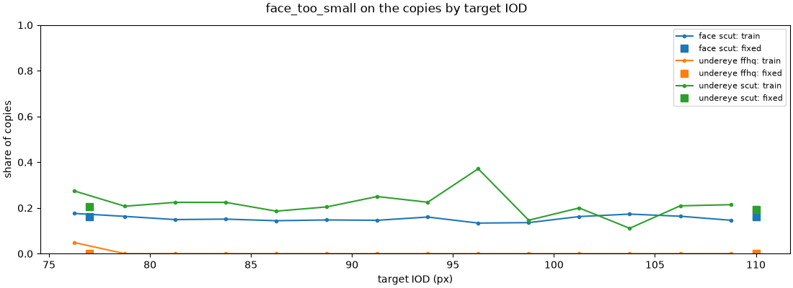
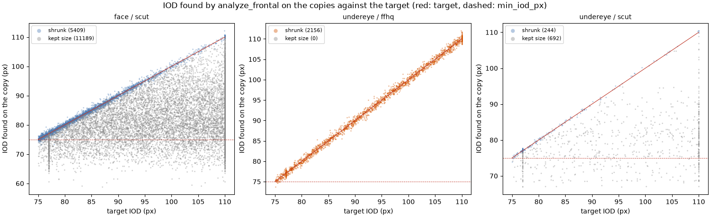

# ตรวจ feature ของ DINOv2

สร้างด้วย `uv run python model/scripts/extract_features.py report` จาก `data/features/` รายงานนี้มีเฉพาะตัวเลขและกราฟ ภาพตรวจที่มีใบหน้าอยู่ใน `features_check/` ของโฟลเดอร์ outputs ซึ่งห้าม commit

- backbone `dinov2_vitb14` แบบแช่แข็ง ภาพ 224×224 โค้ด commit `7764ea0f912e` น้ำหนัก sha256 `0b8b82f85de9…`
- feature: `cls` 768 มิติ, `cls_mean` 1,536 มิติ, `grid4` 12,288 มิติ
- ครอปรุ่น 1 การย่อภาพรุ่น 2 ช่วง IOD ที่เทรน 75–110 px สำเนา fixed ที่ IOD 77 และ 110 px
- Python 3.12.16, torch 2.15.0, mediapipe 1.2.0, facemeasure 0.1.0 อุปกรณ์ที่ดึง feature: mps
- ทุกสำเนาผ่าน `degrade.degrade` แล้ว `model_input.analyze_for_model` ซึ่งเป็นทางเข้าเดียวกับ api

## จำนวนครอป

หนึ่งแถวต่อครอป ใต้ตานับสองข้างแยกกัน ชุดของ face มาจาก `scut_labels.csv` และของ undereye มาจาก `manifest.csv`

### face

| แหล่ง | ชุด | ชนิด | สำเนา | ครอป | มี feature |
| --- | --- | --- | --- | --- | --- |
| scut | train | train | 1 | 2803 | 2803 |
| scut | train | train | 2 | 2803 | 2803 |
| scut | train | train | 3 | 2803 | 2803 |
| scut | train | train | 4 | 2803 | 2803 |
| scut | val | fixed | 1 | 495 | 495 |
| scut | val | fixed | 2 | 495 | 495 |
| scut | test | fixed | 1 | 2198 | 2198 |
| scut | test | fixed | 2 | 2198 | 2198 |
| **รวม** |  |  |  | 16598 | 16598 |

| กลุ่ม | train | val | test |
| --- | --- | --- | --- |
| AF | 4104 | 362 | 1584 |
| AM | 4044 | 356 | 1620 |
| CF | 1576 | 140 | 570 |
| CM | 1488 | 132 | 622 |

### undereye

| แหล่ง | ชุด | ชนิด | สำเนา | ครอป | มี feature |
| --- | --- | --- | --- | --- | --- |
| ffhq | train | train | 1 | 628 | 628 |
| ffhq | train | train | 2 | 628 | 628 |
| ffhq | train | train | 3 | 628 | 628 |
| ffhq | train | train | 4 | 628 | 628 |
| ffhq | train | train | 5 | 628 | 628 |
| ffhq | train | train | 6 | 628 | 628 |
| ffhq | val | fixed | 1 | 136 | 136 |
| ffhq | val | fixed | 2 | 136 | 136 |
| ffhq | test | fixed | 1 | 136 | 136 |
| ffhq | test | fixed | 2 | 136 | 136 |
| scut | train | train | 1 | 212 | 212 |
| scut | train | train | 2 | 212 | 212 |
| scut | train | train | 3 | 212 | 212 |
| scut | train | train | 4 | 212 | 212 |
| scut | train | train | 5 | 212 | 212 |
| scut | train | train | 6 | 212 | 212 |
| scut | train | fixed | 1 | 212 | 212 |
| scut | train | fixed | 2 | 212 | 212 |
| scut | val | fixed | 1 | 44 | 44 |
| scut | val | fixed | 2 | 44 | 44 |
| scut | test | fixed | 1 | 44 | 44 |
| scut | test | fixed | 2 | 44 | 44 |
| **รวม** |  |  |  | 6184 | 6184 |

## สำเนาที่ไม่พบใบหน้าแยกตาม IOD เป้าหมาย

นับสำเนา (ไม่นับข้างของใต้ตาซ้ำ) สำเนาแบบ train แบ่งช่วงเป้าหมายละ 5 px

| งาน | แหล่ง | สำเนา | n | ไม่พบใบหน้า |
| --- | --- | --- | --- | --- |
| face | scut | fixed 77 | 2693 | 0 (0.0%) |
| face | scut | fixed 110 | 2693 | 0 (0.0%) |
| face | scut | train 75–80 | 1661 | 0 (0.0%) |
| face | scut | train 80–85 | 1618 | 0 (0.0%) |
| face | scut | train 85–90 | 1570 | 0 (0.0%) |
| face | scut | train 90–95 | 1558 | 0 (0.0%) |
| face | scut | train 95–100 | 1528 | 0 (0.0%) |
| face | scut | train 100–105 | 1610 | 0 (0.0%) |
| face | scut | train 105–110 | 1667 | 0 (0.0%) |
| undereye | ffhq | fixed 77 | 136 | 0 (0.0%) |
| undereye | ffhq | fixed 110 | 136 | 0 (0.0%) |
| undereye | ffhq | train 75–80 | 261 | 0 (0.0%) |
| undereye | ffhq | train 80–85 | 270 | 0 (0.0%) |
| undereye | ffhq | train 85–90 | 258 | 0 (0.0%) |
| undereye | ffhq | train 90–95 | 258 | 0 (0.0%) |
| undereye | ffhq | train 95–100 | 283 | 0 (0.0%) |
| undereye | ffhq | train 100–105 | 267 | 0 (0.0%) |
| undereye | ffhq | train 105–110 | 287 | 0 (0.0%) |
| undereye | scut | fixed 77 | 150 | 0 (0.0%) |
| undereye | scut | fixed 110 | 150 | 0 (0.0%) |
| undereye | scut | train 75–80 | 104 | 0 (0.0%) |
| undereye | scut | train 80–85 | 98 | 0 (0.0%) |
| undereye | scut | train 85–90 | 87 | 0 (0.0%) |
| undereye | scut | train 90–95 | 96 | 0 (0.0%) |
| undereye | scut | train 95–100 | 76 | 0 (0.0%) |
| undereye | scut | train 100–105 | 90 | 0 (0.0%) |
| undereye | scut | train 105–110 | 85 | 0 (0.0%) |

สำเนา fixed ที่ IOD ต่ำสุด (77 px) พบใบหน้า: face scut 100.00%, undereye ffhq 100.00%, undereye scut 100.00% เกณฑ์คือไม่ต่ำกว่า 99% ผล: **ผ่าน**

## รหัสคุณภาพของสำเนา

รหัสของบริเวณนั้นจากภาพที่ย่อแล้ว ซึ่งเป็นค่าคุณภาพจากรอบแรกของ `analyze_for_model` เหมือนที่ api รายงาน ครอปหนึ่งมีได้หลายรหัส
สำเนา fixed ชุดแรกตั้งไว้ที่ 77 px สูงกว่าเกณฑ์ `min_iod_px` (75 px) 2 px เพราะ IOD ที่วัดบนสำเนาคลาดได้ราว ±1.5% การย่อภาพรุ่น 1 ตั้งไว้เท่าเกณฑ์พอดี สำเนาชุดนี้จึงได้ `face_too_small` ราวครึ่งหนึ่ง `face_too_small` ที่ยังเหลือส่วนใหญ่มาจากภาพเดิมที่ใบหน้าเล็กกว่าเกณฑ์อยู่แล้ว ซึ่งไม่ถูกขยาย (ดูหัวข้อ IOD)

### face

| รหัส | scut fixed 77 jaw | scut fixed 77 nose_base | scut fixed 110 jaw | scut fixed 110 nose_base | scut train jaw | scut train nose_base |
| --- | --- | --- | --- | --- | --- | --- |
| no_face | 0 (0.0%) | 0 (0.0%) | 0 (0.0%) | 0 (0.0%) | 0 (0.0%) | 0 (0.0%) |
| multiple_faces | 0 (0.0%) | 0 (0.0%) | 0 (0.0%) | 0 (0.0%) | 0 (0.0%) | 0 (0.0%) |
| face_too_small | 434 (16.1%) | 434 (16.1%) | 434 (16.1%) | 434 (16.1%) | 1727 (15.4%) | 1727 (15.4%) |
| frontal_pose | 749 (27.8%) | 749 (27.8%) | 754 (28.0%) | 754 (28.0%) | 3134 (28.0%) | 3134 (28.0%) |
| smiling | 990 (36.8%) | 990 (36.8%) | 986 (36.6%) | 986 (36.6%) | 4013 (35.8%) | 4013 (35.8%) |
| eyes_closed | 0 (0.0%) | 0 (0.0%) | 0 (0.0%) | 0 (0.0%) | 0 (0.0%) | 0 (0.0%) |
| hair_occlusion | 519 (19.3%) | 0 (0.0%) | 505 (18.8%) | 0 (0.0%) | 2247 (20.0%) | 0 (0.0%) |
| ผ่านทุกข้อ | 907 (33.7%) | 1078 (40.0%) | 912 (33.9%) | 1081 (40.1%) | 3954 (35.3%) | 4660 (41.6%) |

### undereye

| รหัส | ffhq fixed 77 | ffhq fixed 110 | ffhq train | scut fixed 77 | scut fixed 110 | scut train |
| --- | --- | --- | --- | --- | --- | --- |
| no_face | 0 (0.0%) | 0 (0.0%) | 0 (0.0%) | 0 (0.0%) | 0 (0.0%) | 0 (0.0%) |
| multiple_faces | 0 (0.0%) | 0 (0.0%) | 10 (0.3%) | 0 (0.0%) | 0 (0.0%) | 0 (0.0%) |
| face_too_small | 0 (0.0%) | 0 (0.0%) | 12 (0.3%) | 62 (20.7%) | 58 (19.3%) | 276 (21.7%) |
| frontal_pose | 34 (12.5%) | 32 (11.8%) | 730 (19.4%) | 78 (26.0%) | 76 (25.3%) | 336 (26.4%) |
| smiling | 190 (69.9%) | 192 (70.6%) | 2748 (72.9%) | 98 (32.7%) | 98 (32.7%) | 414 (32.5%) |
| eyes_closed | 0 (0.0%) | 0 (0.0%) | 0 (0.0%) | 2 (0.7%) | 2 (0.7%) | 10 (0.8%) |
| hair_occlusion | 1 (0.4%) | 1 (0.4%) | 6 (0.2%) | 0 (0.0%) | 0 (0.0%) | 0 (0.0%) |
| ผ่านทุกข้อ | 63 (23.2%) | 63 (23.2%) | 808 (21.4%) | 142 (47.3%) | 146 (48.7%) | 614 (48.3%) |

## IOD ที่ได้จริงเทียบกับเป้าหมาย

IOD ที่ได้จริงคือค่าที่ `analyze_frontal` วัดบนสำเนา ภาพที่ใบหน้าเดิมเล็กกว่าเป้าหมายไม่ถูกขยาย จึงเทียบกับ IOD ของภาพเดิมแทน สำเนาที่วัดได้เกิน 110 px ถูก `analyze_for_model` ย่ออีกรอบก่อนครอป เหมือนที่ api ทำ

| งาน | แหล่ง | การย่อ | n | มัธยฐาน | p5 | p95 | คลาด ≤ 1% | คลาด ≤ 2% | เกิน 110 px |
| --- | --- | --- | --- | --- | --- | --- | --- | --- | --- |
| face | scut | ไม่ย่อ (เทียบภาพเดิม) | 11189 | +0.13% | -0.76% | +1.08% | 90.9% | 99.2% | 2 |
| face | scut | ย่อ (เทียบเป้าหมาย) | 5409 | +0.10% | -0.80% | +0.97% | 91.8% | 99.0% | 45 |
| undereye | ffhq | ย่อ (เทียบเป้าหมาย) | 2156 | +0.03% | -1.00% | +1.07% | 88.5% | 99.5% | 85 |
| undereye | scut | ไม่ย่อ (เทียบภาพเดิม) | 692 | +0.14% | -0.36% | +0.76% | 98.4% | 100.0% | 0 |
| undereye | scut | ย่อ (เทียบเป้าหมาย) | 244 | +0.11% | -0.46% | +0.67% | 99.2% | 100.0% | 4 |

สำเนา fixed ชุดแรก (เป้าหมาย 77 px) ที่วัดได้ต่ำกว่าเกณฑ์ `min_iod_px` 75 px

| งาน | แหล่ง | ย่อ n | ย่อแล้วต่ำกว่าเกณฑ์ | ไม่ย่อ n | ไม่ย่อและต่ำกว่าเกณฑ์ |
| --- | --- | --- | --- | --- | --- |
| face | scut | 2050 | 0 (0.0%) | 643 | 434 (67.5%) |
| undereye | ffhq | 136 | 0 (0.0%) | 0 | 0 |
| undereye | scut | 102 | 0 (0.0%) | 48 | 31 (64.6%) |

## เวลาและความตรงของ feature

### เวลาต่อครอป

DINOv2 ViT-B/14 บน mps ชุดละ 32 และบน cpu ชุดละ 8 ครอปจริง 64 ครอป มัธยฐานของ 3 รอบหลังอุ่นเครื่อง ใช้ 4 thread บน CPU

เวลาขึ้นกับความร้อนของเครื่อง เครื่องที่ไม่มีพัดลม เช่น MacBook Air ช้าลงได้หลายเท่าเมื่อรันต่อจากงานหนัก ถ้าจะใช้ตัวเลขในหัวข้อนี้ตัดสินใจเรื่องขนาดของ DINOv2 (api.md หัวข้อ 7) ให้รัน report ตอนเครื่องเย็น

| อุปกรณ์ | ms ต่อครอป |
| --- | --- |
| mps | 72.2 |
| cpu | 126.9 |

### หนึ่งคำขอของ api

`analyze_for_model` (MediaPipe) แล้ว DINOv2 กับสามครอปในชุดเดียว มัธยฐานของ 10 ภาพหลังอุ่นเครื่อง 2 ภาพ ยังไม่รวมการอ่านภาพ การหาเส้นขอบภาพด้านข้าง และการรันหัว (หัวเป็นชั้นเชิงเส้นซึ่งเร็วมาก)

| ภาพ | DINOv2 บน | MediaPipe (ms) | DINOv2 3 ครอป (ms) | รวม (ms) | รวมสูงสุด (ms) |
| --- | --- | --- | --- | --- | --- |
| FFHQ 1024×1024 IOD ราว 245 px (ย่อเหลือ 110 px แล้วหาจุดสองรอบ) | mps | 653 | 123 | 776 | 838 |
| FFHQ 1024×1024 IOD ราว 245 px (ย่อเหลือ 110 px แล้วหาจุดสองรอบ) | cpu | 711 | 294 | 1005 | 1110 |
| เฟรม 1920×1080 IOD 100 px (หาจุดรอบเดียว) | mps | 215 | 127 | 340 | 394 |
| เฟรม 1920×1080 IOD 100 px (หาจุดรอบเดียว) | cpu | 314 | 333 | 651 | 808 |

MediaPipe รันบน CPU ทุกกรณี คอลัมน์ "DINOv2 บน" บอกอุปกรณ์ของ DINOv2 เท่านั้น

### feature จาก CPU เทียบกับอุปกรณ์ที่ใช้

ครอปเดียวกัน 64 ครอป (32 ทั้งใบหน้า และ 32 ใต้ตา) ที่สร้างขึ้นใหม่จาก seed ผ่าน `analyze_for_model` สามแถวล่างเทียบ feature จากอุปกรณ์ที่ใช้กับที่เก็บไว้ใน shard ซึ่งเป็นการตรวจ "ความตรงกับตอนเตรียมข้อมูล" ขั้นแรก (api.md หัวข้อ 7) grid4 เก็บเป็น float16

| เทียบ | feature | cosine ต่ำสุด | มัธยฐาน |
| --- | --- | --- | --- |
| cpu กับ mps | cls | 0.9999998 | 1.0000000 |
| cpu กับ mps | cls_mean | 0.9999998 | 1.0000000 |
| cpu กับ mps | grid4 | 0.9999999 | 1.0000000 |
| mps สร้างใหม่กับที่เก็บไว้ | cls | 0.9999999 | 1.0000000 |
| mps สร้างใหม่กับที่เก็บไว้ | cls_mean | 0.9999999 | 1.0000000 |
| mps สร้างใหม่กับที่เก็บไว้ | grid4 | 0.9999999 | 1.0000000 |

## ขนาดไฟล์

| งาน | shard | shard (MB) | index และไฟล์อื่น (MB) |
| --- | --- | --- | --- |
| face | 17 | 583.5 | 1.93 |
| undereye | 7 | 215.2 | 0.57 |

รวม `data/features/{face,undereye}/` และ `meta.json` 801.2 MB ไม่บีบอัด เพื่อให้อ่านเร็ว
