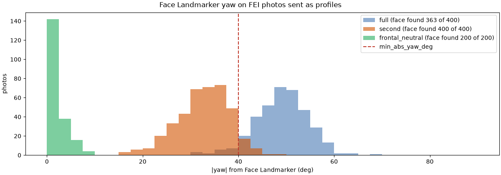
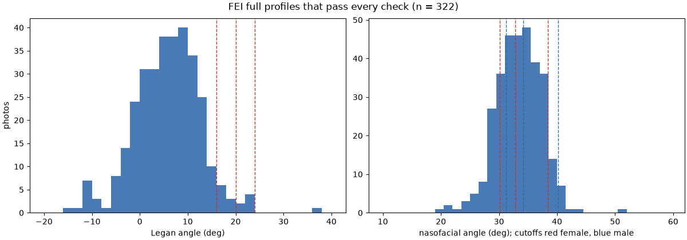
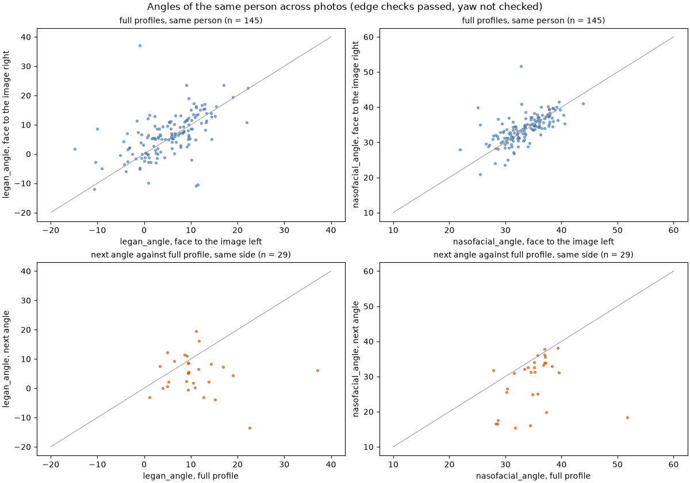
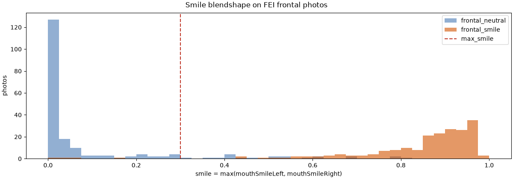

# ตรวจการหาเส้นขอบภาพด้านข้างกับ FEI

สร้างด้วย `uv run python model/scripts/profile_check.py run` ทุกภาพผ่าน `facemeasure.profile.analyze_profile` ซึ่งเป็นฟังก์ชันเดียวกับที่ api เรียก (mediapipe 1.2.0) เกณฑ์มาจาก `shared/quality.json` (`min_abs_yaw_deg` = 40) รายงานนี้มีเฉพาะตัวเลขและกราฟ ภาพ FEI ห้ามแจกจ่าย ภาพตรวจจึงอยู่ใน `fei_profile_check/` ของโฟลเดอร์ outputs เท่านั้น

- เลขท่าที่ใช้: ด้านข้างเต็ม 1 (หน้าหันไปทางซ้ายของภาพ) กับ 10 (ขวาของภาพ), มุมรองลงมา 2 กับ 9, หน้าตรงปกติ 11, หน้าตรงยิ้ม 12
- "วัดได้" คือไม่มีรหัสที่ไม่ผ่าน ส่วน "เส้นขอบผ่าน" คือหาจุดและผ่านการตรวจความสมเหตุสมผลของเส้นขอบ โดยไม่นับเกณฑ์ yaw ภาพที่เส้นขอบผ่านมีมุมเสมอ ซึ่งโหมดทดลองแสดงได้
- FEI ไม่มีป้ายเพศรายภาพในไฟล์ที่โหลด จึงรายงานเส้นแบ่งของสันจมูกทั้งของหญิงและของชาย

## ภาพด้านข้างเต็ม

|  | ภาพ | วัดได้ | เส้นขอบผ่าน | ไม่พบใบหน้า | พบใบหน้าที่ \|yaw\| < 40° |
| --- | --- | --- | --- | --- | --- |
| ด้านข้างเต็ม | 400 | 322 (80.5%) | 325 (81.2%) | 37 (9.2%) | 18 (4.5%) |
| มุมรองลงมา | 400 | 17 (4.2%) | 29 (7.2%) | 0 (0.0%) | 374 (93.5%) |
| หน้าตรงทั้งสองแบบ | 400 | 0 (0.0%) | 0 (0.0%) | 0 (0.0%) | 400 (100.0%) |

เหตุที่เส้นขอบไม่ผ่าน (ไม่นับ `frontal_yaw`) ของภาพด้านข้างเต็ม

| เหตุ | ความหมาย | ภาพ |
| --- | --- | --- |
| `no_forehead` | ขอบหน้าผากไม่ใช่ผิว หรือ G ไม่อยู่หน้าร่องโคนจมูก เช่น แว่นหรือผมบังหน้าผาก หรือหันไม่ถึง | 63 |
| `nose_shallow` | ปลายจมูกยื่นจากเส้น G–Pog น้อยกว่าเกณฑ์ | 8 |
| `no_subnasale` | หา Sn หรือคางใต้จมูกไม่ได้ | 4 |

### เกณฑ์ yaw ที่ระดับต่าง ๆ

สัดส่วนที่ผ่านเกณฑ์ yaw (ไม่พบใบหน้า หรือพบที่ |yaw| ถึงเกณฑ์) และสัดส่วนที่วัดได้เมื่อรวมการตรวจเส้นขอบ

| เกณฑ์ \|yaw\| | ด้านข้างเต็ม ผ่าน yaw | ด้านข้างเต็ม วัดได้ | มุมรองลงมา ผ่าน yaw | หน้าตรง ผ่าน yaw |
| --- | --- | --- | --- | --- |
| 30° | 400 (100.0%) | 325 (81.2%) | 288 (72.0%) | 0 (0.0%) |
| 35° | 395 (98.8%) | 325 (81.2%) | 148 (37.0%) | 0 (0.0%) |
| 40° (ปัจจุบัน) | 382 (95.5%) | 322 (80.5%) | 26 (6.5%) | 0 (0.0%) |
| 45° | 322 (80.5%) | 277 (69.2%) | 2 (0.5%) | 0 (0.0%) |
| 50° | 199 (49.8%) | 175 (43.8%) | 0 (0.0%) | 0 (0.0%) |
| 55° | 84 (21.0%) | 74 (18.5%) | 0 (0.0%) | 0 (0.0%) |
| 60° | 42 (10.5%) | 36 (9.0%) | 0 (0.0%) | 0 (0.0%) |

## มุมของภาพด้านข้างเต็มที่วัดได้

| มุม | ชุด | n | p10 | มัธยฐาน | p90 |
| --- | --- | --- | --- | --- | --- |
| มุม Legan | วัดได้ | 322 | -2.6 | 6.1 | 13.4 |
| มุม Legan | เส้นขอบผ่าน | 325 | -2.6 | 6.0 | 13.3 |
| มุม nasofacial | วัดได้ | 322 | 28.5 | 33.5 | 37.9 |
| มุม nasofacial | เส้นขอบผ่าน | 325 | 28.5 | 33.5 | 37.9 |

สัดส่วนต่อเกรดตามเส้นแบ่งของ model.md (ภาพที่วัดได้) ยังไม่มีช่วงก้ำกึ่ง ซึ่งกำหนดใน `facemeasure.criteria`

| มุม Legan | ภาพ |
| --- | --- |
| 0 (≤ 16°) | 306 (95.0%) |
| 1 (16–20°) | 9 (2.8%) |
| 2 (20–24°) | 6 (1.9%) |
| 3 (> 24°) | 1 (0.3%) |

| เกรดสันจมูก | ช่วงของหญิง | ภาพ | ช่วงของชาย | ภาพ |
| --- | --- | --- | --- | --- |
| 0 | 32.8–38.4° | 158 (49.1%) | 34.2–40.2° | 136 (42.2%) |
| 1 (จมูกยื่นน้อย) | 30.1–32.8° | 77 (23.9%) | 31.2–34.2° | 88 (27.3%) |
| 1 (จมูกยื่นมาก) | > 38.4° | 27 (8.4%) | > 40.2° | 8 (2.5%) |
| 2+ | < 30.1° | 60 (18.6%) | < 31.2° | 90 (28.0%) |

## ความคลาดเคลื่อนจากการถ่ายและการหาจุด

ค่าต่างสัมบูรณ์ของมุมระหว่างภาพสองภาพของคนเดียวกัน เฉพาะภาพที่เส้นขอบผ่าน เพราะเกณฑ์ yaw ไม่เปลี่ยนตำแหน่งจุด

| คู่ภาพ | มุม | คู่ | เฉลี่ย | มัธยฐาน | p90 | สูงสุด |
| --- | --- | --- | --- | --- | --- | --- |
| ด้านข้างเต็ม ซ้าย กับ ขวาของภาพ | Legan | 145 | 4.3 | 3.0 | 9.5 | 38.0 |
| ด้านข้างเต็ม ซ้าย กับ ขวาของภาพ | nasofacial | 145 | 2.2 | 1.5 | 4.6 | 18.9 |
| มุมรองลงมา กับ ด้านข้างเต็ม ข้างเดียวกัน | Legan | 29 | 8.5 | 5.1 | 16.5 | 36.0 |
| มุมรองลงมา กับ ด้านข้างเต็ม ข้างเดียวกัน | nasofacial | 29 | 6.7 | 3.8 | 16.6 | 33.3 |

ค่าเฉลี่ยของ (มุมรองลงมา − ด้านข้างเต็ม): Legan -6.3° nasofacial -6.4°

## ภาพมุมรองลงมาและภาพหน้าตรงที่ส่งเป็นภาพด้านข้าง

- มุมรองลงมาผ่านเกณฑ์ 40°: 26 (6.5%) และวัดได้ 17 (4.2%)
- ภาพหน้าตรงได้ `profile_invalid`: 400 (100.0%)

เหตุของภาพหน้าตรง (ภาพหนึ่งมีได้หลายเหตุ)

| เหตุ | ภาพ |
| --- | --- |
| `frontal_yaw` | 400 |
| `no_forehead` | 398 |
| `no_subnasale` | 2 |

## การตรวจความสมเหตุสมผลของเส้นขอบ

ค่าคงที่ใน `facemeasure/profile.py` ตั้งจากการกระจายนี้ ค่าของภาพที่เส้นขอบผ่าน

| ค่า | ภาพ | n | ต่ำสุด | p1 | มัธยฐาน | p99 | สูงสุด |
| --- | --- | --- | --- | --- | --- | --- | --- |
| Prn หน้าเส้น G–Pog ÷ \|G–Pog\| | ด้านข้างเต็ม | 325 | 0.052 | 0.061 | 0.137 | 0.238 | 0.267 |
| Prn หน้าเส้น G–Pog ÷ \|G–Pog\| | มุมรองลงมา | 29 | 0.056 | 0.057 | 0.085 | 0.152 | 0.155 |
| \|G–Pog\| ÷ ความสูงผิวหน้า | ด้านข้างเต็ม | 325 | 0.485 | 0.491 | 0.600 | 0.776 | 0.873 |
| \|G–Pog\| ÷ ความสูงผิวหน้า | มุมรองลงมา | 29 | 0.509 | 0.513 | 0.610 | 0.717 | 0.728 |
| มุม Legan | ด้านข้างเต็ม | 325 | -14.8 | -10.9 | 6.0 | 22.5 | 37.1 |
| มุม Legan | มุมรองลงมา | 29 | -13.4 | -10.8 | 5.4 | 18.6 | 19.5 |
| มุม nasofacial | ด้านข้างเต็ม | 325 | 19.3 | 23.6 | 33.5 | 41.0 | 51.7 |
| มุม nasofacial | มุมรองลงมา | 29 | 15.4 | 15.6 | 31.3 | 38.1 | 38.2 |

| ค่าคงที่ | ค่า |
| --- | --- |
| `MIN_NOSE_DEPTH` | 0.05 |
| `MIN_FACIAL_LINE` | 0.4 |
| `LEGAN_RANGE` | (-15.0, 40.0) |
| `NASOFACIAL_RANGE` | (15.0, 60.0) |

## ค่า smile ของภาพหน้าตรง

ใช้ประกอบการปรับเกณฑ์ `max_smile` ใน `shared/quality.json` ซึ่งสคริปต์นี้ไม่แก้เอง `smiling` ไม่ผ่านเมื่อ smile หรือ jawOpen เกินเกณฑ์

| ภาพ | พบใบหน้า | smile p10 | มัธยฐาน | p90 | ได้ `smiling` ที่เกณฑ์ปัจจุบัน |
| --- | --- | --- | --- | --- | --- |
| หน้าตรงปกติ | 200 | 0.00 | 0.01 | 0.33 | 21 (10.5%) |
| หน้าตรงยิ้ม | 200 | 0.65 | 0.89 | 0.96 | 197 (98.5%) |

| smile เกิน | หน้าตรงปกติ | หน้าตรงยิ้ม |
| --- | --- | --- |
| 0.2 | 33 (16.5%) | 196 (98.0%) |
| 0.25 | 27 (13.5%) | 196 (98.0%) |
| 0.3 (ปัจจุบัน) | 21 (10.5%) | 196 (98.0%) |
| 0.35 | 20 (10.0%) | 196 (98.0%) |
| 0.4 | 18 (9.0%) | 196 (98.0%) |
| 0.5 | 12 (6.0%) | 193 (96.5%) |

