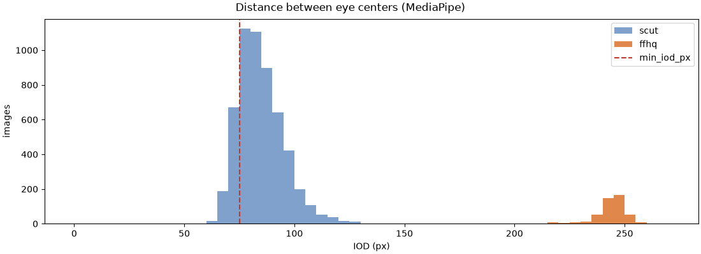
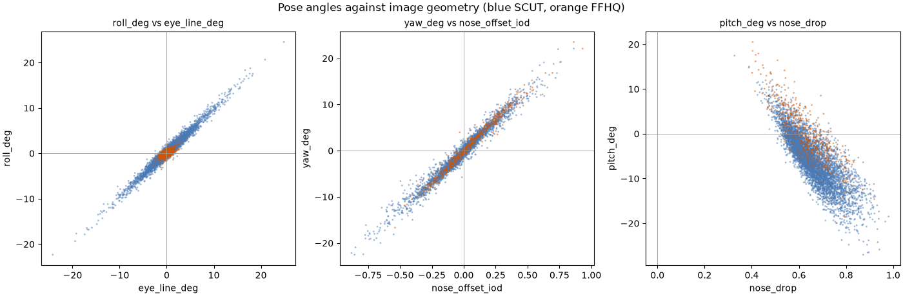
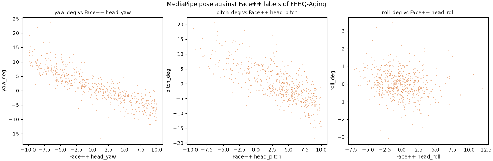
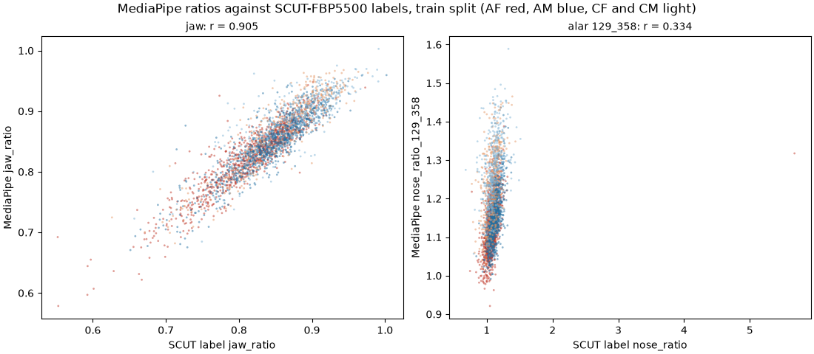
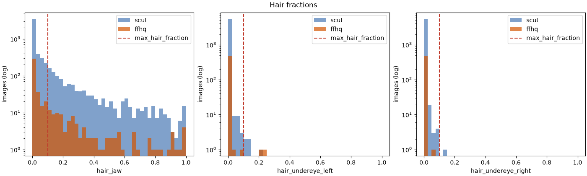

# ตรวจโค้ดวัดค่าภาพหน้าตรงกับ SCUT-FBP5500 และ FFHQ

สร้างด้วย `uv run python model/scripts/frontal_check.py` ทุกภาพผ่าน `facemeasure.frontal.analyze_frontal` ซึ่งเป็นฟังก์ชันเดียวกับที่ api เรียก (ครอปรุ่น 1, mediapipe 1.2.0) เกณฑ์คุณภาพมาจาก `shared/quality.json` รายงานนี้มีเฉพาะตัวเลขและกราฟ ภาพตรวจที่มีใบหน้าอยู่ใน `frontal_check/` ของโฟลเดอร์ outputs ซึ่งห้าม commit

- SCUT-FBP5500 ทุกภาพ และ FFHQ เฉพาะบทบาท graded กับ practice ใน manifest ของชุดเกรด
- ค่าคุณภาพและอัตราส่วนวัดจากใบหน้าที่ระยะระหว่างตามากที่สุด ภาพที่พบสองใบหน้าจึงมีค่าด้วย
- อัตราส่วนจากจุดของ MediaPipe ยังไม่ปรับด้วยสมการเส้นตรง (train_ratio_heads.py)

## จำนวนใบหน้าที่พบ

| แหล่ง | ภาพ | อ่านไม่ได้ | 0 ใบหน้า | 1 ใบหน้า | 2 ใบหน้า | 1 ใบหน้า (%) |
| --- | --- | --- | --- | --- | --- | --- |
| scut | 5500 | 0 | 0 | 5500 | 0 | 100.00% |
| ffhq | 468 | 0 | 0 | 467 | 1 | 99.79% |

ภาพของ ffhq ที่ไม่ได้พบหนึ่งใบหน้า: 08302.png (2)

## รหัสที่ไม่ผ่าน

นับภาพ ภาพหนึ่งมีได้หลายรหัส

| รหัส | scut | ffhq |
| --- | --- | --- |
| no_face | 0 (0.0%) | 0 (0.0%) |
| multiple_faces | 0 (0.0%) | 1 (0.2%) |
| face_too_small | 874 (15.9%) | 0 (0.0%) |
| frontal_pose | 1532 (27.9%) | 78 (16.7%) |
| smiling | 2021 (36.7%) | 339 (72.4%) |
| eyes_closed | 5 (0.1%) | 0 (0.0%) |
| hair_occlusion | 1113 (20.2%) | 105 (22.4%) |
| ผ่านทุกข้อ | 1865 (33.9%) | 89 (19.0%) |

## ระยะระหว่างตา (IOD)

เฉพาะภาพที่พบใบหน้า `extract_features.py` ใช้เลือกขนาดใบหน้าตอนเทรน

| แหล่ง | n | p5 | p50 | p95 | ต่ำกว่า 75 px |
| --- | --- | --- | --- | --- | --- |
| scut | 5500 | 70.8 | 83.2 | 103.5 | 874 (15.9%) |
| ffhq | 468 | 227.9 | 244.8 | 252.7 | 0 (0.0%) |

## การกระจายของค่าคุณภาพ

p5 / p50 / p95 ของภาพที่พบใบหน้า เทียบกับเกณฑ์ใน `shared/quality.json`

| ค่า | เกณฑ์ | scut | ffhq |
| --- | --- | --- | --- |
| yaw_deg | ±10 | -7.86 / -0.32 / 6.84 | -7.55 / 0.87 / 11.00 |
| pitch_deg | ±10 | -14.94 / -5.65 / 2.74 | -8.95 / -0.90 / 10.95 |
| roll_deg | ±8 | -4.58 / 0.37 / 5.66 | -1.14 / -0.03 / 1.19 |
| smile | ≤ 0.3 | 0.00 / 0.03 / 0.93 | 0.00 / 0.76 / 0.97 |
| jaw_open | ≤ 0.2 | 0.00 / 0.00 / 0.13 | 0.00 / 0.02 / 0.20 |
| blink_max | ≤ 0.5 | 0.02 / 0.11 / 0.25 | 0.04 / 0.15 / 0.31 |

## เครื่องหมายของท่าเทียบเรขาคณิตบนภาพ

Pearson r ระหว่างมุมจาก transformation matrix กับค่าที่วัดจากตำแหน่งจุดบนภาพ ทุกภาพที่พบใบหน้า ถ้าสูตรใน `facemeasure.pose` ให้ทิศตามนิยาม r ของ roll และ yaw ต้องเป็นบวก และของ pitch ต้องเป็นลบ เพราะเมื่อเงย ปลายจมูกเข้าใกล้ระดับตา

| การตรวจ | n | r | ทิศที่ต้องได้ | ผล |
| --- | --- | --- | --- | --- |
| roll เทียบมุมของเส้นระหว่างกลางตา | 5968 | 0.982 | บวก | ตรง |
| yaw เทียบระยะแนวนอนจากกึ่งกลางของจุด 234 กับ 454 ถึงปลายจมูก ÷ IOD | 5968 | 0.982 | บวก | ตรง |
| pitch เทียบระยะแนวตั้งจากกลางตาถึงปลายจมูก ÷ ระยะจากกลางตาถึงมุมปาก | 5968 | -0.815 | ลบ | ตรง |

## เทียบท่ากับป้ายของ Face++ (FFHQ-Aging)

ภาพ FFHQ ที่พบใบหน้า ป้ายนี้มาจากเครื่องมืออีกตัว ไม่ใช่คำตอบที่ถูกแน่นอน (api.md หัวข้อ 7) ภาพชุดเกรดคัดมาให้ Face++ yaw และ pitch อยู่ใน ±10° ช่วงค่าจึงแคบ เครื่องหมายที่พบคือทิศของ r ค่าต่างคำนวณหลังกลับเครื่องหมายของ Face++ ให้ตรงกับของเราแล้ว

| ของเรา | Face++ | n | Pearson r | เครื่องหมาย | ค่าต่างเฉลี่ยสัมบูรณ์ (°) | ค่าต่างเฉลี่ย ของเรา − Face++ (°) |
| --- | --- | --- | --- | --- | --- | --- |
| yaw_deg | head_yaw | 468 | -0.858 | ตรงข้าม | 2.74 | 1.89 |
| pitch_deg | head_pitch | 468 | -0.742 | ตรงข้าม | 4.14 | 3.30 |
| roll_deg | head_roll | 468 | -0.191 | ตรงข้าม | 2.11 | -0.16 |

## อัตราส่วนจากจุดของ MediaPipe เทียบ label ของ SCUT-FBP5500

ชุด train ของ `scut_labels.csv` เท่านั้น (ไม่รวม val และ test) ทุกภาพที่พบใบหน้า และเฉพาะภาพที่ผ่านเกณฑ์คุณภาพทุกข้อ อัตราส่วนฐานจมูกของทุกคู่ใช้หัวตา 133 กับ 362

| ค่าวัด | n | r | r AF | r AM | r CF | r CM | n ผ่านเกณฑ์ | r ผ่านเกณฑ์ | เฉลี่ย MediaPipe | เฉลี่ย label |
| --- | --- | --- | --- | --- | --- | --- | --- | --- | --- | --- |
| jaw | 2803 | 0.905 | 0.916 | 0.892 | 0.906 | 0.818 | 976 | 0.869 | 0.847 | 0.840 |
| alar 98_327 | 2803 | 0.323 | 0.334 | 0.538 | 0.534 | 0.378 | 976 | 0.490 | 0.962 | 1.098 |
| alar 64_294 | 2803 | 0.330 | 0.335 | 0.553 | 0.533 | 0.372 | 976 | 0.493 | 1.070 | 1.098 |
| **alar 129_358** | 2803 | 0.334 | 0.342 | 0.546 | 0.528 | 0.369 | 976 | 0.488 | 1.172 | 1.098 |
| alar 102_331 | 2803 | 0.332 | 0.336 | 0.549 | 0.526 | 0.361 | 976 | 0.490 | 1.138 | 1.098 |
| alar 48_278 | 2803 | 0.318 | 0.321 | 0.548 | 0.513 | 0.356 | 976 | 0.477 | 1.053 | 1.098 |
| alar 240_460 | 2803 | 0.321 | 0.328 | 0.541 | 0.532 | 0.377 | 976 | 0.489 | 0.855 | 1.098 |
| alar 235_455 | 2803 | 0.321 | 0.326 | 0.550 | 0.528 | 0.371 | 976 | 0.485 | 0.937 | 1.098 |

คู่จุดฐานจมูกที่ตั้งใน `mp_points.ALAR_BASE`: 98_327

ทุกคู่มี r ต่างกันไม่เกินความคลาดเคลื่อนจากการสุ่มตัวอย่าง จึงเลือกคู่ที่อยู่ตรงนิยามของ model.md หัวข้อ 3.4 คือจุดนอกสุดของฐานปีกจมูกตรงที่ต่อกับริมฝีปาก ส่วนคู่ที่ r สูงสุดอยู่บนสุดของร่องปีกจมูก

## สัดส่วนผม

ภาพที่พบใบหน้า เกณฑ์คือไม่เกิน 0.1 แถบกรามอยู่ด้านในเส้นขอบหน้า กว้าง 0.05 × IOD จากกึ่งกลางระหว่างระดับตากับใต้จมูก ลงไปถึงกึ่งกลางระหว่างระดับมุมปากกับปลายคาง (`facemeasure.quality`)

| ค่า | แหล่ง | n | p50 | p90 | p95 | p99 | เกินเกณฑ์ |
| --- | --- | --- | --- | --- | --- | --- | --- |
| hair_jaw | scut | 5500 | 0.002 | 0.241 | 0.435 | 0.825 | 1113 (20.2%) |
| hair_jaw | ffhq | 468 | 0.002 | 0.285 | 0.528 | 0.940 | 105 (22.4%) |
| hair_undereye_left | scut | 5500 | 0.000 | 0.000 | 0.000 | 0.007 | 5 (0.1%) |
| hair_undereye_left | ffhq | 468 | 0.000 | 0.000 | 0.000 | 0.012 | 2 (0.4%) |
| hair_undereye_right | scut | 5500 | 0.000 | 0.000 | 0.000 | 0.007 | 1 (0.0%) |
| hair_undereye_right | ffhq | 468 | 0.000 | 0.000 | 0.000 | 0.001 | 0 (0.0%) |

