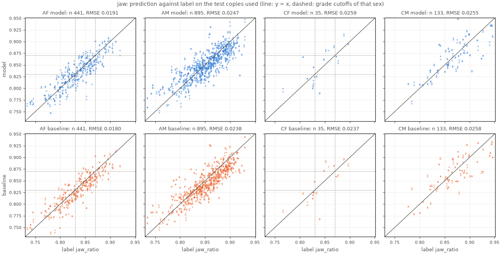
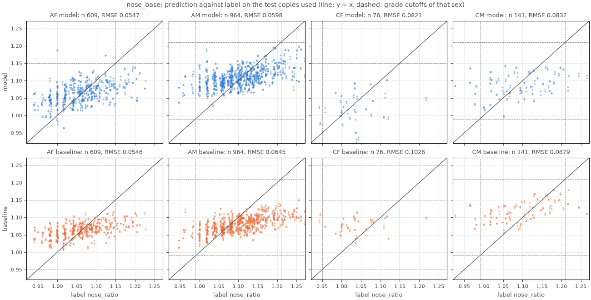

# หัวกรามและหัวฐานจมูก

สร้างด้วย `uv run python model/scripts/train_ratio_heads.py` (`select`, `evaluate`, `wu2021`, `bundle`) รายงานนี้มีเฉพาะตัวเลขและกราฟ ไม่มีภาพใบหน้า

- ridge regression บน feature ของ `dinov2_vitb14` แบบแช่แข็งจากครอปทั้งใบหน้า standardize ด้วย mean และ std ของชุด train (std ต่ำสุด 1e-06) แล้วรวมเข้าไปใน w และ b ด้วย float64 ก่อนบันทึก (model.md หัวข้อ 2.3 และ 6)
- ครอปรุ่น 1 การย่อภาพรุ่น 2 ช่วง IOD ที่เทรน 75.0–110.0 px
- อัตราส่วนเป็นสัดส่วน ไม่ใช่เปอร์เซ็นต์ ค่าคลาดเฉลี่ยเขียนเป็นจุดเปอร์เซ็นต์ (pp)

## จำนวนข้อมูล

แต่ละช่องคือจำนวนแถว (สำเนา) / จำนวนภาพ ชุด train ใช้ทุกสำเนา ชุด val และ test ใช้เฉพาะสำเนาที่ผ่านเกณฑ์คุณภาพของบริเวณนั้น (`reasons_jaw` หรือ `reasons_nose_base` ว่าง)

| หัว | ชุด | AF | AM | CF | CM | รวม |
| --- | --- | --- | --- | --- | --- | --- |
| กราม | train | 4104 / 1026 | 4044 / 1011 | 1576 / 394 | 1488 / 372 | 11212 / 2803 |
| กราม | val | 78 / 41 | 197 / 100 | 3 / 2 | 37 / 19 | 315 / 162 |
| กราม | test | 441 / 231 | 895 / 455 | 35 / 18 | 133 / 67 | 1504 / 771 |
| ฐานจมูก | train | 4104 / 1026 | 4044 / 1011 | 1576 / 394 | 1488 / 372 | 11212 / 2803 |
| ฐานจมูก | val | 111 / 56 | 206 / 104 | 15 / 8 | 37 / 19 | 369 / 187 |
| ฐานจมูก | test | 609 / 310 | 964 / 489 | 76 / 38 | 141 / 71 | 1790 / 908 |

## การเลือกชนิด feature และ alpha

ลองทุกชนิด feature กับ alpha 0.01, 0.1, 1, 10, 100, 1000, 10000, 100000 เทรนด้วยทุกสำเนาของชุด train แล้ววัด RMSE บนชุด val ที่รวมสองสำเนา เลือกค่าที่ RMSE ต่ำสุด แต่ถ้าต่างกันไม่ถึง 1% เลือกชนิดที่มิติน้อยกว่าแล้ว alpha ที่มากกว่า ถ้า alpha ที่ดีที่สุดอยู่ที่ขอบ ขยายช่วงอีก 2 หลักหนึ่งครั้ง

### กราม

RMSE บนชุด val (ตัวหนาคือค่าที่เลือก)

| alpha | `cls` (768) | `cls_mean` (1536) | `grid4` (12288) |
| --- | --- | --- | --- |
| 0.01 | 0.02809 | 0.02689 | 0.06260 |
| 0.1 | 0.02809 | 0.02688 | 0.05110 |
| 1 | 0.02807 | 0.02682 | 0.03531 |
| 10 | 0.02792 | 0.02637 | 0.02863 |
| 100 | 0.02702 | 0.02477 | 0.02548 |
| 1000 | 0.02591 | 0.02356 | 0.02260 |
| 10000 | 0.02687 | 0.02493 | **0.02121** |
| 100000 | 0.03096 | 0.02896 | 0.02340 |

เลือก `grid4` alpha 10000 RMSE 0.02121 ส่วนค่าต่ำสุดคือ `grid4` alpha 10000 RMSE 0.02121

### ฐานจมูก

RMSE บนชุด val (ตัวหนาคือค่าที่เลือก)

| alpha | `cls` (768) | `cls_mean` (1536) | `grid4` (12288) |
| --- | --- | --- | --- |
| 0.01 | 0.08351 | 0.10605 | 0.24051 |
| 0.1 | 0.08350 | 0.10599 | 0.20592 |
| 1 | 0.08339 | 0.10539 | 0.16296 |
| 10 | 0.08241 | 0.10055 | 0.13230 |
| 100 | 0.07663 | 0.08334 | 0.11400 |
| 1000 | 0.06805 | 0.06743 | 0.08674 |
| 10000 | 0.06636 | 0.06478 | 0.06568 |
| 100000 | 0.06622 | 0.06521 | **0.06127** |
| 1e+06 | 0.07058 |  | 0.06380 |
| 1e+07 | 0.07356 |  | 0.06853 |

เลือก `grid4` alpha 100000 RMSE 0.06127 ส่วนค่าต่ำสุดคือ `grid4` alpha 100000 RMSE 0.06127

- `cls` ขยายช่วงไปที่ alpha 1e+06, 1e+07
- `grid4` ขยายช่วงไปที่ alpha 1e+06, 1e+07

### หน่วยความจำและเวลา

แก้สมการด้วย eigendecomposition ครั้งเดียวต่อชนิด feature แล้วใช้กับทุก alpha และทั้งสองหัว ชนิดที่มิติมากกว่าจำนวนแถวใช้รูปแบบ dual (X Xᵀ) "เมทริกซ์" คือขนาดของแถวที่ standardize แล้ว เมทริกซ์ Gram และ eigenvector แบบ float64 รวมกัน ส่วน peak RSS คือหน่วยความจำสูงสุดของ process จนจบชนิดนั้น (สะสม วัดไม่ได้บน Windows)

| feature | มิติ | แถว train | รูปแบบ | eigh (s) | เมทริกซ์ (MB) | peak RSS (MB) |
| --- | --- | --- | --- | --- | --- | --- |
| `cls` | 768 | 11212 | primal (X^T X) | 0.1 | 75 | 619 |
| `cls_mean` | 1536 | 11212 | primal (X^T X) | 0.6 | 167 | 976 |
| `grid4` | 12288 | 11212 | dual (X X^T) | 240.6 | 2969 | 4315 |

## ผลบนชุด test

ทายชุด test ครั้งเดียวด้วยค่าที่เลือก baseline คืออัตราส่วนจากจุดของ MediaPipe ของสำเนาเดียวกัน ปรับด้วยสมการเส้นตรงที่ fit บนชุด train (คอลัมน์ base)

### กราม

`grid4` alpha 10000 เทรนด้วย 11212 แถวจาก 2803 ภาพ ค่าคลาดเฉลี่ย (bias) เป็นจุดเปอร์เซ็นต์ของอัตราส่วน slope คือความชันของค่าทายเทียบกับ label

| ชุดย่อย | n | MAE | RMSE | bias (pp) | slope | MAE base | RMSE base | bias base (pp) | slope base |
| --- | --- | --- | --- | --- | --- | --- | --- | --- | --- |
| ทั้งหมด | 1504 | 0.0168 | 0.0233 | -0.04 | 0.716 | 0.0165 | 0.0224 | -0.50 | 0.757 |
| AF | 441 | 0.0149 | 0.0191 | -0.03 | 0.782 | 0.0142 | 0.0180 | -0.38 | 0.831 |
| AM | 895 | 0.0172 | 0.0247 | -0.07 | 0.645 | 0.0169 | 0.0238 | -0.61 | 0.701 |
| CF | 35 | 0.0209 | 0.0259 | +0.42 | 0.868 | 0.0177 | 0.0237 | -0.03 | 0.916 |
| CM | 133 | 0.0194 | 0.0255 | -0.06 | 0.732 | 0.0210 | 0.0258 | -0.29 | 0.699 |
| หญิง | 476 | 0.0154 | 0.0196 | +0.01 | 0.789 | 0.0145 | 0.0184 | -0.36 | 0.837 |
| ชาย | 1028 | 0.0174 | 0.0248 | -0.07 | 0.663 | 0.0175 | 0.0240 | -0.57 | 0.711 |
| สำเนา IOD 77 px | 750 | 0.0169 | 0.0233 | -0.02 | 0.715 | 0.0165 | 0.0224 | -0.49 | 0.758 |
| สำเนา IOD 110 px | 754 | 0.0167 | 0.0232 | -0.07 | 0.716 | 0.0165 | 0.0224 | -0.52 | 0.756 |

เกรดแบบไม่มีช่วงก้ำกึ่ง เฉพาะผู้หญิง 476 แถว: weighted kappa (linear) โมเดล 0.684 baseline 0.691 เกรดตรงกัน โมเดล 0.763 baseline 0.769

โมเดล

| label (แถว) / ทาย (คอลัมน์) | 0 | 1 | 2+ |
| --- | --- | --- | --- |
| 0 | 183 | 32 | 0 |
| 1 | 33 | 132 | 20 |
| 2+ | 0 | 28 | 48 |

baseline

| label (แถว) / ทาย (คอลัมน์) | 0 | 1 | 2+ |
| --- | --- | --- | --- |
| 0 | 193 | 22 | 0 |
| 1 | 40 | 128 | 17 |
| 2+ | 0 | 31 | 45 |

### ฐานจมูก

`grid4` alpha 100000 เทรนด้วย 11212 แถวจาก 2803 ภาพ ค่าคลาดเฉลี่ย (bias) เป็นจุดเปอร์เซ็นต์ของอัตราส่วน slope คือความชันของค่าทายเทียบกับ label

| ชุดย่อย | n | MAE | RMSE | bias (pp) | slope | MAE base | RMSE base | bias base (pp) | slope base |
| --- | --- | --- | --- | --- | --- | --- | --- | --- | --- |
| ทั้งหมด | 1790 | 0.0476 | 0.0614 | +0.22 | 0.303 | 0.0495 | 0.0656 | -0.86 | 0.182 |
| AF | 609 | 0.0433 | 0.0547 | +0.23 | 0.241 | 0.0428 | 0.0546 | +0.19 | 0.172 |
| AM | 964 | 0.0465 | 0.0598 | +0.13 | 0.203 | 0.0493 | 0.0645 | -2.77 | 0.196 |
| CF | 76 | 0.0634 | 0.0821 | +0.76 | 0.185 | 0.0786 | 0.1026 | +6.42 | 0.124 |
| CM | 141 | 0.0651 | 0.0832 | +0.58 | 0.121 | 0.0645 | 0.0879 | +3.70 | 0.137 |
| หญิง | 685 | 0.0455 | 0.0584 | +0.29 | 0.272 | 0.0467 | 0.0618 | +0.88 | 0.143 |
| ชาย | 1105 | 0.0489 | 0.0632 | +0.18 | 0.200 | 0.0512 | 0.0679 | -1.94 | 0.159 |
| สำเนา IOD 77 px | 892 | 0.0476 | 0.0613 | +0.19 | 0.304 | 0.0495 | 0.0657 | -0.89 | 0.181 |
| สำเนา IOD 110 px | 898 | 0.0476 | 0.0615 | +0.26 | 0.302 | 0.0495 | 0.0656 | -0.83 | 0.183 |

เกรดแบบไม่มีช่วงก้ำกึ่ง ทุกภาพ เส้นแบ่งตามเพศ 1790 แถว: weighted kappa (linear) โมเดล 0.007 baseline 0.000 เกรดตรงกัน โมเดล 0.878 baseline 0.882

โมเดล

| label (แถว) / ทาย (คอลัมน์) | 0 | 1 | 2+ |
| --- | --- | --- | --- |
| 0 | 1570 | 8 | 0 |
| 1 | 204 | 2 | 0 |
| 2+ | 6 | 0 | 0 |

baseline

| label (แถว) / ทาย (คอลัมน์) | 0 | 1 | 2+ |
| --- | --- | --- | --- |
| 0 | 1578 | 0 | 0 |
| 1 | 206 | 0 | 0 |
| 2+ | 6 | 0 | 0 |

`criteria.nose_grade` ให้เกรด 1 ทั้งฝั่งแคบและฝั่งกว้าง แถวที่ label กับค่าทายได้เกรด 1 คนละฝั่งนับเป็นตรงกัน พบ 0 แถว

## เทียบกับ baseline

ผลต่าง = RMSE ของโมเดล − RMSE ของ baseline ค่าบวกแปลว่า baseline แม่นกว่า ช่วงความเชื่อมั่น 95% จาก bootstrap ที่สุ่มภาพ (พร้อมทุกสำเนาของภาพนั้น) 1000 รอบ seed 6696333598873014730 สมการ baseline: กราม slope 0.9014 intercept 0.0762; ฐานจมูก slope 0.4287 intercept 0.6857

| หัว | ชุดย่อย | ภาพ | RMSE โมเดล | RMSE baseline | ผลต่าง | 95% CI |
| --- | --- | --- | --- | --- | --- | --- |
| กราม | ทั้งหมด | 771 | 0.0233 | 0.0224 | +0.0008 | -0.0002 ถึง +0.0018 |
| กราม | หญิง | 249 | 0.0196 | 0.0184 | +0.0012 | -0.0006 ถึง +0.0031 |
| ฐานจมูก | ทั้งหมด | 908 | 0.0614 | 0.0656 | -0.0042 | -0.0066 ถึง -0.0018 |

- กราม: แยกไม่ได้ว่าวิธีใดแม่นกว่า (ช่วงความเชื่อมั่นคร่อม 0)
- ฐานจมูก: โมเดลแม่นกว่า baseline (ช่วงความเชื่อมั่นอยู่ใต้ 0 ทั้งช่วง)

## ช่วงก้ำกึ่ง

ช่วงก้ำกึ่ง = 0.5244 × RMSE ของโมเดลบนชุด test (model.md หัวข้อ 4.1) กรามใช้ RMSE ของผู้หญิง ฐานจมูกใช้ทุกภาพ ค่านี้คือค่าก่อนตัดเพดาน ซึ่ง bundle เก็บไว้ ส่วน `criteria.py` ตัดเพดานตอนให้เกรด ตารางแรกใช้ช่วงนี้กับชุด test เอง (กรามเฉพาะผู้หญิง): สัดส่วนที่ก้ำกึ่ง สัดส่วนที่เกรดตรงกับ label เมื่อผลชัด และสัดส่วนที่ช่วงครอบเกรดของ label เมื่อผลก้ำกึ่ง

| หัว | RMSE ของ | RMSE | ช่วง | n | ก้ำกึ่ง | ชัดและตรง | ก้ำกึ่งและครอบ |
| --- | --- | --- | --- | --- | --- | --- | --- |
| กราม | หญิง | 0.0196 | 0.0103 | 476 | 0.357 | 0.810 | 0.988 |
| ฐานจมูก | ทั้งหมด | 0.0614 | 0.0322 | 1790 | 0.034 | 0.893 | 0.967 |

ช่วงที่ใช้จริงที่แต่ละเส้นแบ่งหลังตัดเพดาน

| หัว | เพศ | เส้นแบ่ง | ช่วง |
| --- | --- | --- | --- |
| กราม | หญิง | 0.83, 0.87 | 0.0103, 0.0103 |
| ฐานจมูก | หญิง | 0.95, 1.15, 1.25 | 0.0322, 0.0322, 0.0322 |
| ฐานจมูก | ชาย | 0.99, 1.21, 1.32 | 0.0322, 0.0322, 0.0322 |

## ค่าทายของภาพเดียวกันที่ IOD ต่ำสุดกับสูงสุด

ภาพ test ที่ทั้งสำเนา IOD 77 px และ 110 px อยู่ในชุดประเมิน ผลต่าง = ค่าที่ IOD 110 px − ค่าที่ IOD 77 px ภาพที่ใบหน้าเล็กกว่าเป้าหมายไม่ถูกขยาย สำเนาสองชุดของภาพนั้นจึงต่างกันแค่ noise

| หัว | วิธี | ภาพ | ผลต่างสัมบูรณ์ เฉลี่ย | ผลต่างสัมบูรณ์ p95 | ผลต่างเฉลี่ย (pp) |
| --- | --- | --- | --- | --- | --- |
| กราม | model | 733 | 0.0027 | 0.0067 | -0.01 |
| กราม | baseline | 733 | 0.0017 | 0.0046 | +0.00 |
| ฐานจมูก | model | 882 | 0.0035 | 0.0091 | +0.10 |
| ฐานจมูก | baseline | 882 | 0.0026 | 0.0067 | +0.07 |

## ภาพจาก \[3\]

ภาพ 8 ภาพในรูปที่ 2 ของ \[3\] (ภาพไม่อยู่ในรายงานนี้) ปรับขนาดให้ IOD เป็น 92.5 px ซึ่งอยู่กลางช่วงที่เทรน แล้วส่งเข้า `analyze_for_model` ครอป DINOv2 และหัวกรามจาก `evaluate` ภาพเป็นภาพดัดแปลงจากใบหน้าเดียวและอาจมีเส้นหรือตัวอักษรกำกับ ผลจึงใช้ดูแนวโน้มเท่านั้น

| ภาพ | บทความ | โมเดล | baseline | IOD เดิม | IOD ที่ใช้ | รหัสคุณภาพของกราม |
| --- | --- | --- | --- | --- | --- | --- |
| A | 0.90 | 0.8491 | 0.8810 | 73.3 | 92.4 | – |
| B | 0.87 | 0.8454 | 0.8662 | 73.7 | 92.7 | – |
| C | 0.85 | 0.8398 | 0.8535 | 73.6 | 92.5 | – |
| D | 0.83 | 0.8313 | 0.8454 | 73.5 | 92.4 | – |
| E | 0.80 | 0.8215 | 0.8275 | 73.6 | 92.5 | – |
| F | 0.75 | 0.8018 | 0.7950 | 74.0 | 92.6 | – |
| G | 0.70 | 0.7755 | 0.7626 | 73.9 | 92.3 | – |
| H | 0.65 | 0.7561 | 0.7308 | 73.5 | 92.7 | – |

- model: Spearman ρ 1.000 ค่าคลาดเฉลี่ย +2.13 pp MAE 0.0427 slope 0.391 (n 8)
- baseline: Spearman ρ 1.000 ค่าคลาดเฉลี่ย +2.65 pp MAE 0.0322 slope 0.607 (n 8)

## ความตรงกับตอนเตรียมข้อมูล

bundle รุ่น 0.1.0 โหลดกลับมาแล้ว สร้างสำเนา IOD ต่ำสุดของภาพ test 20 ภาพขึ้นใหม่จาก seed ส่งเข้า `analyze_for_model` (IOD สูงสุดจาก bundle) ครอป DINOv2 และหัวใน bundle แล้วเทียบค่าทายและ `landmark_value` กับค่าจาก `evaluate` ผลต่างมากสุด 0.000009 เกณฑ์ไม่เกิน 0.0005: **ผ่าน**

ผลต่างมากสุดแยกค่า: `pred_jaw` 8.93e-06, `landmark_jaw` 4.14e-07, `pred_nose_base` 8.78e-06, `landmark_nose_base` 2.49e-07

## ข้อจำกัด

- ธงจากเงื่อนไขหยุด: jaw: slope of the predictions on the labels is 0.716, below 0.8
- ธงจากเงื่อนไขหยุด: nose_base: slope of the predictions on the labels is 0.303, below 0.8
- ธงข้างบนถูกพิจารณาแล้ว และผู้ใช้ตัดสินใจรับผลตามนี้ bundle จึงเขียนด้วย `bundle --accept-flags` โดยไม่ปรับค่าทาย
- slope ต่ำกว่า 1 แปลว่า ridge ดึงค่าทายเข้าหาค่าเฉลี่ย ใบหน้าที่อัตราส่วนสูงหรือต่ำมากจึงได้ค่าทายใกล้กลางกว่าความจริง และเกรดที่ปลายทั้งสองข้างถูกทายน้อยกว่าจริง
- กราม: ชุดประเมินมีแถวน้อยในบางกลุ่ม (CF 35 แถว) เพราะภาพส่วนใหญ่ของกลุ่มนั้นไม่ผ่านเกณฑ์คุณภาพ ตัวเลขของกลุ่มนี้จึงไม่แน่นอน
- **ฐานจมูก: โมเดลแทบแยกเกรดไม่ได้** weighted kappa 0.007 ค่าทายเกือบทั้งหมดได้เกรด 0 (ดู confusion matrix)
- RMSE และช่วงก้ำกึ่งวัดบนสำเนาที่ย่อเลียนแบบเว็บแคมของ SCUT-FBP5500 ไม่รวมความคลาดเคลื่อนจากการถ่ายภาพจริง (model.md หัวข้อ 7.2)
- label มาจากจุดของ SCUT-FBP5500 ที่หา Go และ Zy ด้วยกฎ คลาดได้ในระดับที่คนวางจุดต่างกัน (model.md หัวข้อ 5.2)

## ชุดข้อมูลที่แต่ละคำสั่งอ่าน

ครั้งล่าสุดของแต่ละคำสั่งจาก `run_log.txt` ใน outputs/ratio_heads/ ชุด test ถูกใช้ประเมินเฉพาะใน `evaluate` ส่วน `bundle` สร้างภาพ test 20 ภาพขึ้นใหม่เพื่อตรวจความตรงเท่านั้น

| คำสั่ง | เวลา (UTC) | สิ่งที่อ่าน |
| --- | --- | --- |
| `select` | 2026-11-07T07:07:43+00:00 | reads the train and val splits of features/face (test is not read) |
| `evaluate` | 2026-11-07T07:12:13+00:00 | reads the train split (fit) and the test split (one prediction with the chosen settings) |
| `wu2021` | 2026-11-07T07:18:29+00:00 | reads data/raw/wu2021_fig2/ (8 images of [3], check only) and the heads of evaluate; no SCUT split |
| `bundle` | 2026-11-07T07:27:41+00:00 | writes api/bundle/ 0.1.0 from evaluate; reads 20 test images again for the fidelity check only (no new measures); flags accepted |

## กราฟค่าทายเทียบกับ label

จุดคือสำเนาของชุด test ที่อยู่ในชุดประเมิน แถวบนคือโมเดล แถวล่างคือ baseline เส้นทึบคือ y = x เส้นประคือเส้นแบ่งเกรดของเพศนั้น (กรามของผู้ชายไม่มีเส้นแบ่ง)

