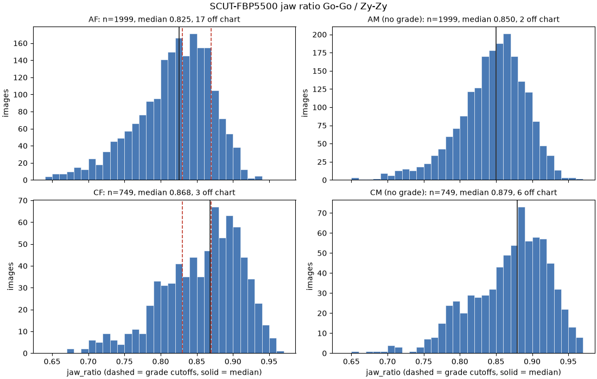
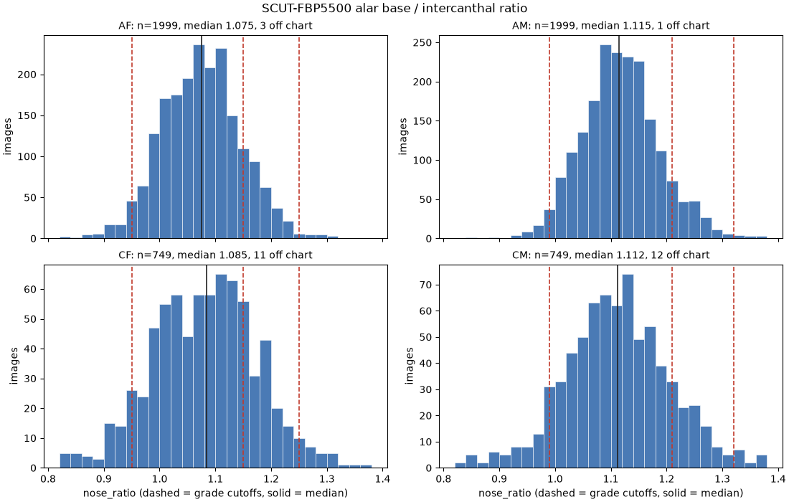

# label ของกรามและฐานจมูกจาก SCUT-FBP5500

สร้างด้วย `uv run python model/scripts/make_scut_labels.py` จากจุด 86 จุดของ SCUT-FBP5500 ด้วยกฎใน model.md หัวข้อ 5.2 ซึ่งอยู่ใน `facemeasure.face_geometry` และ `facemeasure.scut` รายงานนี้มีเฉพาะตัวเลขและกราฟ ภาพตรวจที่มีใบหน้าอยู่ใน `scut_label_check/` ของโฟลเดอร์ outputs ซึ่งห้าม commit

- อัตราส่วนกราม = ระยะ Go–Go ÷ ระยะ Zy–Zy และอัตราส่วนฐานจมูก = ระยะจุด 65–69 ÷ ระยะจุด 43–55 เก็บเป็นสัดส่วน
- ชุด test คือชุด test ของ SCUT (60/40) ชุด val คือ 15% ของชุด train ของ SCUT แบ่งแยก AF, AM, CF และ CM ด้วย seed `scut-labels-v1` ก่อนตัดไฟล์ที่ไม่มี label
- ไฟล์ที่ไม่มี label คือไฟล์จุดที่อ่านไม่ได้ และภาพที่กฎหาจุดไม่ได้ เช่นกลางตา (จุด 59, 60) ไม่เรียงจากซ้ายไปขวาของภาพ หรือเส้นขอบหน้าไม่ถึงระดับมุมปาก (model.md หัวข้อ 5.2)
- ค่าผิดปกติคือค่าที่ต่ำกว่า p1 หรือสูงกว่า p99 ของกลุ่ม

## จำนวนภาพ

| กลุ่ม | train | val | test | รวม |
| --- | --- | --- | --- | --- |
| AF | 1026 | 181 | 792 | 1999 |
| AM | 1011 | 178 | 810 | 1999 |
| CF | 394 | 70 | 285 | 749 |
| CM | 372 | 66 | 311 | 749 |
| รวม | 2803 | 495 | 2198 | 5496 |

### ไฟล์ที่ไม่มี label

| ภาพ | เหตุ |
| --- | --- |
| AF1183.jpg | eye centers are not ordered from image left to image right |
| AM1320.jpg | image-left face edge does not reach mouth level |
| CF434.jpg | eye centers are not ordered from image left to image right |
| CM152.jpg | CM152.pts: 4 bytes, expected 692 (int32 count + 172 float32) |

## การกระจายของอัตราส่วน

| กลุ่ม | n | กราม มัธยฐาน | กราม p10 | กราม p90 | ฐานจมูก มัธยฐาน | ฐานจมูก p10 | ฐานจมูก p90 |
| --- | --- | --- | --- | --- | --- | --- | --- |
| AF | 1999 | 0.825 | 0.742 | 0.878 | 1.075 | 0.984 | 1.169 |
| AM | 1999 | 0.850 | 0.783 | 0.899 | 1.115 | 1.035 | 1.206 |
| CF | 749 | 0.868 | 0.785 | 0.921 | 1.085 | 0.958 | 1.196 |
| CM | 749 | 0.879 | 0.792 | 0.931 | 1.112 | 0.997 | 1.238 |

## กรามของผู้หญิงเทียบเส้นแบ่ง (model.md หัวข้อ 3.1)

| กลุ่ม | n | ≤ 0.83 (เกรด 0) | 0.83–0.87 (เกรด 1) | > 0.87 (เกรด 2+) |
| --- | --- | --- | --- | --- |
| AF | 1999 | 54.2% | 31.3% | 14.5% |
| CF | 749 | 29.8% | 21.5% | 48.7% |
| หญิงทั้งหมด | 2748 | 47.6% | 28.6% | 23.8% |

ผู้หญิงเอเชียที่อัตราส่วนเกิน 0.83 มี 45.8% ไม่ถึงครึ่ง จึงไม่เข้าเงื่อนไขหยุดของ model.md หัวข้อ 3.1 ผู้ชายมีเฉพาะค่า ไม่มีเกณฑ์กราม

## ฐานจมูกเทียบเส้นแบ่งตามเพศ (model.md หัวข้อ 3.4)

หญิง: เกรด 0 ที่ 0.95–1.15, 2+ เมื่อมากกว่า 1.25 · ชาย: เกรด 0 ที่ 0.99–1.21, 2+ เมื่อมากกว่า 1.32 · ฝั่งแคบได้สูงสุดเกรด 1

| กลุ่ม | n | เกรด 0 | เกรด 1 ฝั่งแคบ | เกรด 1 ฝั่งกว้าง | เกรด 2+ |
| --- | --- | --- | --- | --- | --- |
| AF | 1999 | 82.1% | 3.5% | 13.7% | 0.8% |
| AM | 1999 | 88.6% | 2.3% | 8.6% | 0.6% |
| CF | 749 | 68.8% | 8.8% | 18.3% | 4.1% |
| CM | 749 | 75.2% | 9.5% | 12.6% | 2.8% |
| หญิงทั้งหมด | 2748 | 78.5% | 4.9% | 14.9% | 1.7% |
| ชายทั้งหมด | 2748 | 84.9% | 4.3% | 9.6% | 1.2% |

## ตำแหน่งของ Zy ในแถบที่ค้นหา

Zy คือจุดที่หน้ากว้างที่สุดระหว่างระดับกลางตากับระดับใต้จมูก ถ้าเส้นขอบกว้างขึ้นหรือแคบลงตลอดช่วงนี้ Zy จะอยู่ที่ปลายช่วง และถ้าสองข้างอยู่คนละตำแหน่ง เส้นเหลืองในภาพตรวจจะเอียงเทียบกับเส้นตา ปลายช่วงนับเมื่อห่างจากปลายไม่เกิน 2% ของความสูงของช่วง

| กลุ่ม | จำนวนข้าง | ที่ระดับกลางตา | ในช่วง | ที่ระดับใต้จมูก | ภาพที่สองข้างต่างตำแหน่ง |
| --- | --- | --- | --- | --- | --- |
| AF | 3998 | 30.3% | 69.6% | 0.1% | 26.7% |
| AM | 3998 | 20.0% | 79.7% | 0.3% | 23.7% |
| CF | 1498 | 20.0% | 78.9% | 1.1% | 29.6% |
| CM | 1498 | 21.2% | 77.2% | 1.7% | 31.4% |

## Histogram

เส้นประคือเส้นแบ่งเกรดของเพศนั้น เส้นทึบคือมัธยฐาน ค่าที่อยู่นอกช่วงของกราฟนับไว้ในชื่อกราฟ

## ภาพที่ค่าผิดปกติ

224 รายการจาก 220 ภาพ ภาพเหล่านี้อยู่ในแผ่น `outliers_*.png` ของภาพตรวจ

| กลุ่ม | อัตราส่วน | ภาพ | ค่า | p1 | p99 |
| --- | --- | --- | --- | --- | --- |
| AF | กราม | AF441.jpg | 0.5519 | 0.6505 | 0.9100 |
| AF | กราม | AF463.jpg | 0.5527 | 0.6505 | 0.9100 |
| AF | กราม | AF814.jpg | 0.5748 | 0.6505 | 0.9100 |
| AF | กราม | AF1861.jpg | 0.5878 | 0.6505 | 0.9100 |
| AF | กราม | AF1604.jpg | 0.5925 | 0.6505 | 0.9100 |
| AF | กราม | AF702.jpg | 0.5928 | 0.6505 | 0.9100 |
| AF | กราม | AF1431.jpg | 0.5941 | 0.6505 | 0.9100 |
| AF | กราม | AF340.jpg | 0.5972 | 0.6505 | 0.9100 |
| AF | กราม | AF572.jpg | 0.6011 | 0.6505 | 0.9100 |
| AF | กราม | AF1710.jpg | 0.6032 | 0.6505 | 0.9100 |
| AF | กราม | AF1814.jpg | 0.6125 | 0.6505 | 0.9100 |
| AF | กราม | AF1678.jpg | 0.6128 | 0.6505 | 0.9100 |
| AF | กราม | AF1713.jpg | 0.6164 | 0.6505 | 0.9100 |
| AF | กราม | AF1897.jpg | 0.6205 | 0.6505 | 0.9100 |
| AF | กราม | AF1883.jpg | 0.6280 | 0.6505 | 0.9100 |
| AF | กราม | AF1574.jpg | 0.6285 | 0.6505 | 0.9100 |
| AF | กราม | AF1377.jpg | 0.6408 | 0.6505 | 0.9100 |
| AF | กราม | AF1384.jpg | 0.6438 | 0.6505 | 0.9100 |
| AF | กราม | AF1248.jpg | 0.6484 | 0.6505 | 0.9100 |
| AF | กราม | AF1780.jpg | 0.6484 | 0.6505 | 0.9100 |
| AF | กราม | AF4.jpg | 0.9105 | 0.6505 | 0.9100 |
| AF | กราม | AF1976.jpg | 0.9108 | 0.6505 | 0.9100 |
| AF | กราม | AF811.jpg | 0.9109 | 0.6505 | 0.9100 |
| AF | กราม | AF295.jpg | 0.9119 | 0.6505 | 0.9100 |
| AF | กราม | AF424.jpg | 0.9129 | 0.6505 | 0.9100 |
| AF | กราม | AF535.jpg | 0.9131 | 0.6505 | 0.9100 |
| AF | กราม | AF1037.jpg | 0.9155 | 0.6505 | 0.9100 |
| AF | กราม | AF443.jpg | 0.9162 | 0.6505 | 0.9100 |
| AF | กราม | AF562.jpg | 0.9164 | 0.6505 | 0.9100 |
| AF | กราม | AF39.jpg | 0.9166 | 0.6505 | 0.9100 |
| AF | กราม | AF759.jpg | 0.9193 | 0.6505 | 0.9100 |
| AF | กราม | AF460.jpg | 0.9193 | 0.6505 | 0.9100 |
| AF | กราม | AF179.jpg | 0.9206 | 0.6505 | 0.9100 |
| AF | กราม | AF1049.jpg | 0.9217 | 0.6505 | 0.9100 |
| AF | กราม | AF270.jpg | 0.9309 | 0.6505 | 0.9100 |
| AF | กราม | AF1995.jpg | 0.9314 | 0.6505 | 0.9100 |
| AF | กราม | AF248.jpg | 0.9332 | 0.6505 | 0.9100 |
| AF | กราม | AF610.jpg | 0.9333 | 0.6505 | 0.9100 |
| AF | กราม | AF1631.jpg | 0.9386 | 0.6505 | 0.9100 |
| AF | กราม | AF688.jpg | 0.9729 | 0.6505 | 0.9100 |
| AF | ฐานจมูก | AF1687.jpg | 0.7456 | 0.9099 | 1.2391 |
| AF | ฐานจมูก | AF1820.jpg | 0.7724 | 0.9099 | 1.2391 |
| AF | ฐานจมูก | AF779.jpg | 0.8288 | 0.9099 | 1.2391 |
| AF | ฐานจมูก | AF1798.jpg | 0.8383 | 0.9099 | 1.2391 |
| AF | ฐานจมูก | AF1255.jpg | 0.8593 | 0.9099 | 1.2391 |
| AF | ฐานจมูก | AF1010.jpg | 0.8704 | 0.9099 | 1.2391 |
| AF | ฐานจมูก | AF1270.jpg | 0.8772 | 0.9099 | 1.2391 |
| AF | ฐานจมูก | AF712.jpg | 0.8786 | 0.9099 | 1.2391 |
| AF | ฐานจมูก | AF738.jpg | 0.8788 | 0.9099 | 1.2391 |
| AF | ฐานจมูก | AF1225.jpg | 0.8790 | 0.9099 | 1.2391 |
| AF | ฐานจมูก | AF1034.jpg | 0.8833 | 0.9099 | 1.2391 |
| AF | ฐานจมูก | AF1089.jpg | 0.8848 | 0.9099 | 1.2391 |
| AF | ฐานจมูก | AF1457.jpg | 0.8850 | 0.9099 | 1.2391 |
| AF | ฐานจมูก | AF1274.jpg | 0.8913 | 0.9099 | 1.2391 |
| AF | ฐานจมูก | AF1760.jpg | 0.8919 | 0.9099 | 1.2391 |
| AF | ฐานจมูก | AF101.jpg | 0.8926 | 0.9099 | 1.2391 |
| AF | ฐานจมูก | AF1097.jpg | 0.9015 | 0.9099 | 1.2391 |
| AF | ฐานจมูก | AF935.jpg | 0.9057 | 0.9099 | 1.2391 |
| AF | ฐานจมูก | AF502.jpg | 0.9063 | 0.9099 | 1.2391 |
| AF | ฐานจมูก | AF847.jpg | 0.9068 | 0.9099 | 1.2391 |
| AF | ฐานจมูก | AF1857.jpg | 1.2413 | 0.9099 | 1.2391 |
| AF | ฐานจมูก | AF782.jpg | 1.2448 | 0.9099 | 1.2391 |
| AF | ฐานจมูก | AF1185.jpg | 1.2454 | 0.9099 | 1.2391 |
| AF | ฐานจมูก | AF1707.jpg | 1.2499 | 0.9099 | 1.2391 |
| AF | ฐานจมูก | AF175.jpg | 1.2550 | 0.9099 | 1.2391 |
| AF | ฐานจมูก | AF1254.jpg | 1.2562 | 0.9099 | 1.2391 |
| AF | ฐานจมูก | AF1810.jpg | 1.2615 | 0.9099 | 1.2391 |
| AF | ฐานจมูก | AF1541.jpg | 1.2662 | 0.9099 | 1.2391 |
| AF | ฐานจมูก | AF548.jpg | 1.2670 | 0.9099 | 1.2391 |
| AF | ฐานจมูก | AF1492.jpg | 1.2674 | 0.9099 | 1.2391 |
| AF | ฐานจมูก | AF96.jpg | 1.2700 | 0.9099 | 1.2391 |
| AF | ฐานจมูก | AF750.jpg | 1.2843 | 0.9099 | 1.2391 |
| AF | ฐานจมูก | AF849.jpg | 1.2878 | 0.9099 | 1.2391 |
| AF | ฐานจมูก | AF1995.jpg | 1.2966 | 0.9099 | 1.2391 |
| AF | ฐานจมูก | AF1664.jpg | 1.2968 | 0.9099 | 1.2391 |
| AF | ฐานจมูก | AF427.jpg | 1.2996 | 0.9099 | 1.2391 |
| AF | ฐานจมูก | AF839.jpg | 1.3017 | 0.9099 | 1.2391 |
| AF | ฐานจมูก | AF1190.jpg | 1.3044 | 0.9099 | 1.2391 |
| AF | ฐานจมูก | AF749.jpg | 1.3150 | 0.9099 | 1.2391 |
| AF | ฐานจมูก | AF525.jpg | 5.6787 | 0.9099 | 1.2391 |
| AM | กราม | AM478.jpg | 0.6015 | 0.7083 | 0.9312 |
| AM | กราม | AM1813.jpg | 0.6514 | 0.7083 | 0.9312 |
| AM | กราม | AM1236.jpg | 0.6558 | 0.7083 | 0.9312 |
| AM | กราม | AM1095.jpg | 0.6581 | 0.7083 | 0.9312 |
| AM | กราม | AM17.jpg | 0.6652 | 0.7083 | 0.9312 |
| AM | กราม | AM1638.jpg | 0.6749 | 0.7083 | 0.9312 |
| AM | กราม | AM1779.jpg | 0.6877 | 0.7083 | 0.9312 |
| AM | กราม | AM1885.jpg | 0.6891 | 0.7083 | 0.9312 |
| AM | กราม | AM1624.jpg | 0.6902 | 0.7083 | 0.9312 |
| AM | กราม | AM1619.jpg | 0.6912 | 0.7083 | 0.9312 |
| AM | กราม | AM1937.jpg | 0.6916 | 0.7083 | 0.9312 |
| AM | กราม | AM21.jpg | 0.6923 | 0.7083 | 0.9312 |
| AM | กราม | AM1843.jpg | 0.6933 | 0.7083 | 0.9312 |
| AM | กราม | AM134.jpg | 0.6934 | 0.7083 | 0.9312 |
| AM | กราม | AM1760.jpg | 0.6947 | 0.7083 | 0.9312 |
| AM | กราม | AM1620.jpg | 0.6965 | 0.7083 | 0.9312 |
| AM | กราม | AM1674.jpg | 0.6998 | 0.7083 | 0.9312 |
| AM | กราม | AM65.jpg | 0.7012 | 0.7083 | 0.9312 |
| AM | กราม | AM1942.jpg | 0.7034 | 0.7083 | 0.9312 |
| AM | กราม | AM152.jpg | 0.7055 | 0.7083 | 0.9312 |
| AM | กราม | AM74.jpg | 0.9326 | 0.7083 | 0.9312 |
| AM | กราม | AM988.jpg | 0.9331 | 0.7083 | 0.9312 |
| AM | กราม | AM1282.jpg | 0.9336 | 0.7083 | 0.9312 |
| AM | กราม | AM891.jpg | 0.9349 | 0.7083 | 0.9312 |
| AM | กราม | AM1906.jpg | 0.9356 | 0.7083 | 0.9312 |
| AM | กราม | AM366.jpg | 0.9366 | 0.7083 | 0.9312 |
| AM | กราม | AM543.jpg | 0.9383 | 0.7083 | 0.9312 |
| AM | กราม | AM1419.jpg | 0.9384 | 0.7083 | 0.9312 |
| AM | กราม | AM636.jpg | 0.9388 | 0.7083 | 0.9312 |
| AM | กราม | AM61.jpg | 0.9395 | 0.7083 | 0.9312 |
| AM | กราม | AM981.jpg | 0.9399 | 0.7083 | 0.9312 |
| AM | กราม | AM290.jpg | 0.9461 | 0.7083 | 0.9312 |
| AM | กราม | AM90.jpg | 0.9471 | 0.7083 | 0.9312 |
| AM | กราม | AM191.jpg | 0.9498 | 0.7083 | 0.9312 |
| AM | กราม | AM920.jpg | 0.9505 | 0.7083 | 0.9312 |
| AM | กราม | AM893.jpg | 0.9527 | 0.7083 | 0.9312 |
| AM | กราม | AM1063.jpg | 0.9580 | 0.7083 | 0.9312 |
| AM | กราม | AM1125.jpg | 0.9658 | 0.7083 | 0.9312 |
| AM | กราม | AM10.jpg | 0.9683 | 0.7083 | 0.9312 |
| AM | กราม | AM607.jpg | 1.0020 | 0.7083 | 0.9312 |
| AM | ฐานจมูก | AM721.jpg | 0.8410 | 0.9631 | 1.2922 |
| AM | ฐานจมูก | AM185.jpg | 0.8827 | 0.9631 | 1.2922 |
| AM | ฐานจมูก | AM1375.jpg | 0.9263 | 0.9631 | 1.2922 |
| AM | ฐานจมูก | AM1622.jpg | 0.9268 | 0.9631 | 1.2922 |
| AM | ฐานจมูก | AM982.jpg | 0.9378 | 0.9631 | 1.2922 |
| AM | ฐานจมูก | AM1594.jpg | 0.9392 | 0.9631 | 1.2922 |
| AM | ฐานจมูก | AM325.jpg | 0.9426 | 0.9631 | 1.2922 |
| AM | ฐานจมูก | AM470.jpg | 0.9461 | 0.9631 | 1.2922 |
| AM | ฐานจมูก | AM811.jpg | 0.9468 | 0.9631 | 1.2922 |
| AM | ฐานจมูก | AM76.jpg | 0.9469 | 0.9631 | 1.2922 |
| AM | ฐานจมูก | AM1528.jpg | 0.9506 | 0.9631 | 1.2922 |
| AM | ฐานจมูก | AM220.jpg | 0.9524 | 0.9631 | 1.2922 |
| AM | ฐานจมูก | AM426.jpg | 0.9575 | 0.9631 | 1.2922 |
| AM | ฐานจมูก | AM1532.jpg | 0.9585 | 0.9631 | 1.2922 |
| AM | ฐานจมูก | AM1851.jpg | 0.9590 | 0.9631 | 1.2922 |
| AM | ฐานจมูก | AM574.jpg | 0.9600 | 0.9631 | 1.2922 |
| AM | ฐานจมูก | AM1036.jpg | 0.9600 | 0.9631 | 1.2922 |
| AM | ฐานจมูก | AM19.jpg | 0.9608 | 0.9631 | 1.2922 |
| AM | ฐานจมูก | AM366.jpg | 0.9628 | 0.9631 | 1.2922 |
| AM | ฐานจมูก | AM447.jpg | 0.9630 | 0.9631 | 1.2922 |
| AM | ฐานจมูก | AM1010.jpg | 1.2973 | 0.9631 | 1.2922 |
| AM | ฐานจมูก | AM1596.jpg | 1.2976 | 0.9631 | 1.2922 |
| AM | ฐานจมูก | AM1089.jpg | 1.2979 | 0.9631 | 1.2922 |
| AM | ฐานจมูก | AM1106.jpg | 1.3028 | 0.9631 | 1.2922 |
| AM | ฐานจมูก | AM1908.jpg | 1.3043 | 0.9631 | 1.2922 |
| AM | ฐานจมูก | AM1926.jpg | 1.3089 | 0.9631 | 1.2922 |
| AM | ฐานจมูก | AM764.jpg | 1.3127 | 0.9631 | 1.2922 |
| AM | ฐานจมูก | AM1712.jpg | 1.3128 | 0.9631 | 1.2922 |
| AM | ฐานจมูก | AM48.jpg | 1.3151 | 0.9631 | 1.2922 |
| AM | ฐานจมูก | AM1963.jpg | 1.3238 | 0.9631 | 1.2922 |
| AM | ฐานจมูก | AM44.jpg | 1.3260 | 0.9631 | 1.2922 |
| AM | ฐานจมูก | AM71.jpg | 1.3332 | 0.9631 | 1.2922 |
| AM | ฐานจมูก | AM179.jpg | 1.3332 | 0.9631 | 1.2922 |
| AM | ฐานจมูก | AM1463.jpg | 1.3492 | 0.9631 | 1.2922 |
| AM | ฐานจมูก | AM1003.jpg | 1.3543 | 0.9631 | 1.2922 |
| AM | ฐานจมูก | AM1703.jpg | 1.3564 | 0.9631 | 1.2922 |
| AM | ฐานจมูก | AM1973.jpg | 1.3690 | 0.9631 | 1.2922 |
| AM | ฐานจมูก | AM1738.jpg | 1.3721 | 0.9631 | 1.2922 |
| AM | ฐานจมูก | AM1643.jpg | 1.3742 | 0.9631 | 1.2922 |
| AM | ฐานจมูก | AM1167.jpg | 1.3852 | 0.9631 | 1.2922 |
| CF | กราม | CF374.jpg | 0.6262 | 0.7053 | 0.9535 |
| CF | กราม | CF276.jpg | 0.6710 | 0.7053 | 0.9535 |
| CF | กราม | CF582.jpg | 0.6712 | 0.7053 | 0.9535 |
| CF | กราม | CF566.jpg | 0.6922 | 0.7053 | 0.9535 |
| CF | กราม | CF595.jpg | 0.6954 | 0.7053 | 0.9535 |
| CF | กราม | CF548.jpg | 0.7029 | 0.7053 | 0.9535 |
| CF | กราม | CF610.jpg | 0.7048 | 0.7053 | 0.9535 |
| CF | กราม | CF61.jpg | 0.7052 | 0.7053 | 0.9535 |
| CF | กราม | CF236.jpg | 0.9551 | 0.7053 | 0.9535 |
| CF | กราม | CF44.jpg | 0.9556 | 0.7053 | 0.9535 |
| CF | กราม | CF135.jpg | 0.9561 | 0.7053 | 0.9535 |
| CF | กราม | CF421.jpg | 0.9579 | 0.7053 | 0.9535 |
| CF | กราม | CF147.jpg | 0.9592 | 0.7053 | 0.9535 |
| CF | กราม | CF227.jpg | 0.9635 | 0.7053 | 0.9535 |
| CF | กราม | CF496.jpg | 0.9767 | 0.7053 | 0.9535 |
| CF | กราม | CF418.jpg | 0.9774 | 0.7053 | 0.9535 |
| CF | ฐานจมูก | CF679.jpg | 0.7680 | 0.8269 | 1.3130 |
| CF | ฐานจมูก | CF494.jpg | 0.7727 | 0.8269 | 1.3130 |
| CF | ฐานจมูก | CF13.jpg | 0.7859 | 0.8269 | 1.3130 |
| CF | ฐานจมูก | CF517.jpg | 0.7918 | 0.8269 | 1.3130 |
| CF | ฐานจมูก | CF55.jpg | 0.7921 | 0.8269 | 1.3130 |
| CF | ฐานจมูก | CF724.jpg | 0.8133 | 0.8269 | 1.3130 |
| CF | ฐานจมูก | CF28.jpg | 0.8143 | 0.8269 | 1.3130 |
| CF | ฐานจมูก | CF29.jpg | 0.8247 | 0.8269 | 1.3130 |
| CF | ฐานจมูก | CF538.jpg | 1.3151 | 0.8269 | 1.3130 |
| CF | ฐานจมูก | CF204.jpg | 1.3321 | 0.8269 | 1.3130 |
| CF | ฐานจมูก | CF371.jpg | 1.3428 | 0.8269 | 1.3130 |
| CF | ฐานจมูก | CF697.jpg | 1.3664 | 0.8269 | 1.3130 |
| CF | ฐานจมูก | CF203.jpg | 1.3804 | 0.8269 | 1.3130 |
| CF | ฐานจมูก | CF542.jpg | 1.3884 | 0.8269 | 1.3130 |
| CF | ฐานจมูก | CF41.jpg | 1.4354 | 0.8269 | 1.3130 |
| CF | ฐานจมูก | CF22.jpg | 1.5968 | 0.8269 | 1.3130 |
| CM | กราม | CM442.jpg | 0.6568 | 0.7121 | 0.9667 |
| CM | กราม | CM708.jpg | 0.6795 | 0.7121 | 0.9667 |
| CM | กราม | CM530.jpg | 0.6825 | 0.7121 | 0.9667 |
| CM | กราม | CM42.jpg | 0.6962 | 0.7121 | 0.9667 |
| CM | กราม | CM716.jpg | 0.7007 | 0.7121 | 0.9667 |
| CM | กราม | CM638.jpg | 0.7008 | 0.7121 | 0.9667 |
| CM | กราม | CM577.jpg | 0.7042 | 0.7121 | 0.9667 |
| CM | กราม | CM690.jpg | 0.7092 | 0.7121 | 0.9667 |
| CM | กราม | CM516.jpg | 0.9670 | 0.7121 | 0.9667 |
| CM | กราม | CM529.jpg | 0.9694 | 0.7121 | 0.9667 |
| CM | กราม | CM91.jpg | 0.9746 | 0.7121 | 0.9667 |
| CM | กราม | CM575.jpg | 0.9792 | 0.7121 | 0.9667 |
| CM | กราม | CM508.jpg | 0.9830 | 0.7121 | 0.9667 |
| CM | กราม | CM326.jpg | 0.9892 | 0.7121 | 0.9667 |
| CM | กราม | CM505.jpg | 0.9908 | 0.7121 | 0.9667 |
| CM | กราม | CM587.jpg | 0.9912 | 0.7121 | 0.9667 |
| CM | ฐานจมูก | CM301.jpg | 0.6796 | 0.8502 | 1.3744 |
| CM | ฐานจมูก | CM326.jpg | 0.8011 | 0.8502 | 1.3744 |
| CM | ฐานจมูก | CM21.jpg | 0.8139 | 0.8502 | 1.3744 |
| CM | ฐานจมูก | CM230.jpg | 0.8177 | 0.8502 | 1.3744 |
| CM | ฐานจมูก | CM379.jpg | 0.8199 | 0.8502 | 1.3744 |
| CM | ฐานจมูก | CM212.jpg | 0.8221 | 0.8502 | 1.3744 |
| CM | ฐานจมูก | CM348.jpg | 0.8334 | 0.8502 | 1.3744 |
| CM | ฐานจมูก | CM372.jpg | 0.8480 | 0.8502 | 1.3744 |
| CM | ฐานจมูก | CM495.jpg | 1.3751 | 0.8502 | 1.3744 |
| CM | ฐานจมูก | CM577.jpg | 1.3969 | 0.8502 | 1.3744 |
| CM | ฐานจมูก | CM122.jpg | 1.4099 | 0.8502 | 1.3744 |
| CM | ฐานจมูก | CM198.jpg | 1.4175 | 0.8502 | 1.3744 |
| CM | ฐานจมูก | CM497.jpg | 1.4292 | 0.8502 | 1.3744 |
| CM | ฐานจมูก | CM66.jpg | 1.4526 | 0.8502 | 1.3744 |
| CM | ฐานจมูก | CM586.jpg | 1.4900 | 0.8502 | 1.3744 |
| CM | ฐานจมูก | CM470.jpg | 1.5122 | 0.8502 | 1.3744 |
