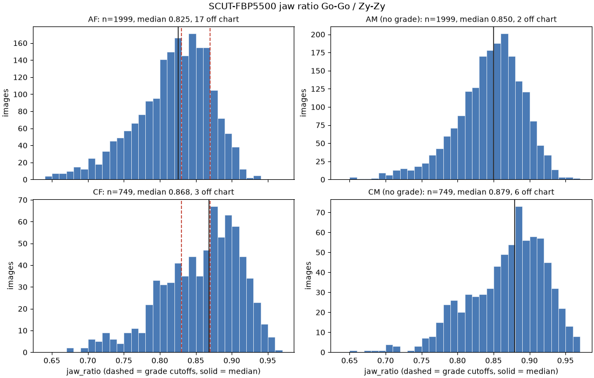
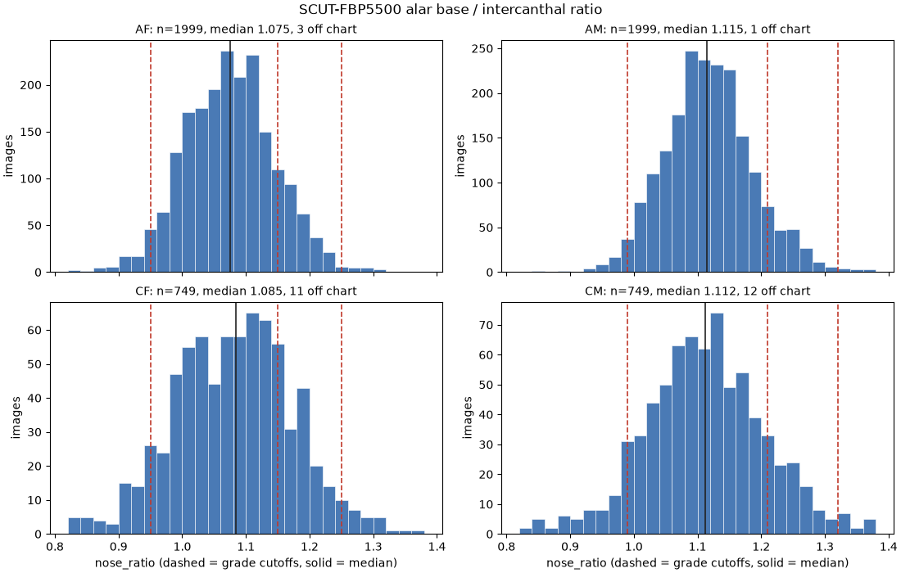
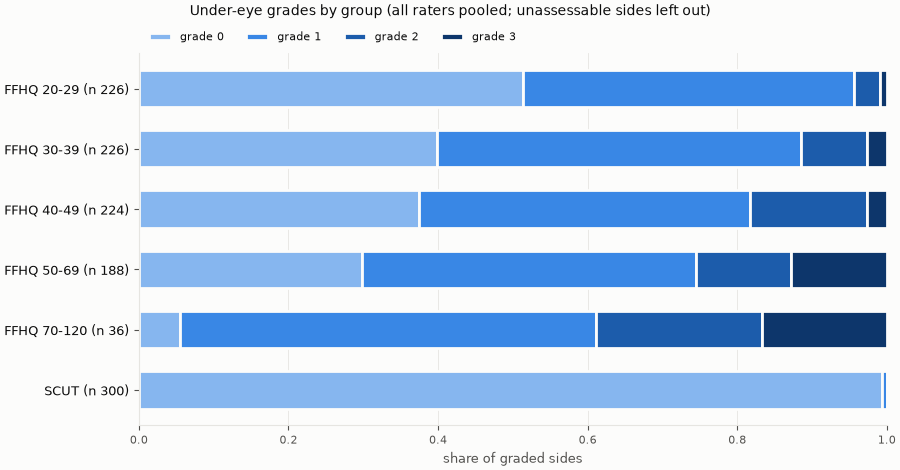
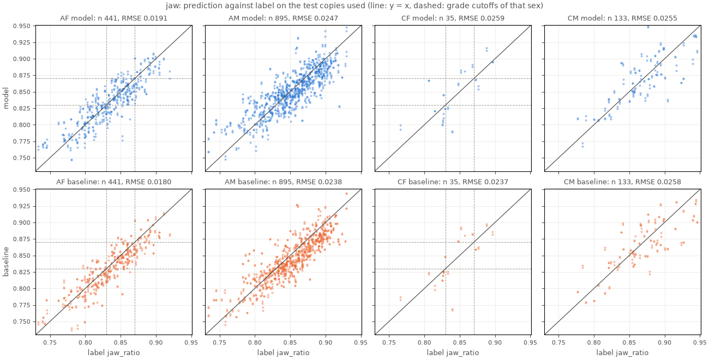
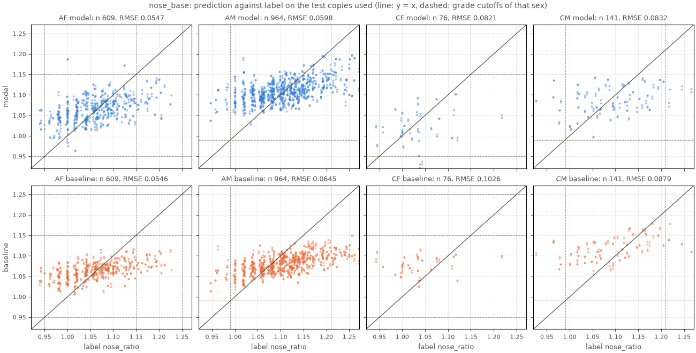
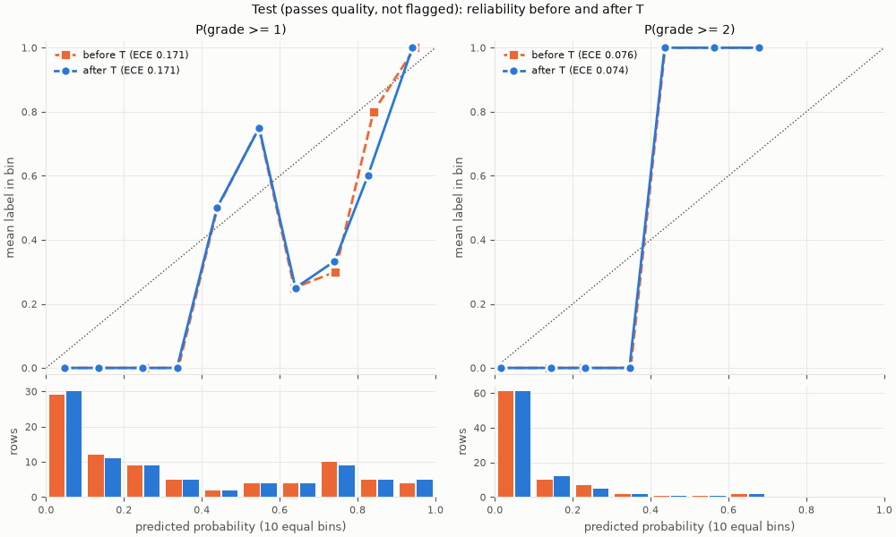
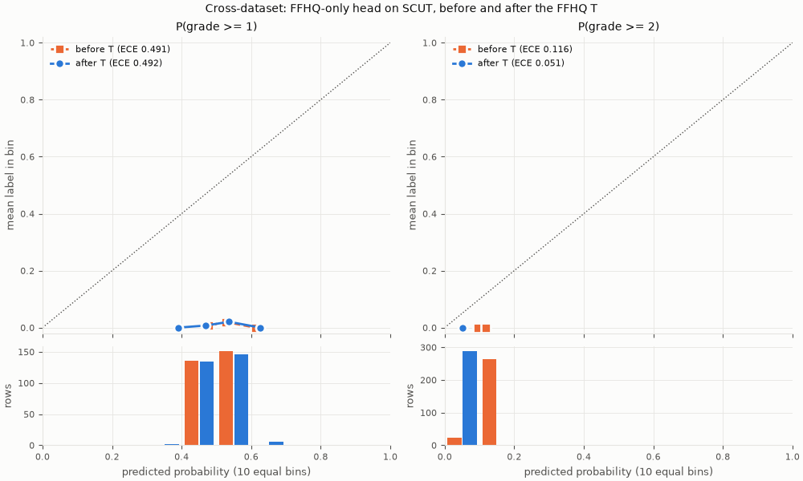
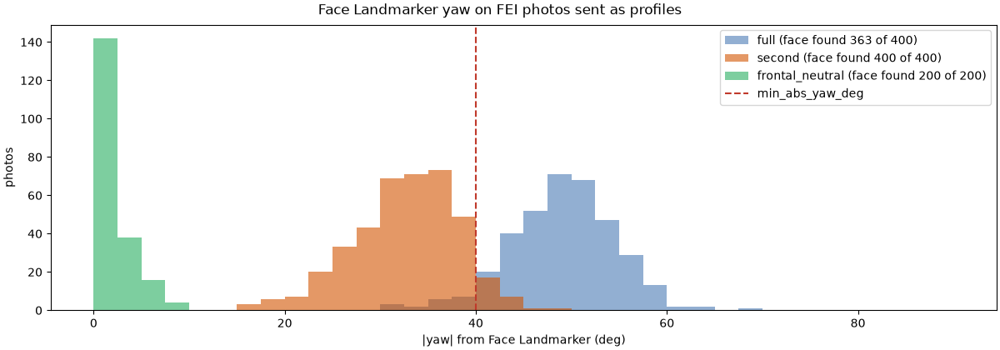
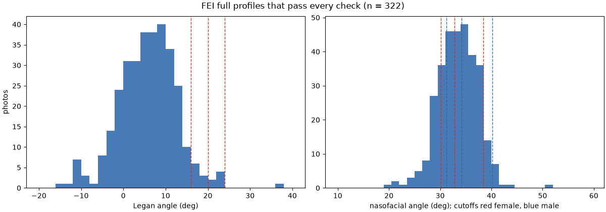
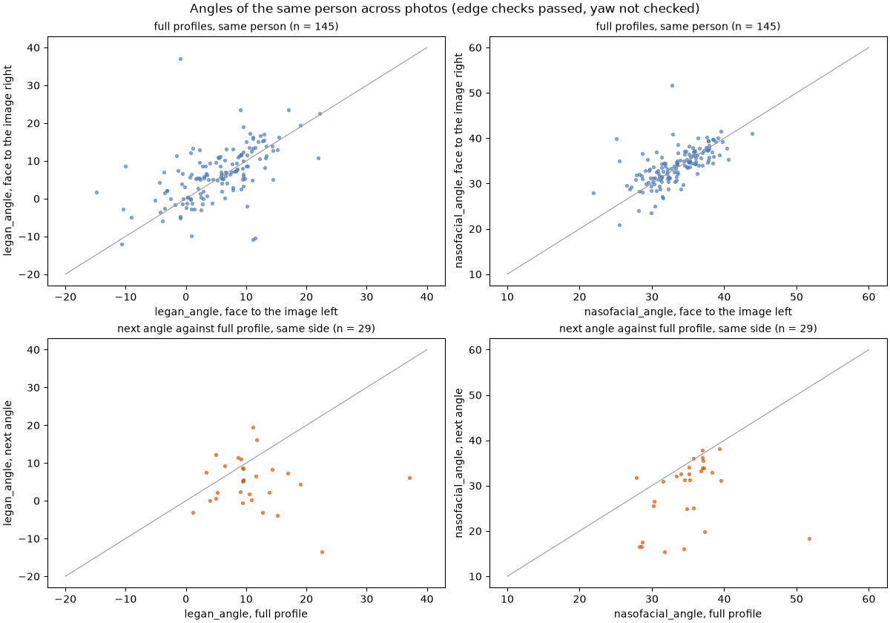

# สรุปผลทั้งโปรเจกต์

รายงานสรุปสำหรับนำเสนอ มีเฉพาะตัวเลขและกราฟ ไม่มีภาพใบหน้า ตัวเลขทุกตัวคัดมาจากรายงานต้นทางใน `model/reports/` ซึ่งระบุไว้ท้ายหัวข้อหรือใต้ตาราง ถ้ารายงานต้นทางเปลี่ยน ต้องแก้ตัวเลขที่นี่ตาม

- รุ่น: api 0.1.0, bundle 0.2.0 ไม่มีหัวที่เป็น stub, mediapipe 1.2.0, torch 2.15.0, Python 3.12.16 (`api_check.md`)
- เครื่องที่ใช้: Mac (Apple Silicon) เครื่องเดียว ทั้งเตรียมข้อมูล เทรน และรัน api จึงไม่มีการตรวจข้ามเครื่อง
- ชุดข้อมูล: SCUT-FBP5500, FFHQ กับป้าย FFHQ-Aging และ FEI เท่านั้น (model.md หัวข้อ 5.1)

## 1. ข้อมูลและ label

### 1.1 อัตราส่วนกรามและฐานจมูกจาก SCUT-FBP5500

มี label 5,496 จาก 5,500 ภาพ อีก 4 ภาพไม่มี label คือกฎหาจุดไม่ได้ 3 ภาพ กับไฟล์จุดที่อ่านไม่ได้ 1 ไฟล์ แบ่งเป็น train 2,803, val 495 และ test 2,198 ภาพ (`scut_labels.md`)

| กลุ่ม | n | กราม มัธยฐาน (p10–p90) | ฐานจมูก มัธยฐาน (p10–p90) |
| --- | --- | --- | --- |
| หญิงเอเชีย (AF) | 1999 | 0.825 (0.742–0.878) | 1.075 (0.984–1.169) |
| ชายเอเชีย (AM) | 1999 | 0.850 (0.783–0.899) | 1.115 (1.035–1.206) |
| หญิงผิวขาว (CF) | 749 | 0.868 (0.785–0.921) | 1.085 (0.958–1.196) |
| ชายผิวขาว (CM) | 749 | 0.879 (0.792–0.931) | 1.112 (0.997–1.238) |

ที่มา: `scut_labels.md` หัวข้อ "การกระจายของอัตราส่วน"

| กรามของผู้หญิงเทียบเส้นแบ่ง | ≤ 0.83 (เกรด 0) | 0.83–0.87 (เกรด 1) | > 0.87 (เกรด 2+) |
| --- | --- | --- | --- |
| AF | 54.2% | 31.3% | 14.5% |
| CF | 29.8% | 21.5% | 48.7% |
| หญิงทั้งหมด | 47.6% | 28.6% | 23.8% |

ผู้หญิงเอเชียที่อัตราส่วนกรามเกิน 0.83 มี 45.8% ต่ำกว่าครึ่ง จึงไม่เข้าเงื่อนไขหยุดของ model.md หัวข้อ 3.1 ส่วนฐานจมูกได้เกรด 0 ในผู้หญิง 78.5% และผู้ชาย 84.9% ได้เกรด 2+ เพียง 1.7% และ 1.2% (`scut_labels.md`)

### 1.2 เกรดใต้ตา

ผู้ให้เกรด 1 คน (R1) ให้เกรด 600 ภาพ หรือ 1,200 ข้าง ในจำนวนนี้มี 50 ข้างที่ติดธงถุงใต้ตาหรือรอยคล้ำ ซึ่งไม่ใช้เทรน ผู้ให้เกรดใช้เวลามัธยฐาน 3.0 วินาทีต่อภาพ (`undereye_head.md`)

| กลุ่ม | ข้าง | เกรด 0 | เกรด 1 | เกรด 2 | เกรด 3 | ≥2 |
| --- | --- | --- | --- | --- | --- | --- |
| ทั้งหมด | 1200 | 53.8% | 34.6% | 7.9% | 3.7% | 11.6% |
| FFHQ | 900 | 38.7% | 45.9% | 10.6% | 4.9% | 15.4% |
| SCUT | 300 | 99.3% | 0.7% | 0.0% | 0.0% | 0.0% |
| FFHQ อายุ 20–29 | 226 | 51.3% | 44.2% | 3.5% | 0.9% | 4.4% |
| FFHQ อายุ 30–39 | 226 | 39.8% | 48.7% | 8.8% | 2.7% | 11.5% |
| FFHQ อายุ 40–49 | 224 | 37.5% | 44.2% | 15.6% | 2.7% | 18.3% |
| FFHQ อายุ 50–69 | 188 | 29.8% | 44.7% | 12.8% | 12.8% | 25.5% |
| FFHQ อายุ 70 ขึ้นไป | 36 | 5.6% | 55.6% | 22.2% | 16.7% | 38.9% |

ที่มา: `undereye_head.md` หัวข้อ "การกระจายของเกรด"

**ความสอดคล้องระหว่างผู้ให้เกรดวัดไม่ได้ เพราะมีผู้ให้เกรดคนเดียว** label จึงเป็นการตัดสินของคนเดียวที่ไม่ใช่แพทย์ (model.md หัวข้อ 5.2 และ 7.2)

## 2. โมเดล

### 2.1 หัวกรามและหัวฐานจมูกเทียบ baseline

ทั้งสองหัวเป็น ridge regression บน feature `grid4` ของ DINOv2 ซึ่งได้ RMSE บนชุด val ต่ำสุด baseline คืออัตราส่วนจากจุดของ MediaPipe ที่ปรับด้วยสมการเส้นตรง ทั้งสองวิธีวัดบนสำเนาของชุด test ที่ผ่านเกณฑ์คุณภาพ (`jaw_nose_heads.md`)

| หัว | ชุดย่อย | แถว | MAE โมเดล | MAE baseline | RMSE โมเดล | RMSE baseline | ผลต่าง RMSE (95% CI) | slope โมเดล |
| --- | --- | --- | --- | --- | --- | --- | --- | --- |
| กราม | ทั้งหมด | 1504 | 0.0168 | 0.0165 | 0.0233 | 0.0224 | +0.0008 (−0.0002 ถึง +0.0018) | 0.716 |
| กราม | หญิง | 476 | 0.0154 | 0.0145 | 0.0196 | 0.0184 | +0.0012 (−0.0006 ถึง +0.0031) | 0.789 |
| ฐานจมูก | ทั้งหมด | 1790 | 0.0476 | 0.0495 | 0.0614 | 0.0656 | −0.0042 (−0.0066 ถึง −0.0018) | 0.303 |

ที่มา: `jaw_nose_heads.md` หัวข้อ "ผลบนชุด test" และ "เทียบกับ baseline" ผลต่างที่เป็นบวกหมายถึง baseline แม่นกว่า

| หัว | weighted kappa (โมเดล / baseline) | เกรดตรงกัน (โมเดล / baseline) | ช่วงก้ำกึ่ง | สัดส่วนที่ก้ำกึ่ง | ชัดและตรง | ก้ำกึ่งและครอบเกรดจริง |
| --- | --- | --- | --- | --- | --- | --- |
| กราม (หญิง) | 0.684 / 0.691 | 0.763 / 0.769 | ±0.0103 | 35.7% | 81.0% | 98.8% |
| ฐานจมูก | 0.007 / 0.000 | 0.878 / 0.882 | ±0.0322 | 3.4% | 89.3% | 96.7% |

ที่มา: `jaw_nose_heads.md` หัวข้อ "ผลบนชุด test" และ "ช่วงก้ำกึ่ง"

- **กราม**: แยกไม่ได้ว่าโมเดลหรือ baseline แม่นกว่า เพราะช่วงความเชื่อมั่นคร่อม 0 ระบบใช้ค่าจากโมเดลตาม model.md หัวข้อ 7.1
- **ฐานจมูก**: RMSE ของโมเดลต่ำกว่า baseline แต่แทบแยกเกรดไม่ได้ (kappa 0.007) เพราะค่าทายเกือบทั้งหมดได้เกรด 0
- slope ต่ำกว่า 1 ทั้งสองหัว (0.716 และ 0.303) แปลว่าค่าทายถูกดึงเข้าหาค่าเฉลี่ย ทีมตัดสินใจรับผลนี้แล้วตอนเทรน
- **ภาพ 8 ภาพของ \[3\]** ลำดับของโมเดลตรงกับบทความทุกภาพ (Spearman ρ 1.000) ค่าคลาดเฉลี่ย +2.13 จุดเปอร์เซ็นต์ และ slope 0.391 ส่วน baseline ได้ ρ 1.000 ค่าคลาดเฉลี่ย +2.65 จุดเปอร์เซ็นต์ และ slope 0.607 (`jaw_nose_heads.md` หัวข้อ "ภาพจาก \[3\]")

### 2.2 หัวใต้ตาเทียบผู้ให้เกรด

หัว ordinal แบบ CORAL บน feature `cls_mean` λ 1 ปรับเทียบด้วย temperature T = 0.9771 ที่หาบนชุด val (`undereye_head.md`)

| ชุดที่ประเมิน | แถว | accuracy | κ (linear) | ECE ≥1 | ECE ≥2 |
| --- | --- | --- | --- | --- | --- |
| test ที่ผ่านเกณฑ์คุณภาพ (ผลหลัก) | 84 | 83.3% | 0.645 | 0.171 | 0.074 |
| test เฉพาะ FFHQ | 50 | 72.0% | 0.566 | 0.234 | 0.120 |
| test ทุกสำเนา ไม่กรองคุณภาพ (ผลประกอบ) | 348 | 70.1% | 0.568 | 0.095 | 0.048 |
| test ทุกสำเนา เฉพาะ FFHQ (ผลประกอบ) | 260 | 60.0% | 0.436 | 0.118 | 0.063 |

ที่มา: `undereye_head.md` หัวข้อ "ผลบนชุด test" ECE เป็นค่าหลังปรับเทียบ

- ด้วยเกณฑ์ 0.3/0.7 ของ bundle บนผลหลัก ผลก้ำกึ่ง 25.0% ผลชัดตรงกับผู้ให้เกรด 87.3% และผลก้ำกึ่งครอบเกรดของผู้ให้เกรด 100% (`undereye_head.md`)
- ตัวเลขสำหรับเทียบคร่าว ๆ คือ kappa 0.55–0.65 ของแพทย์ใน \[7\] แต่เป็นการเทียบคนละแบบ ซึ่งในงานนั้นแพทย์ 3 คนประเมินผู้เข้าร่วมตัวจริง ส่วนของเราเป็นโมเดลเทียบกับผู้ให้เกรดคนเดียวที่ดูภาพ
- ผลหลักมี label ≥2 เพียง 4 แถว ตัวเลขของจุดเปลี่ยนที่ 2 จึงไม่แน่นอนมาก

**ผลข้ามชุดข้อมูล**: เทรนหัวด้วยภาพ FFHQ อย่างเดียว แล้วตรวจกับใต้ตาของ SCUT 288 แถว ได้ accuracy 47.9% และ κ 0.012 ECE ของ P(เกรด ≥ 1) หลังปรับเทียบเท่ากับ 0.492 บน SCUT เทียบกับ 0.109 บนชุด val ของ FFHQ ใต้ตาของ SCUT ไม่มีข้างที่ได้เกรด ≥2 จึงตรวจจุดเปลี่ยนที่ 2 ข้ามชุดข้อมูลไม่ได้ (`undereye_head.md` หัวข้อ "ตรวจข้ามชุดข้อมูล")

## 3. ภาพด้านข้างบน FEI

| ภาพที่ส่ง | ภาพ | วัดได้ | หมายเหตุ |
| --- | --- | --- | --- |
| ด้านข้างเต็ม | 400 | 322 (80.5%) | ไม่พบใบหน้า 9.2% ซึ่งถือว่าหันพอ ส่วนเส้นขอบไม่ผ่านส่วนใหญ่เป็น `no_forehead` (63 ภาพ) |
| มุมรองลงมา | 400 | 17 (4.2%) | ผ่านเกณฑ์ yaw 40° เพียง 6.5% |
| หน้าตรงที่ส่งเป็นภาพด้านข้าง | 400 | 0 (0.0%) | ได้ `profile_invalid` ทุกภาพ |

| มุมของภาพด้านข้างเต็มที่วัดได้ (n 322) | p10 | มัธยฐาน | p90 |
| --- | --- | --- | --- |
| Legan | −2.6° | 6.1° | 13.4° |
| nasofacial | 28.5° | 33.5° | 37.9° |

- Legan ได้เกรด 0 ไป 95.0% ส่วนสันจมูกได้เกรด 2+ 18.6% ตามเส้นแบ่งของผู้หญิง และ 28.0% ตามเส้นแบ่งของผู้ชาย (FEI ไม่มีป้ายเพศรายภาพ)
- คนเดียวกันที่หันซ้ายเทียบกับหันขวา (145 คู่) มุม Legan ต่างกันเฉลี่ย 4.3° (มัธยฐาน 3.0°, p90 9.5°) และ nasofacial ต่างกันเฉลี่ย 2.2° (มัธยฐาน 1.5°, p90 4.6°)
- ภาพหน้าตรงปกติได้ `smiling` 10.5% ที่เกณฑ์ 0.3 ส่วนภาพยิ้มได้ 98.5%

ที่มา: `fei_profiles.md`

## 4. api

| การตรวจ (api.md หัวข้อ 7) | ผล |
| --- | --- |
| ความตรงกับตอนเทรนหัวกรามและฐานจมูก: กราม value คลาดสูงสุด 0.0501 จุดเปอร์เซ็นต์ (เกณฑ์ 0.0510) และฐานจมูก 0.00034 (เกณฑ์ 0.00051) | ผ่าน |
| ความตรงกับตอนเทรนหัวใต้ตา: P(เกรด ≥ k) คลาดสูงสุด 0.00045 (เกณฑ์ 0.00051) | ผ่าน |
| ส่งซ้ำได้ผลเดิม, หมุนด้วย EXIF, กลับภาพด้านข้าง (19 จาก 20 ภาพวัดได้ทั้งสองแบบ มุมคลาด 0.00°) | ผ่าน |
| รหัสคุณภาพภาพ 5 รหัส และโหมดทดลอง | ผ่าน |

| เวลาต่อคำขอ (mps, 20 คำขอ, เฟรม 1920×1080) | p50 | p90 | สูงสุด |
| --- | --- | --- | --- |
| ส่งจนได้ผล | 0.59 วินาที | 0.61 วินาที | 0.74 วินาที |

ที่มา: `api_check.md` ที่รันใหม่เมื่อ 2026-11-09 ส่วนเวลาของ MediaPipe กับ DINOv2 บน CPU อย่างเดียวคือ 651 ms ต่อเฟรม 1920×1080 เทียบกับ 340 ms เมื่อ DINOv2 รันบน mps (`features.md` หัวข้อ "หนึ่งคำขอของ api")

## 5. ข้อจำกัด

รวบรวมจาก model.md หัวข้อ 7.2 และ 8, api.md หัวข้อ 8 และ web.md หัวข้อ 10 พร้อมสิ่งที่พบเพิ่มระหว่างทำ

**ข้อมูลและ label**
- เกรดใต้ตามาจากผู้ให้เกรดคนเดียวที่ไม่ใช่แพทย์ จึงวัดความสอดคล้องระหว่างผู้ให้เกรดไม่ได้ และความน่าจะเป็นหลังปรับเทียบบอกได้เพียงว่าผลตรงกับผู้ให้เกรดคนนี้แค่ไหน
- label ของกรามและฐานจมูกแม่นได้ไม่เกินจุดที่คนวาง และ Go กับ Zy หาจากเส้นขอบด้วยกฎ ถ้านิยามต่างจากเกณฑ์ เกรดกรามจะเลื่อนทั้งระบบ
- ภาพทุกชุดถ่ายต่างจากเว็บแคมของผู้ใช้ ภาพใต้ตามาจากอินเทอร์เน็ตซึ่งแสงและการแต่งภาพหลากหลาย และ SCUT-FBP5500 มีใบหน้าอายุ 15–17 ปีปนอยู่
- ภาพด้านข้างมีเพียง FEI ซึ่งเป็นชาวบราซิล ผลของท่า การหาเส้นขอบ และเกณฑ์คางกับสันจมูกจึงอาจไม่ตรงกับคนไทย และสันจมูกอาจได้เกรด ≥2 บ่อยเกินจริง (18.6–28.0% บน FEI)
- ไม่มีชุดที่ถ่ายคนเดิมซ้ำ ช่วงก้ำกึ่งจึงตั้งจาก RMSE บนสำเนาที่ย่อเลียนแบบเว็บแคม

**โมเดล**
- หัวกรามแยกจาก baseline ไม่ได้ และหัวฐานจมูกแทบแยกเกรดไม่ได้ (kappa 0.007) ระบบใช้ค่าจากโมเดลเพราะโปรเจกต์ตั้งใจแสดงการเทรนโมเดล
- ค่าทายของทั้งสองหัวถูกดึงเข้าหาค่าเฉลี่ย ใบหน้าที่อัตราส่วนสูงหรือต่ำมากจึงได้เกรดใกล้กลางกว่าความจริง
- หัวใต้ตาที่เทรนด้วย FFHQ ใช้กับ SCUT ได้ไม่ดี (ECE 0.492) จึงอาจปรับเทียบกับคนเอเชียได้ไม่ดี และยังไม่ได้ยืนยันกับกล้องจริง web จึงแสดงผลใต้ตาเป็นระดับ ไม่แสดงตัวเลข

**การถ่ายภาพ**
- ไม่ได้วัดระยะถ่าย มุมหันของภาพด้านข้าง และทิศแสง ระยะคุมด้วยขนาดกรอบนำท่าซึ่งขึ้นกับมุมรับภาพของกล้อง ภาพจากเครื่องไม่รู้ระยะ และเว็บแคม 720p ละเอียดไม่พอที่ระยะ 1 ม.
- ภาพด้านข้างไม่มีการคุมท่าแบบ live เกณฑ์ yaw 40° เป็นมาตราของ Face Landmarker ไม่ใช่มุมจริง segmentation หยาบ (256×256) และภาพด้านข้างเต็มของ FEI วัดได้ 80.5%
- ใช้ภาพหน้าตรงภาพเดียว ไม่เฉลี่ยหลายเฟรม การตรวจในเว็บทำบนภาพพรีวิว จึงอาจไม่ตรงกับ api
- ไม่ตรวจแว่น ทิศแสง ผมบังหน้าผาก และปากเปิดในภาพด้านข้าง

**ระบบ**
- ใช้ได้เฉพาะบนเครื่องที่รันระบบ เครื่องรุ่นเก่าอาจรัน Face Landmarker และ DINOv2 ช้า เส้นวัดของกรามและฐานจมูกวาดจากจุดของ MediaPipe แต่ตัวเลขมาจากโมเดล
- ไม่มีแพทย์ร่วม การจับคู่เกรดของคางและจมูกกับหัตถการเป็นการเชื่อมโยงของทีม เกณฑ์บางส่วนไม่ได้มาจากคนไทย และ model card ของ MediaPipe ระบุว่าไม่ได้มีไว้สำหรับการตัดสินใจที่กระทบชีวิต

**พบเพิ่มระหว่างรวมระบบ**
- MediaPipe เวอร์ชันเว็บพิมพ์ข้อความแจ้ง เช่น `INFO: Created TensorFlow Lite XNNPACK delegate for CPU.` ผ่าน stderr ซึ่ง DevTools แสดงเป็น error สีแดง ทั้งที่ไม่ใช่ข้อผิดพลาด เทสต์ e2e จึงข้ามบรรทัดที่ขึ้นต้นด้วย `INFO: `
- กล้องจำลองในเทสต์ e2e เล่นภาพนิ่ง จึงไม่ได้ตรวจการเคลื่อนไหว noise และแสงของกล้องจริง และไม่ได้ทดสอบการคุมท่ากับผู้ใช้หลายคน
- ระยะระหว่างตาที่ 1 ม. กับกล้องของทีมสูงกว่าเกณฑ์เพียง 3.4 px ช่วงระยะที่ผ่านจึงแคบ (ราว 0.85–1.04 ม. สำหรับผู้วัด) และคนที่ใบหน้ากว้างหรือแคบต่างไปจะได้ช่วงต่างไป
