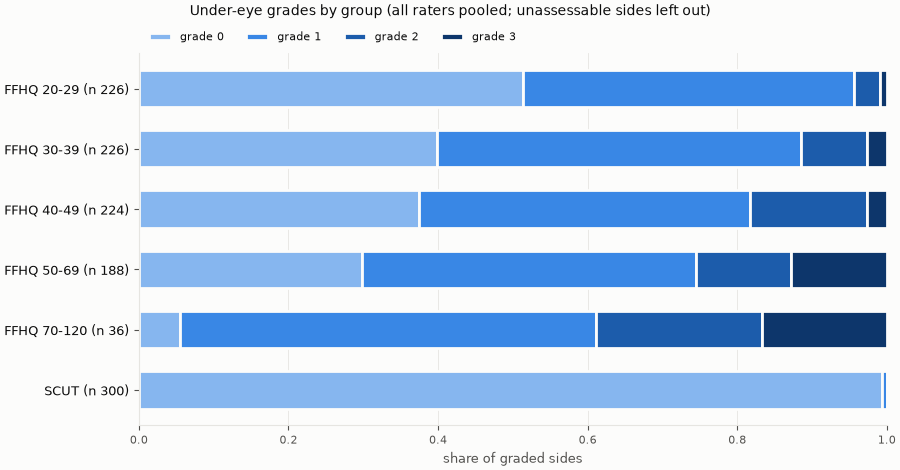
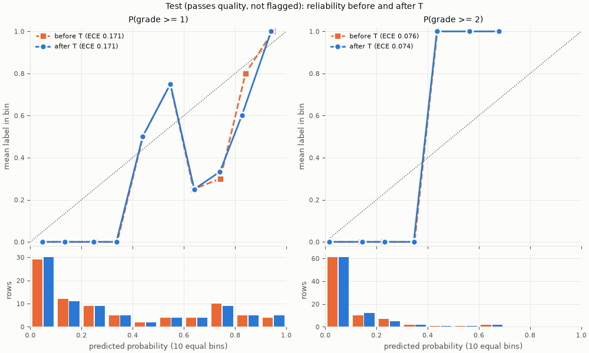
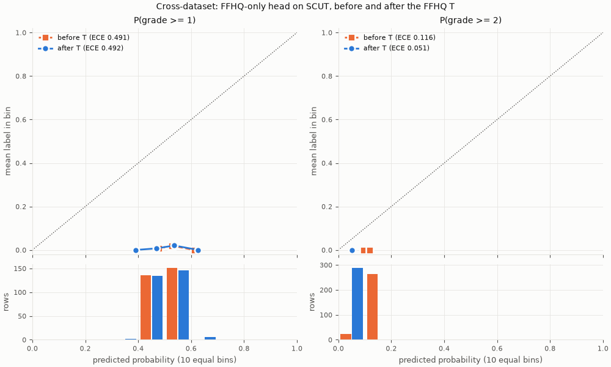

# หัวใต้ตา

สร้างด้วย `uv run python model/scripts/train_undereye_head.py` (`labels`, `select`, `calibrate`, `evaluate`, `cross`, `bundle`) รายงานนี้มีเฉพาะตัวเลขและกราฟ ไม่มีครอปใต้ตา ภาพจากชุดข้อมูล หรือภาพอ้างอิง GIHS และใช้รหัส R1, R2, … แทนชื่อผู้ให้เกรด

- หัว ordinal ในรูปเดียวกับ CORAL \[28\] บน feature ของ `dinov2_vitb14` แบบแช่แข็งจากครอปใต้ตาทีละข้าง: คะแนน s = x·w ตัวเดียว และ P(เกรด ≥ k) = sigmoid(s + b_k) สำหรับ k = 1 และ 2 (model.md หัวข้อ 4.2 และ 6)
- loss: ค่าเฉลี่ยทุกแถวของ BCE(k = 1) + BCE(k = 2) เทียบกับ soft label บวก λ‖w‖² บน feature ที่ standardize แล้ว (ไม่ลงโทษ bias) เทรนด้วย PyTorch แบบ float64 บน CPU ใช้ L-BFGS ทั้งชุด เริ่มจากศูนย์ standardize ด้วยค่าของชุด train แล้วรวมเข้าไปใน w และ b ก่อนบันทึก api จึงใช้ sigmoid((x·w + b_k) / T) ได้ตรง ๆ
- temperature T ตัวเดียวของทั้งสองจุดเปลี่ยน หาบนชุด val ในช่วง 0.25–4.0 (\[10\])
- ครอปรุ่น 1 การย่อภาพรุ่น 2 ช่วง IOD ที่เทรน 75.0–110.0 px ชุดข้อมูลแบ่งตามภาพ 70/15/15 จาก `grading_set.py` ใต้ตาสองข้างของภาพเดียวกันอยู่ชุดเดียวกัน

## ผู้ให้เกรดและ label

ผู้ให้เกรด 1 คน (R1) 600 ภาพ 1200 ข้าง ข้างที่ตัดออก: 0 ข้างที่ `flagged` (ถุงใต้ตาหรือรอยคล้ำ ตามผู้ให้เกรดตั้งแต่ครึ่งหนึ่ง) 50 ข้าง ซึ่งไม่ใช้เทรนแต่รายงานผลบนชุด test แยกไว้

ไฟล์ใน `data/grading/results/` (ชื่อไฟล์และชื่อผู้ให้เกรดไม่อยู่ในรายงาน ใช้รหัสแทน)

| ไฟล์ | ผล | แถว | ผู้ให้เกรด | set_id | หมายเหตุ |
| --- | --- | --- | --- | --- | --- |
| F1 | ใช้ | 1200 | R1 | NV4E8V | – |

เมื่อมีผู้ให้เกรดคนเดียว label ของแต่ละข้างคือเกรดของเขา P(เกรด ≥ 1) และ P(เกรด ≥ 2) จึงเป็น 0 หรือ 1 (model.md หัวข้อ 5.2 และ 6)

## การกระจายของเกรด

เปอร์เซ็นต์ในวงเล็บคิดจากข้างที่ให้เกรด ไม่นับข้างที่ประเมินไม่ได้ คอลัมน์ ≥2 คือสัดส่วนของข้างที่ไม่ถูกตัดซึ่งผู้ให้เกรดตั้งแต่ครึ่งหนึ่งให้ตั้งแต่ 2 SCUT-FBP5500 ไม่มีป้ายอายุรายภาพ

**R1**

| กลุ่ม | ข้าง | เกรด 0 | เกรด 1 | เกรด 2 | เกรด 3 | ประเมินไม่ได้ | flagged | ≥2 (ทุกข้าง) | ≥2 (ไม่ flagged) |
| --- | --- | --- | --- | --- | --- | --- | --- | --- | --- |
| ทั้งหมด | 1200 | 646 (53.8%) | 415 (34.6%) | 95 (7.9%) | 44 (3.7%) | 0 | 50 | 11.6% | 11.4% |
| FFHQ | 900 | 348 (38.7%) | 413 (45.9%) | 95 (10.6%) | 44 (4.9%) | 0 | 50 | 15.4% | 15.4% |
| SCUT | 300 | 298 (99.3%) | 2 (0.7%) | 0 (0.0%) | 0 (0.0%) | 0 | 0 | 0.0% | 0.0% |
| FFHQ อายุ 20-29 | 226 | 116 (51.3%) | 100 (44.2%) | 8 (3.5%) | 2 (0.9%) | 0 | 9 | 4.4% | 4.6% |
| FFHQ อายุ 30-39 | 226 | 90 (39.8%) | 110 (48.7%) | 20 (8.8%) | 6 (2.7%) | 0 | 6 | 11.5% | 10.9% |
| FFHQ อายุ 40-49 | 224 | 84 (37.5%) | 99 (44.2%) | 35 (15.6%) | 6 (2.7%) | 0 | 12 | 18.3% | 17.5% |
| FFHQ อายุ 50-69 | 188 | 56 (29.8%) | 84 (44.7%) | 24 (12.8%) | 24 (12.8%) | 0 | 19 | 25.5% | 27.2% |
| FFHQ อายุ 70-120 | 36 | 2 (5.6%) | 20 (55.6%) | 8 (22.2%) | 6 (16.7%) | 0 | 4 | 38.9% | 43.8% |
| หญิง | 600 | 332 (55.3%) | 196 (32.7%) | 52 (8.7%) | 20 (3.3%) | 0 | 12 | 12.0% | 11.9% |
| ชาย | 600 | 314 (52.3%) | 219 (36.5%) | 43 (7.2%) | 24 (4.0%) | 0 | 38 | 11.2% | 10.9% |
| ชุด train | 840 | 468 (55.7%) | 276 (32.9%) | 64 (7.6%) | 32 (3.8%) | 0 | 36 | 11.4% | 11.4% |
| ชุด val | 180 | 92 (51.1%) | 75 (41.7%) | 7 (3.9%) | 6 (3.3%) | 0 | 8 | 7.2% | 7.6% |
| ชุด test | 180 | 86 (47.8%) | 64 (35.6%) | 24 (13.3%) | 6 (3.3%) | 0 | 6 | 16.7% | 14.9% |
| 200 ภาพแรก (pilot) | 400 | 226 (56.5%) | 134 (33.5%) | 28 (7.0%) | 12 (3.0%) | 0 | 16 | 10.0% | 9.9% |

ข้างที่ผู้ให้เกรดตั้งแต่ครึ่งหนึ่งให้ตั้งแต่ 2 มี 11.6% ของข้างที่ไม่ถูกตัด (11.4% เมื่อไม่นับ flagged) ไม่ต่ำกว่าเกณฑ์เตือน 10% แต่ดูสัดส่วนของชุด val และ test ในหัวข้อจำนวนแถวด้วย

เวลาเกรดมัธยฐานต่อภาพ (ตามแท็บสรุปผลของเครื่องมือ): R1 3.0 วินาที

## ความสอดคล้องระหว่างผู้ให้เกรด

**วัดความสอดคล้องระหว่างผู้ให้เกรดไม่ได้ เพราะมีผู้ให้เกรดคนเดียว** (model.md หัวข้อ 5.2 และ 7.2) label จึงเป็นการตัดสินของคนเดียวที่ไม่ใช่แพทย์ และความน่าจะเป็นหลังปรับเทียบบอกเพียงว่าตรงกับผู้ให้เกรดคนนี้แค่ไหน ถ้าภายหลังมีผู้ให้เกรดเพิ่ม ให้ทุกคนเกรดชุด `full_600` แล้วรัน `labels` ใหม่ หัวข้อนี้จะแสดง weighted kappa และ ICC(2,1) ที่ต้องตรงกับแท็บ "สรุปผลหลายคน" ของเครื่องมือ

## จำนวนแถว

แต่ละข้างมีหลายสำเนา (train 6 สำเนา val และ test 2 สำเนา fixed ที่ IOD ต่ำสุดและสูงสุด) จึงนับทั้งแถวและข้าง

- train: สำเนาแบบ train ของข้างที่พบใบหน้า ไม่ถูกตัด และไม่ flagged ไม่กรองคุณภาพ
- val: สำเนาแบบ fixed ของข้างที่ไม่ถูกตัด ไม่ flagged และผ่านเกณฑ์คุณภาพของข้างนั้น (`reasons` ว่าง)
- test: สำเนาแบบ fixed ที่ผ่านเกณฑ์คุณภาพ ข้างที่ flagged อยู่ในตารางนี้แต่ผลหลักไม่นับ
- ผลประกอบ (`val_all`, `test_all`): ทุกสำเนา fixed ไม่กรองคุณภาพ ไม่ใช้เลือกค่าและไม่ลง bundle ใช้ดูว่าตัวเลขเปลี่ยนแค่ไหนเมื่อมีแถวมากขึ้น เพราะเกณฑ์คุณภาพ (ส่วนใหญ่คือ `smiling`) ตัดสำเนา fixed ของ FFHQ ไปราวสามในสี่

แถว ≥1 และ ≥2 คือผลรวมของ soft label ซึ่งเท่ากับจำนวนแถวเมื่อมีผู้ให้เกรดคนเดียว

| ชุดย่อย | แหล่ง | แถว | ข้าง | ภาพ | แถว flagged | แถว ≥1 | แถว ≥2 | สัดส่วน ≥2 |
| --- | --- | --- | --- | --- | --- | --- | --- | --- |
| train | ffhq | 3552 | 592 | 297 | 0 | 2076 | 552 | 15.5% |
| train | scut | 1272 | 212 | 106 | 0 | 12 | 0 | 0.0% |
| train | all | 4824 | 804 | 403 | 0 | 2088 | 552 | 11.4% |
| val | ffhq | 72 | 38 | 19 | 0 | 46 | 6 | 8.3% |
| val | scut | 48 | 24 | 12 | 0 | 0 | 0 | 0.0% |
| val | all | 120 | 62 | 31 | 0 | 46 | 6 | 5.0% |
| test | ffhq | 54 | 27 | 14 | 4 | 20 | 4 | 7.4% |
| test | scut | 34 | 18 | 9 | 0 | 0 | 0 | 0.0% |
| test | all | 88 | 45 | 23 | 4 | 20 | 4 | 4.5% |
| test ทุกสำเนา (ผลประกอบ) | ffhq | 272 | 136 | 68 | 12 | 188 | 60 | 22.1% |
| test ทุกสำเนา (ผลประกอบ) | scut | 88 | 44 | 22 | 0 | 0 | 0 | 0.0% |
| test ทุกสำเนา (ผลประกอบ) | all | 360 | 180 | 90 | 12 | 188 | 60 | 16.7% |
| cross: FFHQ train | ffhq | 3552 | 592 | 297 | 0 | 2076 | 552 | 15.5% |
| cross: FFHQ train | all | 3552 | 592 | 297 | 0 | 2076 | 552 | 15.5% |
| cross: FFHQ val | ffhq | 72 | 38 | 19 | 0 | 46 | 6 | 8.3% |
| cross: FFHQ val | all | 72 | 38 | 19 | 0 | 46 | 6 | 8.3% |
| cross: SCUT ทุกชุด | scut | 288 | 146 | 73 | 0 | 4 | 0 | 0.0% |
| cross: SCUT ทุกชุด | all | 288 | 146 | 73 | 0 | 4 | 0 | 0.0% |

ผลประกอบ `val_all` มี 344 แถว 172 ข้าง

## การเลือกชนิด feature และ λ

cross-entropy บนชุด val (120 แถว) ของหัวที่เทรนด้วยชุด train (4824 แถว) ทุกชนิด feature คู่กับ λ 1e-05, 0.0001, 0.001, 0.01, 0.1, 1, 10 loss คือ ค่าเฉลี่ยทุกแถวของ BCE(k = 1) + BCE(k = 2) เทียบกับ soft label บวก λ‖w‖² บน feature ที่ standardize แล้ว (ไม่ลงโทษ bias) เลือกค่าที่ต่ำสุด แต่ถ้าต่างกันไม่ถึง 1% เลือกชนิดที่มิติน้อยกว่าแล้ว λ ที่มากกว่า ถ้า λ ที่ดีที่สุดอยู่ที่ขอบ ขยายช่วงอีก 2 หลักหนึ่งครั้ง (กติกาเดียวกับหัวกรามและฐานจมูก) ตัวหนาคือค่าที่เลือก

| λ | `cls` (768) | `cls_mean` (1536) | `grid4` (12288) |
| --- | --- | --- | --- |
| 1e-05 | 2.93684 | 3.01958 | 2.32739 |
| 0.0001 | 1.76687 | 1.83307 | 1.84528 |
| 0.001 | 1.02406 | 1.14370 | 1.39805 |
| 0.01 | 0.72155 | 0.79770 | 1.01127 |
| 0.1 | 0.65539 | 0.66770 | 0.74730 |
| 1 | 0.65777 | **0.64214** | 0.66329 |
| 10 | 0.72591 | 0.68938 | 0.63974 |
| 100 |  |  | 0.69360 |
| 1000 |  |  | 0.83154 |

เลือก `cls_mean` λ 1 CE 0.64214 ส่วนค่าต่ำสุดคือ `grid4` λ 10 CE 0.63974

- `grid4` ขยายช่วงไปที่ λ 100, 1000
- L-BFGS ใช้มากสุด 2005 รอบ (เพดาน 3000)

## การปรับเทียบบนชุด val

เทรนหัว `cls_mean` λ 1 ด้วยชุด train 4824 แถว (804 ข้าง 403 ภาพ) L-BFGS 46 รอบ ลู่เข้า: ใช่ bias b₁ = -0.541 และ b₂ = -3.149 การรวม standardization เข้าไปใน w และ b ทำให้ logit ต่างไปไม่เกิน 1.8e-15

T = **0.9771** หาบนชุด val 120 แถว (62 ข้าง) ในช่วง 0.25–4.0 cross-entropy 0.6421 → 0.6420 

ECE แบบ 10 ช่วงเท่ากันของชุด val เทียบความน่าจะเป็นกับ soft label

| ชุด | จุดเปลี่ยน | ECE ก่อนปรับ | ECE หลังปรับ |
| --- | --- | --- | --- |
| val | P(เกรด ≥ 1) | 0.0975 | 0.1117 |
| val | P(เกรด ≥ 2) | 0.0478 | 0.0468 |

### เกณฑ์ทางเลือกบนชุด val

ใช้ความน่าจะเป็นหลังปรับ ตัดสินด้วย `undereye.decide` ก้ำกึ่งคือสัดส่วนที่ผลเป็นช่วงเกรด ชัดและตรงคือสัดส่วนของผลชัดที่ตรงกับเกรด 0/1/≥2 ของผู้ให้เกรด ก้ำกึ่งและครอบคือสัดส่วนของผลก้ำกึ่งที่ช่วงครอบเกรดของผู้ให้เกรด ระบบยังใช้ 0.3/0.7 จนกว่าผู้ใช้จะตกลงเปลี่ยน

| เกณฑ์ (low / high) | ผู้ให้เกรด | n | ก้ำกึ่ง | ชัดและตรง | ก้ำกึ่งและครอบ |
| --- | --- | --- | --- | --- | --- |
| 0.2 / 0.8 | R1 | 120 | 56.7% | 88.5% | 89.7% |
| 0.25 / 0.75 | R1 | 120 | 45.8% | 80.0% | 92.7% |
| 0.3 / 0.7 (ใช้อยู่) | R1 | 120 | 40.0% | 80.6% | 91.7% |
| 0.35 / 0.65 | R1 | 120 | 33.3% | 78.8% | 92.5% |
| 0.4 / 0.6 | R1 | 120 | 22.5% | 75.3% | 92.6% |

### ผลประกอบ: ทุกสำเนา fixed ของชุด val

ถ้าหา T บนทุกสำเนา fixed ของชุด val (344 แถว 172 ข้าง ไม่กรองคุณภาพ) จะได้ T = 0.8829 เทียบกับ 0.9771 จากสำเนาที่ผ่านเกณฑ์ ค่านี้ไม่ได้ใช้ใน bundle

| ชุด | จุดเปลี่ยน | ECE ก่อนปรับ | ECE หลังปรับด้วย T ของ val |
| --- | --- | --- | --- |
| val ทุกสำเนา | P(เกรด ≥ 1) | 0.0812 | 0.0916 |
| val ทุกสำเนา | P(เกรด ≥ 2) | 0.0303 | 0.0256 |

## ผลบนชุด test

ชุด test ที่ผ่านเกณฑ์คุณภาพและไม่ flagged 84 แถว (43 ข้าง 22 ภาพ) label ≥1 16 แถว ≥2 4 แถว เกรดเดี่ยวของโมเดลคือจำนวนจุดเปลี่ยนที่ P(เกรด ≥ k) ตั้งแต่ 0.5 (โมเดลให้เกรด 0/1/≥2 = 57/24/3 แถว)

| เทียบกับ | n | accuracy | κ เกรด 0/1/≥2 (linear) | Landis–Koch |
| --- | --- | --- | --- | --- |
| R1 | 84 | 83.3% | 0.645 | substantial |

มีผู้ให้เกรดคนเดียว จึงไม่มี kappa ระหว่างผู้ให้เกรดให้วางคู่ ค่าที่ใช้เป็นหลักอ้างอิงคร่าว ๆ คือ 0.55 และ 0.65 ของแพทย์ใน \[7\] **ซึ่งเป็นการเทียบคนละแบบ** คือแพทย์ 3 คนประเมินผู้เข้าร่วมตัวจริงด้วยเกรด 0–3 ส่วนนี่คือโมเดลเทียบกับผู้ให้เกรดคนเดียวที่ไม่ใช่แพทย์บนภาพถ่าย ด้วยเกรด 0/1/≥2 (model.md หัวข้อ 7.1 ข้อ 3)

confusion matrix เทียบกับ R1

| ผู้ให้เกรด (แถว) / โมเดล (คอลัมน์) | 0 | 1 | ≥2 |
| --- | --- | --- | --- |
| 0 | 56 | 12 | 0 |
| 1 | 1 | 11 | 0 |
| ≥2 | 0 | 1 | 3 |

### การปรับเทียบ

ECE แบบ 10 ช่วงเท่ากัน เทียบความน่าจะเป็นกับ soft label ก่อนปรับคือ T = 1

| ชุด | จุดเปลี่ยน | ECE ก่อนปรับ | ECE หลังปรับ |
| --- | --- | --- | --- |
| test | P(เกรด ≥ 1) | 0.1706 | 0.1713 |
| test | P(เกรด ≥ 2) | 0.0764 | 0.0743 |

กราฟบนคือค่าเฉลี่ยของ label เทียบกับค่าเฉลี่ยของความน่าจะเป็นในแต่ละช่วง เส้นจุดคือการปรับเทียบที่สมบูรณ์ กราฟล่างคือจำนวนแถวในแต่ละช่วง ตัวเลขเดียวกันอยู่ใน `evaluate.json`

### การตัดสินด้วยเกณฑ์ 0.3/0.7 ของ bundle

`undereye.decide` บนความน่าจะเป็นหลังปรับ

| ผู้ให้เกรด | n | ก้ำกึ่ง | ชัดและตรง | ก้ำกึ่งและครอบ |
| --- | --- | --- | --- | --- |
| R1 | 84 | 25.0% | 87.3% | 100.0% |

### แยกกลุ่ม

ทุกกลุ่มยกเว้น flagged คือแถวที่ไม่ flagged กลุ่มที่มีแถวน้อยให้ตัวเลขที่ไม่แน่นอนมาก ECE เป็นค่าหลังปรับ

| กลุ่ม | ผู้ให้เกรด | แถว | ข้าง | accuracy | κ | ECE ≥1 | ECE ≥2 | ก้ำกึ่ง | ชัดและตรง | ก้ำกึ่งและครอบ |
| --- | --- | --- | --- | --- | --- | --- | --- | --- | --- | --- |
| ทั้งหมด (ไม่ flagged) | R1 | 84 | 43 | 83.3% | 0.645 | 0.171 | 0.074 | 25.0% | 87.3% | 100.0% |
| FFHQ | R1 | 50 | 25 | 72.0% | 0.566 | 0.234 | 0.120 | 40.0% | 73.3% | 100.0% |
| SCUT | R1 | 34 | 18 | 100.0% | – | 0.079 | 0.007 | 2.9% | 100.0% | 100.0% |
| FFHQ อายุ 20-29 | R1 | 22 | 11 | 95.5% | 0.831 | 0.201 | 0.035 | 27.3% | 100.0% | 100.0% |
| FFHQ อายุ 30-39 | R1 | 8 | 4 | 87.5% | 0.875 | 0.133 | 0.215 | 62.5% | 100.0% | 100.0% |
| FFHQ อายุ 40-49 | R1 | 0 | 0 | – | – | – | – | – | – | – |
| FFHQ อายุ 50-69 | R1 | 20 | 10 | 40.0% | 0.000 | 0.367 | 0.177 | 45.0% | 27.3% | 100.0% |
| FFHQ อายุ 70-120 | R1 | 0 | 0 | – | – | – | – | – | – | – |
| หญิง | R1 | 26 | 13 | 84.6% | 0.581 | 0.186 | 0.049 | 19.2% | 85.7% | 100.0% |
| ชาย | R1 | 58 | 30 | 82.8% | 0.664 | 0.178 | 0.086 | 27.6% | 88.1% | 100.0% |
| สำเนา IOD 77 px | R1 | 41 | 41 | 85.4% | 0.705 | 0.162 | 0.072 | 22.0% | 87.5% | 100.0% |
| สำเนา IOD 110 px | R1 | 43 | 43 | 81.4% | 0.580 | 0.180 | 0.076 | 27.9% | 87.1% | 100.0% |
| flagged | R1 | 4 | 2 | 0.0% | 0.000 | 0.578 | 0.050 | 75.0% | 0.0% | 100.0% |

### ผลประกอบ: ทุกสำเนา fixed ของชุด test

รวมสำเนาที่ไม่ผ่านเกณฑ์คุณภาพ (ส่วนใหญ่ยิ้ม) ซึ่ง api จะไม่ให้เกรด ไม่นับข้างที่ flagged ใช้ดูความไม่แน่นอนของผลหลักที่มีแถวน้อย ไม่ใช่ผลที่ระบบจะได้จริง

| กลุ่ม | ผู้ให้เกรด | แถว | ข้าง | accuracy | κ | ECE ≥1 ก่อน | ECE ≥1 หลัง | ECE ≥2 ก่อน | ECE ≥2 หลัง | ก้ำกึ่ง | ชัดและตรง |
| --- | --- | --- | --- | --- | --- | --- | --- | --- | --- | --- | --- |
| ทุกสำเนา fixed (ไม่กรองคุณภาพ) | R1 | 348 | 174 | 70.1% | 0.568 | 0.103 | 0.095 | 0.056 | 0.048 | 45.1% | 80.1% |
| ทุกสำเนา fixed: FFHQ | R1 | 260 | 130 | 60.0% | 0.436 | 0.124 | 0.118 | 0.073 | 0.063 | 60.0% | 63.5% |
| ทุกสำเนา fixed: SCUT | R1 | 88 | 44 | 100.0% | – | 0.063 | 0.060 | 0.005 | 0.005 | 1.1% | 100.0% |

## ตรวจข้ามชุดข้อมูล

หัวที่เทรนด้วยภาพ FFHQ ของชุด train อย่างเดียว (3552 แถว) เลือกค่าและหา T ด้วยภาพ FFHQ ของชุด val (72 แถว) ด้วยกติกาเดียวกับหัวหลัก ได้ `cls_mean` λ 100 T = 0.6923 แล้วตรวจบนสำเนา fixed ที่ผ่านเกณฑ์คุณภาพของใต้ตา SCUT ที่เกรดแล้วทุกชุด 288 แถว (146 ข้าง ไม่นับ flagged 0 แถว) หัวนี้ใช้ตรวจเท่านั้น ไม่อยู่ใน bundle (model.md หัวข้อ 4.2 และ 5.3) "สูงกว่ามาก" ในรายงานนี้คือ ECE หลังปรับของ SCUT ตั้งแต่ 2 เท่าของ FFHQ val และห่างกันตั้งแต่ 0.05

| ชุด | จุดเปลี่ยน | ECE ก่อนปรับ | ECE หลังปรับ |
| --- | --- | --- | --- |
| FFHQ val (ใช้หา T) | P(เกรด ≥ 1) | 0.0515 | 0.1093 |
| FFHQ val (ใช้หา T) | P(เกรด ≥ 2) | 0.0731 | 0.0188 |
| SCUT | P(เกรด ≥ 1) | 0.4906 | 0.4925 |
| SCUT | P(เกรด ≥ 2) | 0.1161 | 0.0509 |

เกรดเดี่ยวของโมเดลบน SCUT เทียบกับผู้ให้เกรด

| เทียบกับ | n | accuracy | κ เกรด 0/1/≥2 |
| --- | --- | --- | --- |
| R1 | 288 | 47.9% | 0.012 |

- **ใต้ตาของภาพ SCUT ไม่มีข้างที่ได้เกรดตั้งแต่ 2 จึงตรวจจุดเปลี่ยนที่ 2 ข้ามชุดข้อมูลไม่ได้** ผลของจุดเปลี่ยนที่ 1 เป็นหลัก ECE ของ P(เกรด ≥ 2) ข้างบนบอกเพียงว่าโมเดลให้ความน่าจะเป็นต่ำแค่ไหนกับข้างที่ label เป็น 0 ทั้งหมด
- SCUT มีข้างที่ได้เกรดตั้งแต่ 1 อยู่ 2 ข้าง จากที่ใช้ 146 ข้าง kappa จึงขึ้นกับข้างไม่กี่ข้าง
- หัว FFHQ ให้ P(เกรด ≥ 1) หลังปรับกับแถว SCUT เฉลี่ย 0.51 ทุกแถวอยู่ในช่วง 0.3–0.7 ใกล้กับสัดส่วนเกรด ≥1 ของภาพ FFHQ ที่ใช้เทรน (58.4%) จึงได้เกรด 0/1/≥2 = 136/152/0 แถว ขณะที่ label ≥1 มี 4 แถว ECE ที่สูงจึงมาจากสัดส่วนของเกรดที่ต่างกันมากระหว่างสองชุดเป็นหลัก ส่วนหัวหลักซึ่งเห็นภาพ SCUT ของชุด train ตอนเทรน ให้เกรด 0/1/≥2 กับแถว SCUT ของชุด test = 34/0/0 แถว ข้อมูลชุดนี้แยกไม่ได้ว่าหัวหลักแยกตามร่องใต้ตา ตามลักษณะของชุดข้อมูล (แสง กล้อง การแต่งภาพ) หรือผู้ให้เกรดเห็นใต้ตาของ SCUT ต่างจาก FFHQ
- **ข้อสังเกต:** P(เกรด ≥ 1): ECE ของ SCUT สูงกว่าของ FFHQ มาก (0.492 เทียบกับ 0.109) T จาก FFHQ อาจใช้กับคนเอเชียได้ไม่ดี

## bundle และความตรงกับตอนเตรียมข้อมูล

`api/bundle/` รุ่น 0.2.0 มีหัว `undereye` ที่เทรนแล้ว (`stub` เป็น false) ส่วนหัว `jaw`, `nose_base` และ baseline คัดลอกจากรุ่น 0.1.0 ทุกหัวจึงไม่เป็น stub

ความตรงกับตอนเตรียมข้อมูล (api.md หัวข้อ 7): สร้างสำเนา IOD ต่ำสุดของ 20 ข้างจาก 17 ภาพในชุด test ขึ้นใหม่จาก seed ส่งเข้า `analyze_for_model` (IOD สูงสุดจาก bundle) ครอปใต้ตาของข้างนั้น DINOv2 และหัวใน bundle ที่โหลดกลับมา แล้วเทียบ P(เกรด ≥ 1) และ P(เกรด ≥ 2) กับค่าจาก `evaluate` ผลต่างมากสุด 4.9e-11 เกณฑ์ไม่เกิน 0.0001: **ผ่าน** รหัสคุณภาพตรงกันทุกข้าง: ใช่ การตัดสินตรงกันทุกข้าง: ใช่

## ข้อสังเกตและข้อจำกัด

- label มาจากผู้ให้เกรดคนเดียวที่ไม่ใช่แพทย์ วัดความสอดคล้องระหว่างผู้ให้เกรดไม่ได้ (model.md หัวข้อ 7.2)
- ผลหลักบนชุด test มี 84 แถว (43 ข้าง) และ label ≥2 4 แถว ตัวเลขของจุดเปลี่ยนที่ 2 จึงไม่แน่นอนมาก ผลประกอบบนทุกสำเนา fixed ช่วยดูทิศทาง แต่รวมภาพที่ api ไม่ให้เกรด
- κ รวมเทียบกับ R1 (0.645) สูงกว่า κ ของ FFHQ อย่างเดียว (0.566) เพราะแถว SCUT 34 แถว เกือบทั้งหมดเป็นเกรด 0 ที่ทายถูกง่าย κ ของ FFHQ บนทุกสำเนา fixed (ผลประกอบ) คือ 0.436 ค่าที่ใกล้กับการใช้งานกับใบหน้าที่มีร่องใต้ตาจึงต่ำกว่าตัวเลขรวม
- กลุ่ม FFHQ อายุ 40-49, FFHQ อายุ 70-120 ไม่มีแถวในผลหลักของชุด test เพราะทุกสำเนาไม่ผ่านเกณฑ์คุณภาพหรือ flagged จึงไม่มีผลของกลุ่มอายุนี้บนภาพที่ api จะให้เกรด ดูได้เฉพาะในผลประกอบ
- ตรวจข้ามชุดข้อมูล: P(เกรด ≥ 1): ECE ของ SCUT สูงกว่าของ FFHQ มาก (0.492 เทียบกับ 0.109) T จาก FFHQ อาจใช้กับคนเอเชียได้ไม่ดี
- ตรวจจุดเปลี่ยนที่ 2 ข้ามชุดข้อมูลไม่ได้ เพราะใต้ตาของภาพ SCUT ไม่มีข้างที่ได้เกรดตั้งแต่ 2
- ทุกผลวัดบนภาพจากอินเทอร์เน็ตที่ย่อเลียนแบบเว็บแคม ยังไม่ได้ยืนยันกับกล้องจริง web จึงแสดงผลเป็นระดับ "ชัด" หรือ "ก้ำกึ่ง" ไม่แสดงตัวเลข (model.md หัวข้อ 4.2)
- ระบบประเมินเฉพาะร่องใต้ตา ข้างที่มีถุงใต้ตาหรือรอยคล้ำเด่นไม่ใช้เทรน ผลของกลุ่ม flagged ในตารางแยกกลุ่มจึงเป็นกรณีที่หัวไม่ได้เรียน

## ชุดข้อมูลที่แต่ละคำสั่งอ่าน

ครั้งล่าสุดของแต่ละคำสั่งจาก `run_log.txt` ใน outputs/undereye_head/ ชุด test ใช้ประเมินหัวที่ลง bundle เฉพาะใน `evaluate` `cross` อ่านภาพ SCUT ของชุด test ด้วยโดยตั้งใจ (ทุกภาพ SCUT จากทุกชุด) แต่ใช้กับหัวที่เทรนด้วย FFHQ อย่างเดียวซึ่งไม่ลง bundle และรันหลัง `evaluate` ส่วน `bundle` สร้างภาพ test 20 ข้างขึ้นใหม่เพื่อตรวจความตรงเท่านั้น

| คำสั่ง | เวลา (UTC) | สิ่งที่อ่าน |
| --- | --- | --- |
| `labels` | 2026-11-07T08:24:21+00:00 | reads grading/results/*.csv and grading/manifest.csv: the grades of every split (no features) |
| `select` | 2026-11-07T08:24:32+00:00 | reads the train and val splits of features/undereye (test is not read) |
| `calibrate` | 2026-11-07T08:29:42+00:00 | reads the train split (fit) and the val split (T, ECE, thresholds); test is not read |
| `evaluate` | 2026-11-07T08:29:50+00:00 | reads the test split once, with the head and T of calibrate (train and val are not read) |
| `cross` | 2026-11-07T08:30:00+00:00 | reads FFHQ train (fit) and val (choice and T) for a head that never goes into the bundle, and the SCUT fixed copies of every split (train, val and test) to check it; runs after evaluate |
| `bundle` | 2026-11-07T08:31:39+00:00 | writes api/bundle/ 0.2.0: jaw, nose_base and baseline from bundle 0.1.0, the under-eye head of calibrate; reads 20 test sides again for the fidelity check only (no new measures) |
